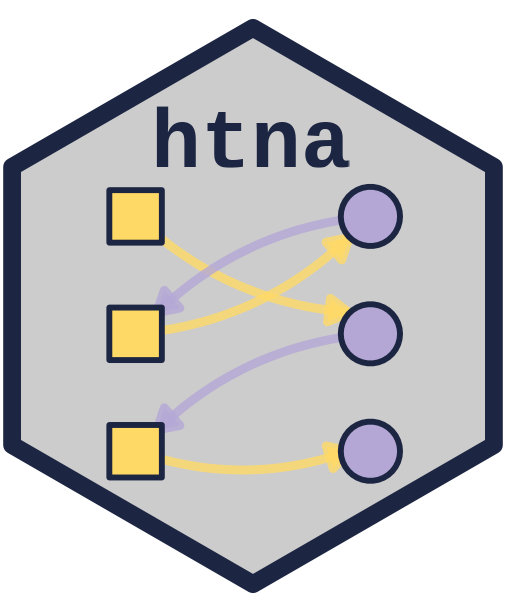

<!-- README.md is generated from README.Rmd. Please edit that file and rebuild
     from the repository root with:
     Rscript -e 'pkgload::load_all(".", quiet = TRUE); knitr::knit("README.Rmd", "README.md")' -->

```{r setup, include = FALSE}
knitr::opts_chunk$set(
  collapse = TRUE, comment = "#>", message = FALSE,
  fig.path = "man/figures/README-", fig.width = 7, fig.height = 6,
  fig.align = "center", out.width = "70%", dpi = 150
)
old_options <- options(width = 90, digits = 3)
```

# htna: Heterogeneous Transition Network Analysis 

<!-- badges: start -->
[](https://CRAN.R-project.org/package=htna)
[](https://github.com/sonsoleslp/htna/actions/workflows/R-CMD-check.yaml)
<!-- badges: end -->

## Vignettes and guides

**Vignettes**

- [Heterogeneous transition network analysis](https://sonsoles.me/htna/articles/htna.html)
- [Grouped heterogeneous transition networks](https://sonsoles.me/htna/articles/grouped.html)

**Guides**

- [Input formats](https://sonsoles.me/htna/articles/input-formats.html)
- [Comparing networks](https://sonsoles.me/htna/articles/comparing-networks.html)
- [Model assessment](https://sonsoles.me/htna/articles/model-assessment.html)
- [Markov-order adequacy](https://sonsoles.me/htna/articles/markov-order.html)
- [Sequences and patterns](https://sonsoles.me/htna/articles/sequences-and-patterns.html)
- [Frequencies and mosaic plots](https://sonsoles.me/htna/articles/frequencies-and-mosaic.html)
- [Clustering inputs](https://sonsoles.me/htna/articles/clustering.html)
- [Three or more actor groups](https://sonsoles.me/htna/articles/multigroup.html)

**Case studies**

- [Early and late sessions of vibe coding](https://sonsoles.me/htna/articles/case-early-late.html)
- [Help-seeking in vibe coding](https://sonsoles.me/htna/articles/case-vibe-coding.html)

## Overview

`htna` analyses sequences of events produced by actors of different kinds
that take turns: a learner and an AI assistant, a programmer and a coding
agent, a student and a tutor. Heterogeneous transition network analysis
(HTNA) represents such sequences as one transition network in which each
code belongs to one actor type, so the network separates what each actor
does after its own moves from how the actors hand over to each other
(López-Pernas, Misiejuk & Saqr, 2026). It shows, for example, what the AI
does after the learner asks for help, and how the learner responds. Networks
can be built for one group or for several cohorts or clusters, compared by
permutation or Bayesian tests, and assessed by bootstrap, split-half
reliability, case-dropping stability and Markov-order tests; paths and
meta-paths of turn-taking can be counted.

The networks are estimated from long event data or clustering results by the
[Nestimate](https://CRAN.R-project.org/package=Nestimate) package and drawn by
[cograph](https://CRAN.R-project.org/package=cograph), with each actor type on
its own arc of the layout and in its own colour and shape. The actor
partition is kept on the results of every later analysis.

## The model

A session is a sequence of codes $c_1, \ldots, c_T$, and every code $i$
belongs to one actor type $a(i)$. With $n_{ij}$ the number of times code $i$
is directly followed by code $j$ over all sessions, the relative
transition network has the weights
$w_{ij} = n_{ij} / \sum_k n_{ik}$. The actor partition divides the weight
matrix into blocks $W_{AB}$ of transitions from codes of actor $A$ to codes
of actor $B$: the diagonal blocks describe how an actor continues its own
turn and the off-diagonal blocks how the actors hand over to each other.
A meta-path is the sequence of actor types that a path of codes passes
through, such as Human $\to$ AI $\to$ Human.

## Installation

```{r installation, eval = FALSE}
install.packages("htna")

# development version
install.packages("remotes")
remotes::install_github("sonsoleslp/htna")
```

## Example

The bundled `human_ai` data hold 19,347 coded events from 429 sessions in
which programmers worked with an AI coding agent, with six human and six
AI codes. `build_htna()` estimates the network; `actor_type` names the
column that assigns each event to its actor.

```{r build}
library(htna)
net <- build_htna(human_ai, actor_type = "actor_type")
as.data.frame(summary(net), what = "actor_pairs")
```

All 36 possible transitions between the human and the AI codes occur in
both directions. `plot_htna()` draws each actor's codes on their own arc.

```{r htna-plot}
plot_htna(net)
```

Meta-paths count the order in which the actors take turns; a lift above
one means a pattern occurs more often than the frequencies of the actors
would predict.

```{r meta-paths}
extract_meta_paths(net, level = "type", length = 3)
```

The bootstrap shows which transitions the resampled sessions reproduce.

```{r bootstrap}
bootstrap_htna(net, iter = 100, seed = 1)
```

## Authors and citation

`htna` is written by [Sonsoles López-Pernas](https://sonsoles.me), Kamila
Misiejuk and [Mohammed Saqr](https://saqr.me). Sonsoles López-Pernas
maintains the package. Questions and bug reports can be submitted through
the [repository issue tracker](https://github.com/sonsoleslp/htna/issues).
The package citation is available through `citation("htna")`.

The method is described in:

- López-Pernas, S., Misiejuk, K., & Saqr, M. (2026). How AI-generated
  feedback hinders or helps learning: A heterogeneous TNA study of learning
  dynamics. *Journal of Computer Assisted Learning*, 42(4), e70285.
  <https://doi.org/10.1002/jcal.70285>

Related research:

- López-Pernas, S., Misiejuk, K., Tikka, S., & Saqr, M. (2026). Role
  dynamics in student-AI collaboration: A heterogeneous transition network
  analysis approach. *Innovations in Analytics of Learning Dynamics:
  Proceedings of the 1st Workshop on Transition Network Analysis (TNA)*.
  <https://dx.doi.org/10.2139/ssrn.6082190>
- Rinja, D., Oliveira, E. A., López-Pernas, S., Saqr, M., Specht, M., &
  Misiejuk, K. (2027). Unpacking vibe coding: Help-seeking processes in
  student-AI interactions while programming. *Proceedings of Artificial
  Intelligence in Education: 27th International Conference, AIED 2026*.
  Springer Nature Switzerland. <https://doi.org/10.1007/978-3-032-29763-1_35>

Related packages: [tna](https://CRAN.R-project.org/package=tna) for
transition network analysis of single-actor sequences,
[Nestimate](https://CRAN.R-project.org/package=Nestimate) for network
estimation and inference, and
[cograph](https://CRAN.R-project.org/package=cograph) for network plots.

```{r restore-options, include = FALSE}
options(old_options)
```
