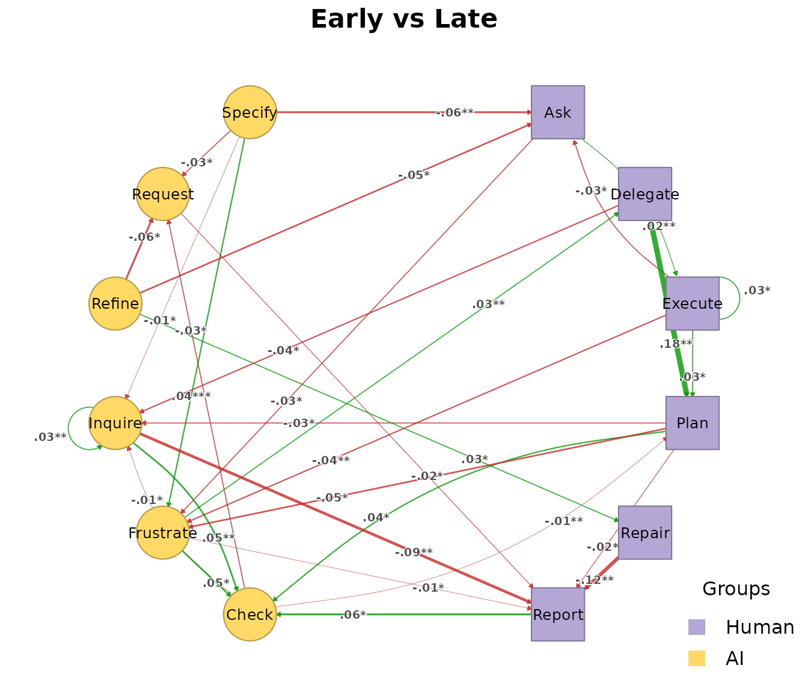
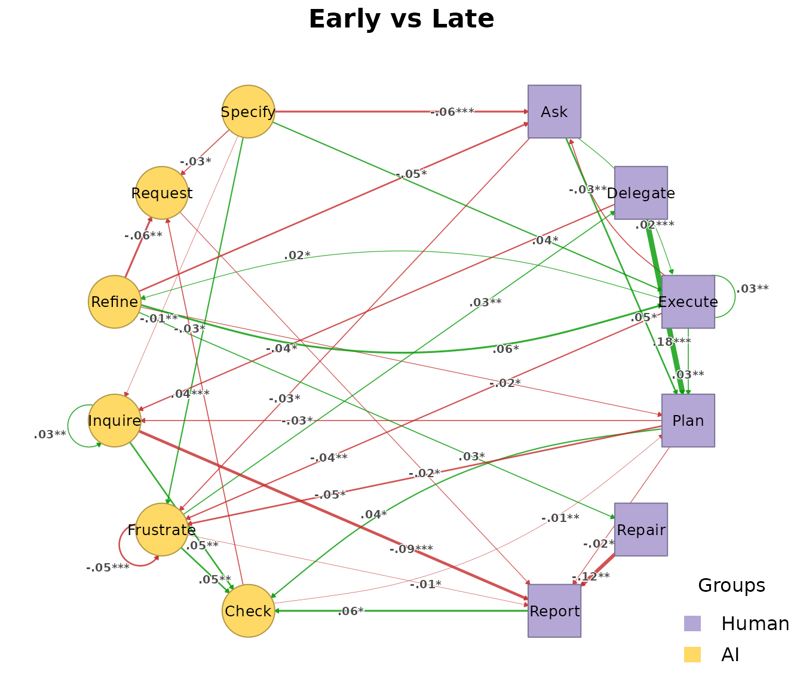

# Case study: early and late sessions of vibe coding

When people work with a generative AI tool over several weeks, the way
they interact with it can change: they may learn which requests the tool
handles well, delegate more, check less, or become more frustrated with
its failures. Whether such a change has occurred is a question about the
process of interaction, not about how often each action occurs, and it
is answered by comparing the transition structure of early and late
sessions. With two actors the comparison has a further layer: the change
can lie in how each actor continues its own turn or in how the actors
hand over to each other.

This case study compares the first and second halves of a set of
vibe-coding sessions, in which programmers directed an AI coding agent.
It asks, in turn, whether the two networks differ at all, in which
actor-pair blocks the differences lie, which individual transitions
differ and with what certainty, and whether the turn-taking patterns
between the actors have changed.

``` r

library(htna)
set.seed(2026)
```

## Data

`human_ai` holds the coded turns of 429 vibe-coding sessions. Each row
is one coded event.

- **Session and order:** `session_id`, `order_in_session`; transitions
  are counted within sessions.
- **Code:** `code`, six human codes (`Check`, `Frustrate`, `Inquire`,
  `Refine`, `Request`, `Specify`) and six AI codes (`Ask`, `Delegate`,
  `Execute`, `Plan`, `Repair`, `Report`).
- **Actor type:** `actor_type`, `"Human"` or `"AI"`.
- **Phase:** `phase`, `Early` or `Late`: the sessions ordered by their
  first date and split in half (214 and 215 sessions).

``` r

grp <- build_htna(human_ai, actor_type = "actor_type", group = "phase")
grp
#> Group Networks (2 groups)
#> 
#>   Group  Nodes  Edges  Weights
#>   Early  12     135    [0.001, 0.689]
#>   Late   12     134    [0.001, 0.508]
```

Both networks contain all twelve codes; the early network has 135
non-zero edges and the late one 134.

## Do the networks differ at all?

A permutation test reshuffles the sessions between the two phases and
asks whether the observed differences exceed those of the reshuffled
data. Its global statistics test the networks as a whole, so they need
no correction for the number of edges.

``` r

perm <- permutation_htna(grp, iter = 1000, seed = 1)
perm
#> Grouped Permutation Test
#> Groups: Early vs Late 
#> 
#> -- Early vs Late --
#> Permutation Test: Transition Network (relative probabilities) [directed]
#>   Iterations: 1000  |  Alpha: 0.05
#>   Nodes: 12  |  Edges tested: 135  |  Significant: 31
#>   Global test (networks differ overall?): M = 2.760 (p = 0.000999)  |  S = 0.181 (p = 0.012)
```

The sum of the absolute edge differences, 2.76, is larger than in any of
the 1,000 reshuffles (p = 0.001), and the largest single difference,
0.181, is exceeded in about one percent of them (p = 0.012). The way the
programmers and the agent interact did change between the two halves of
the study.

## Where in the actor structure?

The descriptive comparison splits the edge differences by actor-pair
block; differences are early minus late.

``` r

cmp <- compare_htna(grp)
summary(cmp)
#>      comparison source_actor target_actor n_cells n_nonzero_x n_nonzero_y n_changed
#> 1 Early vs Late        Human        Human      36          35          35        35
#> 2 Early vs Late        Human           AI      36          36          36        36
#> 3 Early vs Late           AI        Human      36          36          36        36
#> 4 Early vs Late           AI           AI      36          28          27        28
#>   mean_difference mean_absolute_difference rms_difference max_absolute_difference
#> 1         0.00168                   0.0159         0.0228                  0.0631
#> 2        -0.00168                   0.0179         0.0277                  0.0922
#> 3        -0.00622                   0.0216         0.0268                  0.0571
#> 4         0.00622                   0.0212         0.0428                  0.1812
```

The four blocks change by similar amounts on average (mean absolute
differences between 0.016 and 0.022), so the change is not confined to
one kind of transition. The AI-to-AI block holds the largest single
difference (0.181). The transitions from AI codes to human codes carry
more weight in the late sessions (mean difference, early minus late,
−0.006), and those between AI codes carry less by the same amount: after
an AI event, the next event is more often a human one late in the study.
The overall similarity of the two networks stays high.

``` r

head(as.data.frame(cmp, what = "metrics"), 8)
#>      comparison          category               metric  value
#> 1 Early vs Late Weight Deviations      Mean Abs. Diff. 0.0192
#> 2 Early vs Late Weight Deviations    Median Abs. Diff. 0.0107
#> 3 Early vs Late Weight Deviations            RMS Diff. 0.0310
#> 4 Early vs Late Weight Deviations       Max Abs. Diff. 0.1812
#> 5 Early vs Late Weight Deviations Rel. Mean Abs. Diff. 0.2300
#> 6 Early vs Late Weight Deviations             CV Ratio 1.0957
#> 7 Early vs Late      Correlations              Pearson 0.9594
#> 8 Early vs Late      Correlations             Spearman 0.9365
```

The edge weights correlate at 0.959 between the phases: the late network
is a modified version of the early one, not a different process.

## Which transitions differ?

The permutation test also gives a p-value for each of the 135 edges.

``` r

xtabs(~ sig, data = summary(perm))
#> sig
#> FALSE  TRUE 
#>   104    31
```

At the 0.05 level, 31 edges differ. With 135 tests about seven would be
expected by chance alone, so the edge tests are repeated with the
Benjamini-Hochberg adjustment of the p-values.

``` r

permutation_htna(grp, iter = 1000, adjust = "BH", seed = 1)
#> Grouped Permutation Test
#> Groups: Early vs Late 
#> 
#> -- Early vs Late --
#> Permutation Test: Transition Network (relative probabilities) [directed]
#>   Iterations: 1000  |  Alpha: 0.05  |  Adjust: BH
#>   Nodes: 12  |  Edges tested: 135  |  Significant: 0
#>   Global test (networks differ overall?): M = 2.760 (p = 0.000999)  |  S = 0.181 (p = 0.012)
```

After the adjustment no edge remains significant. The difference network
shows the 31 unadjusted differences, green where the early sessions have
the larger weight and red where the late sessions do.

``` r

plot_htna_diff(perm)
```



The Bayesian comparison estimates the size of each difference with a
credible interval.

``` r

bc <- bayes_compare_htna(grp, draws = 5000, seed = 1)
xtabs(~ sig, data = summary(bc))
#> sig
#> FALSE  TRUE 
#>    99    36
head(summary(bc))
#>      comparison from        to weight_x weight_y count_x count_y      diff effect_size
#> 1 Early vs Late  Ask       Ask   0.0186   0.0185      21      22  9.62e-05      0.0172
#> 2 Early vs Late  Ask     Check   0.0688   0.0580      79      70  1.08e-02      1.0760
#> 3 Early vs Late  Ask   Execute   0.0333   0.0119      38      14  2.14e-02      3.4848
#> 4 Early vs Late  Ask Frustrate   0.0991   0.1313     114     159 -3.21e-02     -2.4803
#> 5 Early vs Late  Ask   Inquire   0.0541   0.0720      62      87 -1.79e-02     -1.8244
#> 6 Early vs Late  Ask      Plan   0.4316   0.3840     498     466  4.77e-02      2.3699
#>   ci_lower ci_upper ci_width p_difference p_value   sig
#> 1 -0.01070  0.01122   0.0219        0.506  0.9884 FALSE
#> 2 -0.00847  0.03095   0.0394        0.863  0.2740 FALSE
#> 3  0.00936  0.03368   0.0243        1.000  0.0004  TRUE
#> 4 -0.05741 -0.00672   0.0507        0.992  0.0164  TRUE
#> 5 -0.03750  0.00114   0.0386        0.968  0.0648 FALSE
#> 6  0.00747  0.08628   0.0788        0.990  0.0204  TRUE
```

Thirty-six edges have a 95% credible interval that excludes zero and
pass the default size thresholds; the Bayesian model treats every
transition as independent and makes no correction for multiplicity, so
this count is an upper bound on the edges that changed. The first rows
of the table show the pattern: an AI `Ask` is followed by an AI
`Execute` with probability 0.033 in the early sessions and 0.012 in the
late ones, and by a human `Frustrate` with probability 0.099 and 0.131.

``` r

plot_htna_diff(bc)
```



## Has the turn-taking changed?

Replacing every code by its actor type gives the meta-paths of the
sessions, and the sequence comparison asks which of them became more or
less frequent.

``` r

sequence_compare_htna(grp, level = "type", sub = 2:4, iter = 1000)
#> Sequence Comparison  [28 patterns | 2 groups: Early, Late]
#>   Lengths: 2, 3, 4  |  min_freq: 5  |  permutation: 1000 iter (fdr)
#> 
#>                  pattern length freq_Early freq_Late prop_Early prop_Late resid_Early
#>     Human->Human->AI->AI      4        846       646     0.0888   0.07570        3.19
#>            Human->AI->AI      3       1203       986     0.1235   0.11271        2.26
#>     Human->AI->AI->Human      4        976       796     0.1024   0.09327        2.06
#>         Human->AI->Human      3       1813      1780     0.1861   0.20348       -2.98
#>  Human->Human->AI->Human      4        788       786     0.0827   0.09210       -2.24
#>     AI->Human->Human->AI      4       1245      1031     0.1307   0.12081        1.99
#>     AI->AI->Human->Human      4        618       492     0.0649   0.05765        2.01
#>     Human->AI->Human->AI      4        884       907     0.0928   0.10628       -3.03
#>            AI->AI->Human      3       1142       958     0.1172   0.10951        1.65
#>           AI->AI->AI->AI      4         21        33     0.0022   0.00387       -2.04
#>  resid_Late effect_size p_value
#>       -3.19        3.76  0.0839
#>       -2.26        2.48  0.2238
#>       -2.06        2.21  0.2238
#>        2.98        2.16  0.2238
#>        2.24        2.05  0.2238
#>       -1.99        1.94  0.2238
#>       -2.01        1.73  0.2517
#>        3.03        1.58  0.2517
#>       -1.65        1.50  0.2517
#>        2.04        1.47  0.2517
#>   ... and 18 more patterns
```

Runs in which the AI acts twice in a row after a human event (Human
$`\to`$ Human $`\to`$ AI $`\to`$ AI, Human $`\to`$ AI $`\to`$ AI) are
more frequent in the early sessions than independence predicts (positive
residuals), and strict alternation (Human $`\to`$ AI $`\to`$ Human,
Human $`\to`$ AI $`\to`$ Human $`\to`$ AI) is more frequent in the late
sessions. None of these patterns differs significantly after the false
discovery rate correction (smallest adjusted p = 0.084), so the shift
towards shorter AI turns is a tendency, not an established change.

## Conclusion

The networks of the early and late sessions differ as wholes (p =
0.001), yet no single transition differs once the 135 tests are taken
into account, and the four actor-pair blocks change by similar amounts.
The change between the two halves of the study is diffuse: many
transitions shift a little, in the direction of more frequent
alternation between the programmer and the agent and fewer consecutive
AI actions, rather than a few transitions changing a lot. A report of
this comparison should rest on the global test and the actor-pair
summary, and present the individual edge differences as descriptive.

## When to use which

- [`permutation_htna()`](https://sonsoles.me/htna/reference/permutation_htna.md):
  whether two networks differ, globally and edge by edge, respecting the
  nesting of transitions in sessions; set `adjust` for the edge tests.
- [`compare_htna()`](https://sonsoles.me/htna/reference/compare_htna.md):
  where the differences lie in the actor structure, and how similar the
  networks are overall; descriptive only.
- [`bayes_compare_htna()`](https://sonsoles.me/htna/reference/bayes_compare_htna.md):
  how large each difference is and how precisely it is estimated.
- `sequence_compare_htna(level = "type")`: whether the turn-taking
  between the actors has changed, beyond single transitions.
