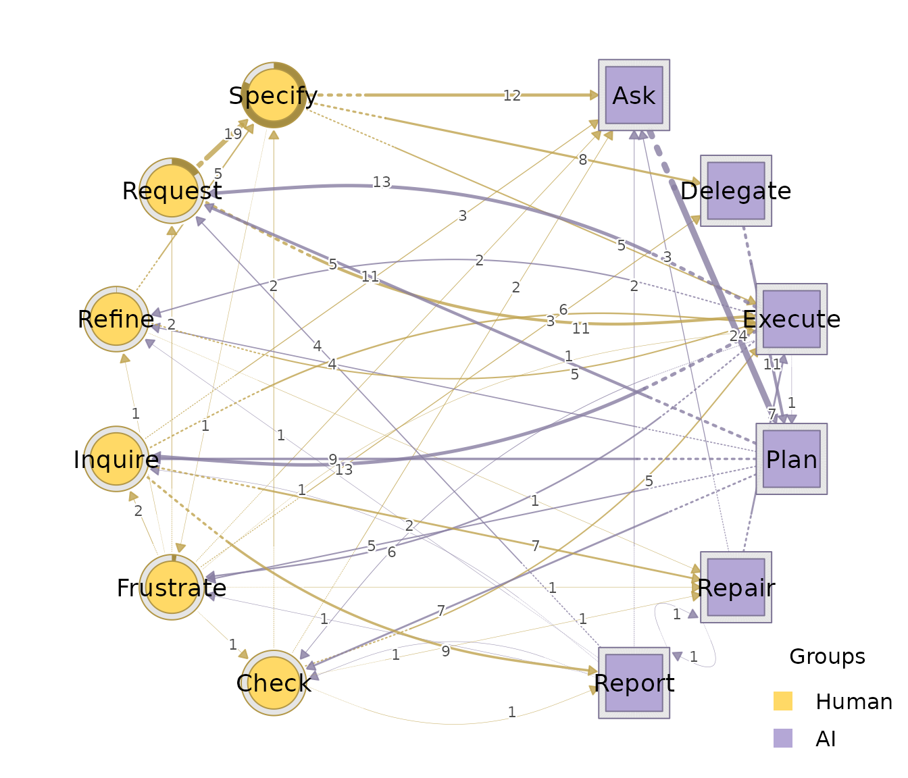
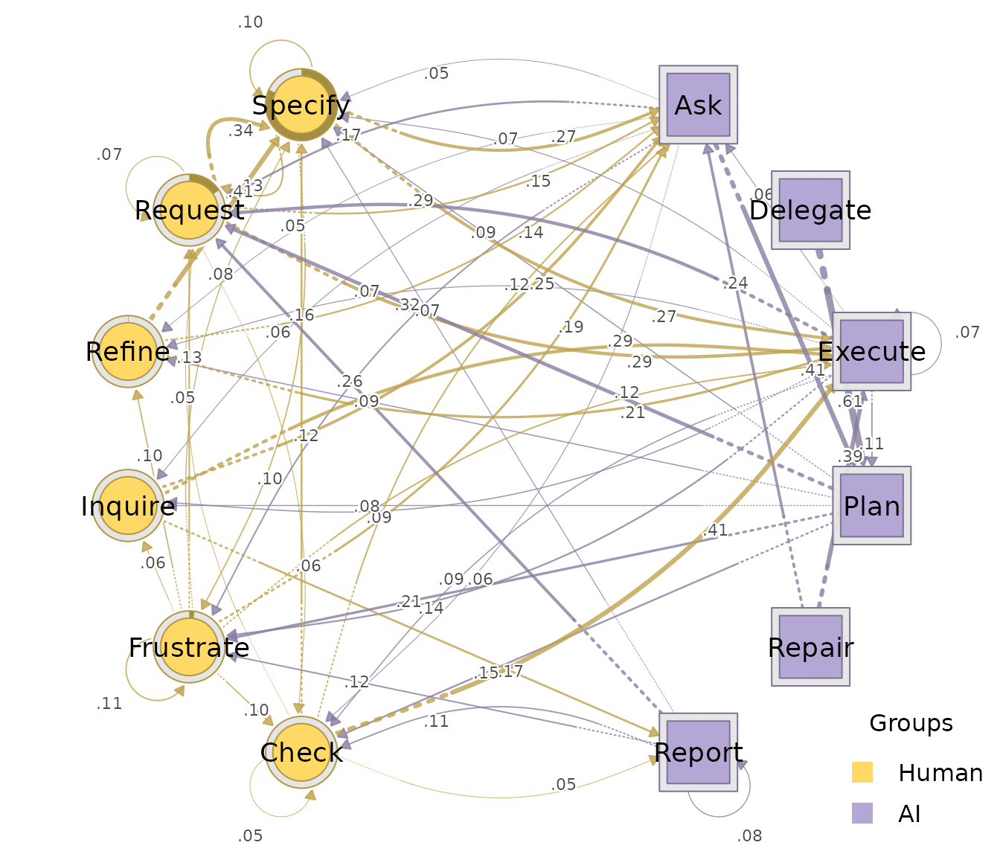

# Case study: help-seeking in vibe coding

In “vibe coding” a programmer describes what the software should do and
an AI coding agent writes, runs and repairs the code. Programming
becomes a sequence of requests, specifications, checks and complaints
addressed to the agent, interleaved with the agent’s plans, actions,
questions and reports. How programmers seek help in this setting, and
how the agent’s moves shape what they do next, is a question about the
process of the interaction: it concerns which moves follow which, within
and across the two actors. Rinja et al. (2027) studied help-seeking in
student-AI programming interactions from this perspective with
heterogeneous transition network analysis.

This case study follows that line of analysis on the bundled sessions.
It asks how the programmers distribute their moves, how the agent
responds to each kind of request, which agent moves are followed by
frustration, what turn-taking patterns recur, and whether the
conclusions are stable. It does not reproduce the published study and
its numbers.

``` r

library(htna)
```

## Data

`human_ai` holds 19,347 coded events from 429 vibe-coding sessions. Each
code belongs to one actor, as recorded in the codebook
`human_ai_codebook`.

- **Session and order:** `session_id`, `order_in_session`.
- **Human codes:** `Specify`, `Request` (merging the original codes
  Command and Request), `Check` (Correct and Verify), `Inquire`,
  `Refine` and `Frustrate` (Frustrate and Interrupt).
- **AI codes:** `Plan`, `Execute`, `Ask` (merging Ask, Investigate and
  Inquire), `Report` (Explain and Report), `Repair` and `Delegate`.

``` r

human_ai_codebook
#>         code actor_type
#> 1    Specify      Human
#> 2    Request      Human
#> 3  Frustrate      Human
#> 4      Check      Human
#> 5    Inquire      Human
#> 6     Refine      Human
#> 7   Delegate         AI
#> 8       Plan         AI
#> 9    Execute         AI
#> 10       Ask         AI
#> 11    Repair         AI
#> 12    Report         AI
```

The network is built from the data and the codebook, which assigns each
code to its actor.

``` r

net <- build_htna(human_ai, node_groups = human_ai_codebook)
```

## How the actors divide their activity

``` r

frequencies_htna(net)
#>    group     state count proportion
#> 1     AI   Execute  3258     0.3810
#> 2  Human   Request  3104     0.2875
#> 3  Human   Specify  2920     0.2705
#> 4     AI       Ask  2416     0.2825
#> 5  Human Frustrate  1829     0.1694
#> 6     AI      Plan  1620     0.1895
#> 7  Human     Check  1298     0.1202
#> 8  Human   Inquire   853     0.0790
#> 9  Human    Refine   792     0.0734
#> 10    AI    Report   705     0.0824
#> 11    AI  Delegate   295     0.0345
#> 12    AI    Repair   257     0.0301
```

The programmers’ moves are mostly directive: `Request` (29% of their
events) and `Specify` (27%) together make up more than half of them,
`Frustrate` follows with 17%, and questions (`Inquire`, 8%) are rare.
The agent mostly executes (38% of its events), asks (28%) and plans
(19%); it seldom repairs (3%) or delegates (3%). Help is sought by
directing the agent rather than by asking it.

## How the agent responds to each request

The two-step paths from a human code to an AI code show how the agent
responds; lift compares each count with the count expected if the two
codes followed each other at random.

``` r

print(extract_meta_paths(net, schema = "Human->AI"), n = 8)
#> State-level instances of schema 'Human->AI' over 429 sequences
#> Rows: 36 | Lengths: 2 | Gaps: 0
#>            schema meta_schema length gap count n_seq support frequency lift
#>  Request->Execute   Human->AI      2   0   904   299   0.697     0.151 1.77
#>  Specify->Execute   Human->AI      2   0   796   261   0.608     0.133 1.66
#>      Specify->Ask   Human->AI      2   0   784   292   0.681     0.131 2.20
#>    Check->Execute   Human->AI      2   0   534   243   0.566     0.089 2.50
#>      Request->Ask   Human->AI      2   0   459   222   0.517     0.077 1.21
#>    Frustrate->Ask   Human->AI      2   0   327   227   0.529     0.055 1.46
#>  Inquire->Execute   Human->AI      2   0   243   123   0.287     0.041 1.73
#>      Inquire->Ask   Human->AI      2   0   214   133   0.310     0.036 2.05
#> ... (28 more)
```

Requests and specifications are followed by execution (904 and 796
times), and specifications also often by a question from the agent (784
times, 2.2 times as often as expected). A check is followed by execution
2.5 times as often as expected: the agent responds to a correction by
acting on it. The agent answers questions (`Inquire`) with both
execution and a question of its own.

## What follows the agent’s moves

The reverse paths show what the programmer does after each agent move.

``` r

print(extract_meta_paths(net, schema = "AI->Human"), n = 8)
#> State-level instances of schema 'AI->Human' over 429 sequences
#> Rows: 36 | Lengths: 2 | Gaps: 0
#>              schema meta_schema length gap count n_seq support frequency lift
#>    Execute->Request   AI->Human      2   0   921   269   0.627     0.162 1.80
#>       Plan->Request   AI->Human      2   0   503   268   0.625     0.088 1.98
#>  Execute->Frustrate   AI->Human      2   0   451   230   0.536     0.079 1.50
#>        Ask->Request   AI->Human      2   0   409   212   0.494     0.072 1.08
#>     Plan->Frustrate   AI->Human      2   0   333   197   0.459     0.058 2.22
#>    Execute->Inquire   AI->Human      2   0   277   150   0.350     0.049 1.97
#>      Execute->Check   AI->Human      2   0   274   134   0.312     0.048 1.28
#>      Ask->Frustrate   AI->Human      2   0   273   153   0.357     0.048 1.22
#> ... (28 more)
```

After an execution the programmer most often issues the next request
(921 times, in 269 sessions), and after a plan as well (503).
Frustration is the next most common reaction to an execution (451
times). The schema `AI->Frustrate` lists every agent move that precedes
frustration.

``` r

extract_meta_paths(net, schema = "AI->Frustrate")
#> State-level instances of schema 'AI->Frustrate' over 429 sequences
#> Rows: 6 | Lengths: 2 | Gaps: 0
#>               schema meta_schema length gap count n_seq support frequency lift
#>   Execute->Frustrate   AI->Human      2   0   451   230   0.536     0.381 1.50
#>      Plan->Frustrate   AI->Human      2   0   333   197   0.459     0.281 2.22
#>       Ask->Frustrate   AI->Human      2   0   273   153   0.357     0.231 1.22
#>    Report->Frustrate   AI->Human      2   0    85    67   0.156     0.072 1.30
#>  Delegate->Frustrate   AI->Human      2   0    31    28   0.065     0.026 1.14
#>    Repair->Frustrate   AI->Human      2   0    11    11   0.026     0.009 0.46
```

Frustration follows a plan 2.22 times as often as expected, more than it
follows an execution (1.50) or a question (1.22), and it rarely follows
a repair (lift 0.46). Programmers react against the agent’s plans more
than against its actions.

## Recurring turn-taking

At the level of actor types, four-step meta-paths show how turns are
exchanged.

``` r

extract_meta_paths(net, level = "type", length = 4, min_lift = 1)
#> Meta-paths (type-level) over 429 sequences
#> Rows: 9 | Lengths: 4 | Gaps: 0
#>                   schema length gap count n_seq support frequency lift
#>     AI->Human->Human->AI      4   0  2276   389   0.907     0.126 2.07
#>     AI->Human->AI->Human      4   0  1984   356   0.830     0.110 1.81
#>     Human->AI->Human->AI      4   0  1791   337   0.786     0.099 1.63
#>     Human->AI->AI->Human      4   0  1772   394   0.918     0.098 1.61
#>  Human->AI->Human->Human      4   0  1718   366   0.853     0.095 1.24
#>  Human->Human->AI->Human      4   0  1574   358   0.834     0.087 1.13
#>     Human->Human->AI->AI      4   0  1492   391   0.911     0.083 1.36
#>     AI->AI->Human->Human      4   0  1110   323   0.753     0.061 1.01
#>        AI->AI->Human->AI      4   0   953   333   0.776     0.053 1.10
```

The most over-represented pattern is AI $`\to`$ Human $`\to`$ Human
$`\to`$ AI (lift 2.07, in 389 of the 429 sessions): the programmer
answers an agent move with two moves of their own before the agent acts
again. Patterns that alternate strictly between the actors follow (lifts
1.81 and 1.63). Help-seeking in these sessions is a dialogue of short
turns in which the programmer often needs more than one move to redirect
the agent.

The paths that start with a question show what a programmer’s question
leads to.

``` r

print(extract_meta_paths(net, schema = "Inquire->AI->Human"), n = 6)
#> State-level instances of schema 'Inquire->AI->Human' over 429 sequences
#> Rows: 26 | Lengths: 3 | Gaps: 0
#>                       schema      meta_schema length gap count n_seq support frequency
#>    Inquire->Execute->Request Human->AI->Human      3   0    73    52   0.121     0.164
#>    Inquire->Execute->Inquire Human->AI->Human      3   0    42    31   0.072     0.094
#>        Inquire->Ask->Request Human->AI->Human      3   0    41    37   0.086     0.092
#>     Inquire->Report->Request Human->AI->Human      3   0    36    30   0.070     0.081
#>      Inquire->Ask->Frustrate Human->AI->Human      3   0    32    28   0.065     0.072
#>  Inquire->Execute->Frustrate Human->AI->Human      3   0    25    24   0.056     0.056
#>  lift
#>  3.31
#>  6.94
#>  2.51
#>  7.55
#>  3.33
#>  1.93
#> ... (20 more)
```

A question answered by an execution is most often followed by a new
request (73 times), but a question answered by an execution is also
followed by a further question 6.94 times as often as expected, and a
question answered by a report by a request 7.55 times as often: answers
lead to more questions or to new instructions, in loops.

## Which codes broker the interaction

``` r

centralities_htna(net, measures = c("InStrength", "Betweenness"))
#>         node actor InStrength Betweenness
#> 1        Ask    AI      1.527          13
#> 2      Check Human      0.752           0
#> 3   Delegate    AI      0.174           0
#> 4    Execute    AI      2.034          29
#> 5  Frustrate Human      0.967           2
#> 6    Inquire Human      0.515          14
#> 7       Plan    AI      1.250          25
#> 8     Refine Human      0.470           0
#> 9     Repair    AI      0.200           0
#> 10    Report    AI      0.525           0
#> 11   Request Human      1.693          19
#> 12   Specify Human      1.353          15
```

`Execute` receives the most transition weight (in-strength 2.03) and
lies on the most shortest paths (betweenness 29), followed by the
agent’s `Plan` (25) and the programmer’s `Request` (19). The interaction
is held together by the request-plan-execute cycle.

``` r

plot_edge_betweenness_htna(net)
```



## Are the conclusions stable?

The bootstrap identifies the transitions that the resampled sessions
reproduce, and pruning with it keeps only those.

``` r

boot <- bootstrap_htna(net, iter = 200, seed = 1)
pruned <- prune_htna(net, method = "bootstrap", boot = boot)
as.data.frame(summary(pruned), what = "actor_pairs")
#>   source_actor target_actor n_edges
#> 1        Human        Human      18
#> 2        Human           AI      17
#> 3           AI        Human      22
#> 4           AI           AI      11
```

Sixty-eight edges are retained. The AI-to-human block keeps the most
(22), so the responses of the programmers to the agent are the
best-supported part of the network.

``` r

plot_htna(pruned)
```



Case-dropping asks whether the edge weights hold when sessions are
removed.

``` r

casedrop_reliability_htna(net, iter = 100, seed = 1)
#> Edge-weight Case-dropping Stability
#>   Cases (resampled)     : 429
#>   Edges assessed        : 125 (diagonal excluded)
#>   Iterations / prop     : 100
#>   Correlation method    : spearman
#>   CS-coefficient (r)    : 0.90  (threshold=0.70, certainty=0.95)
#> 
#> Model-level reliability across iterations (mean +/- sd per drop):
#>   drop_prop      p=0.1        p=0.2        p=0.3        p=0.4        p=0.5        p=0.6        p=0.7        p=0.8        p=0.9      
#>   mean|diff|      0.002+- 0.000   0.003+- 0.000   0.004+- 0.000   0.006+- 0.001   0.007+- 0.001   0.008+- 0.001   0.010+- 0.001   0.014+- 0.002   0.021+- 0.003
#>   median|diff|    0.001+- 0.000   0.002+- 0.000   0.003+- 0.000   0.003+- 0.000   0.004+- 0.001   0.005+- 0.001   0.006+- 0.001   0.009+- 0.001   0.013+- 0.002
#>   cor             0.998+- 0.001   0.996+- 0.001   0.994+- 0.002   0.991+- 0.002   0.988+- 0.003   0.982+- 0.005   0.972+- 0.006   0.957+- 0.011   0.911+- 0.022
#>   max|diff|       0.017+- 0.007   0.023+- 0.006   0.032+- 0.012   0.039+- 0.012   0.048+- 0.014   0.059+- 0.016   0.074+- 0.021   0.098+- 0.033   0.143+- 0.041
```

The edge weights keep a rank correlation above 0.7 until 90% of the
sessions are dropped (CS coefficient 0.90), so the transition structure
described above is not carried by a few sessions.

## Conclusion

Programmers in these sessions sought help by directing the agent:
requests and specifications dominate their moves, and questions are
rare. The agent answers requests and checks by executing, and the
programmers answer executions and plans with further requests or with
frustration, the latter most often after a plan. The exchange runs in
short turns, with the programmer often making two moves before the agent
acts again, and the structure is stable under resampling and
case-dropping.

## References

Rinja, D., Oliveira, E. A., López-Pernas, S., Saqr, M., Specht, M., &
Misiejuk, K. (2027). Unpacking vibe coding: Help-seeking processes in
student-AI interactions while programming. In *Artificial Intelligence
in Education: 27th International Conference, AIED 2026*. Springer Nature
Switzerland. <https://doi.org/10.1007/978-3-032-29763-1_35>
