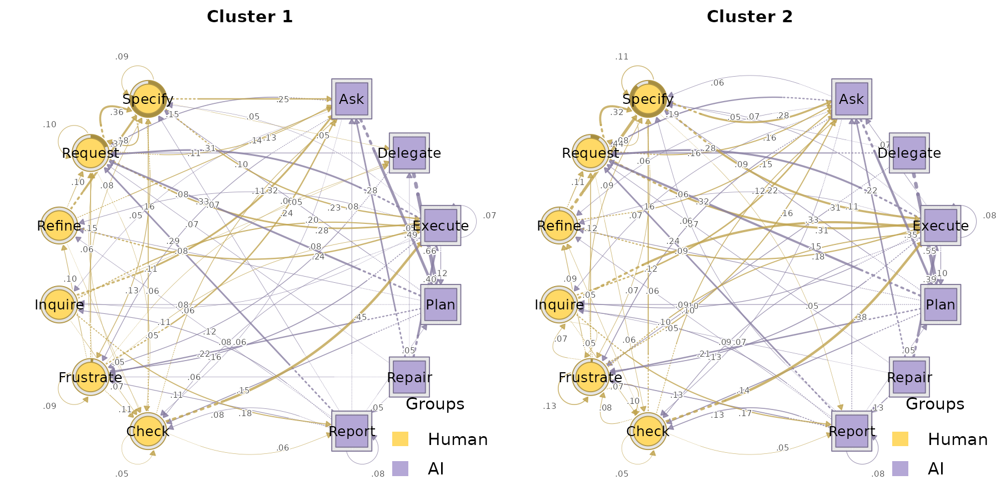
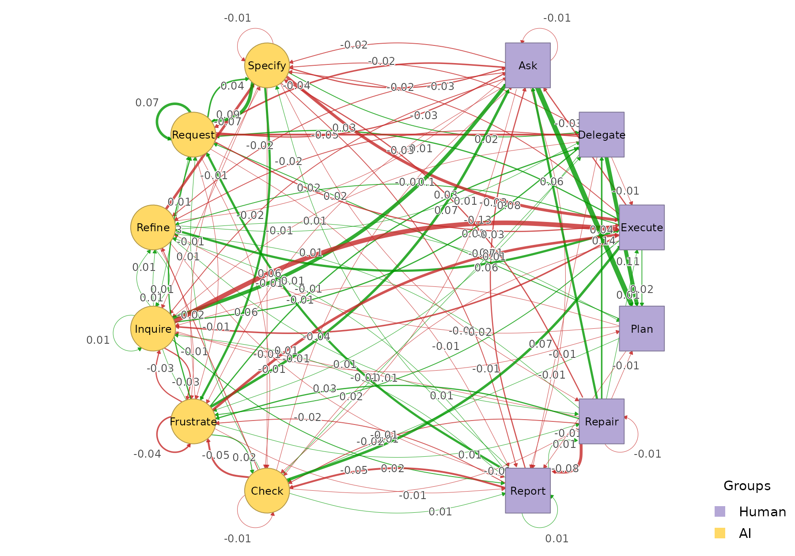

# Clustering inputs to build_htna()

[`build_htna()`](https://sonsoles.me/htna/reference/build_htna.md)
accepts clustering results from the `Nestimate` ecosystem as first-class
inputs. You can hand a clustering object straight to
[`build_htna()`](https://sonsoles.me/htna/reference/build_htna.md) and
get back an `htna`-aware result with the actor partition already
attached.

The clustering constructors covered here all operate at the **cohort
level**: sessions are grouped into *k* clusters and one htna network is
built per cluster. The result is an `htna_group`, identical in shape to
what `build_htna(..., group = ...)` returns, so every grouped-htna
wrapper
([`plot_htna()`](https://sonsoles.me/htna/reference/plot_htna.md),
[`plot_htna_diff()`](https://sonsoles.me/htna/reference/plot_htna_diff.md),
[`permutation_htna()`](https://sonsoles.me/htna/reference/permutation_htna.md),
[`centrality_stability_htna()`](https://sonsoles.me/htna/reference/centrality_stability_htna.md),
etc.) works unchanged.

## Setup

``` r

library(htna)
data(human_ai)

net <- build_htna(human_ai, actor_type = "actor_type")
```

## `Nestimate::build_clusters()` (distance-based)

`build_clusters()` computes a pairwise dissimilarity between sessions
(Hamming by default) and applies a partitioning algorithm (`pam` by
default) to split them into *k* cohorts. Feed the returned
`net_clustering` object straight to
[`build_htna()`](https://sonsoles.me/htna/reference/build_htna.md):

``` r

cc  <- Nestimate::build_clusters(net, k = 2, seed = 1)
grp <- build_htna(cc)

class(grp)
#> [1] "htna_group"      "netobject_group" "list"
names(grp)
#> [1] "Cluster 1" "Cluster 2"
```

The result is an `htna_group`: one htna network per cluster, each
carrying the same actor partition inherited from `net`. Plot the two
cohorts side by side:

``` r

op <- par(mfrow = c(1, 2))
plot_htna(grp)
```



``` r

par(op)
```

Because both networks share the alphabet, they compose with the
comparison wrappers:

``` r

plot_htna_diff(grp[[1]], grp[[2]])
```



## `Nestimate::cluster_mmm()` (mixture of Markov chains)

`cluster_mmm()` fits a *k*-component mixture of first-order Markov
chains via EM and assigns each session probabilistically to a component.
The returned `net_mmm` object is also a legal
[`build_htna()`](https://sonsoles.me/htna/reference/build_htna.md)
input:

``` r

cm    <- Nestimate::cluster_mmm(net, k = 2, seed = 1)
grp_m <- build_htna(cm)

names(grp_m)
#> [1] "Cluster 1" "Cluster 2"
```

`grp_m` is again an `htna_group`, ready to feed any of the grouped
wrappers.

`build_clusters()` and `cluster_mmm()` answer different questions:
`build_clusters()` groups sessions by *trajectory similarity* under a
fixed distance metric; `cluster_mmm()` groups sessions by the
first-order transition process most likely to have generated them. The
Nestimate documentation covers the trade-offs.

## Choosing the number of clusters

Both constructors take a *k*. Two Nestimate helpers sweep a range of
candidate values and score them, so the choice does not have to be made
blind. A third helper reports per-cluster quality once a particular fit
has been settled on.

### For `build_clusters()`: `cluster_choice()`

`cluster_choice()` fits the same partitioning algorithm at each *k* in a
grid and reports the average silhouette width, mean within-cluster
distance, and the cluster-size range. Higher silhouette (closer to 1) is
better; extreme size ratios flag partitions with a single dominant
cluster and a tiny satellite. The row flagged `<-- best` in the print
method is the largest silhouette across the grid.

``` r

Nestimate::cluster_choice(net, k = 2:4)
#> Cluster Choice (sweep: k)
#> 
#>  k silhouette within_dist sizes     ratio  best    
#>  2 0.756      56.274      [11, 418] 38.000 <-- best
#>  3 0.501      49.323      [11, 349] 31.727         
#>  4 0.503      48.827      [5, 349]  69.800
```

### For `cluster_mmm()`: `compare_mmm()`

`compare_mmm()` fits the mixture at each candidate *k* and returns the
standard information criteria (`AIC`, `BIC`, `ICL`) plus the average
posterior probability (`AvePP`, higher = more confident assignments) and
normalised entropy (lower = more separated components). The row flagged
`<-- BIC` is the best BIC across the grid; ICL trades off fit against
classification uncertainty and is often preferred when the cohorts must
be used for downstream inference.

``` r

Nestimate::compare_mmm(net, k = 2:3, seed = 1)
#> MMM Model Comparison
#> 
#>  k log_likelihood AIC      BIC      ICL      AvePP     Entropy   converged
#>  2 -36345.27      73264.54 74430.17 74510.27 0.9211857 0.2658902 TRUE     
#>  3 -36115.29      73092.59 74843.08 74932.82 0.9136712 0.1967376 TRUE     
#>  best   
#>  <-- BIC
#> 
```

### Validating a specific fit: `cluster_diagnostics()`

Once you have picked a *k* and fit the clustering, pass the result to
`cluster_diagnostics()` to see per-cluster sizes, mean within- cluster
distance, and silhouette. Small satellites or negative silhouettes on
one cluster indicate that the partition is stretched by outliers even if
the aggregate score is acceptable.

``` r

Nestimate::cluster_diagnostics(cc)
#> Cluster Diagnostics (distance) [pam / hamming]
#>   Sequences: 429  |  Clusters: 2
#>   Quality: silhouette = 0.300
#> 
#>   Cluster  N            Mean within-dist  Silhouette
#>   1        288 (67.1%)  36.300            0.552
#>   2        141 (32.9%)  93.620            -0.215
```

## Comparing the resulting cohorts

Once clustering has produced an `htna_group`,
[`compare_htna()`](https://sonsoles.me/htna/reference/compare_htna.md)
computes a descriptive summary of every cohort pair in one call — you do
not need to pull out individual cohorts by hand.

``` r

comparisons <- compare_htna(grp)

class(comparisons)
#> [1] "htna_comparison_group" "list"
names(comparisons)
#> [1] "Cluster 1 vs Cluster 2"
```

Each element is an `htna_comparison`: the `Nestimate` `net_comparison`
fields (`summary_metrics`, `edge_metrics`, `network_metrics`,
`matrices`, `difference_matrix`) plus an `htna`-aware
`actor_pair_metrics` table that summarises the difference for every
directed actor-type block:

``` r

one <- comparisons[[1]]
one$summary_metrics
#>                category               metric       value
#> 1     Weight Deviations      Mean Abs. Diff.  0.02025425
#> 2     Weight Deviations    Median Abs. Diff.  0.01020158
#> 3     Weight Deviations            RMS Diff.  0.03290003
#> 4     Weight Deviations       Max Abs. Diff.  0.14058447
#> 5     Weight Deviations Rel. Mean Abs. Diff.  0.24305095
#> 6     Weight Deviations             CV Ratio  1.09485122
#> 7          Correlations              Pearson  0.95470530
#> 8          Correlations             Spearman  0.94189862
#> 9          Correlations              Kendall  0.80856141
#> 10         Correlations             Distance  0.88970520
#> 11      Dissimilarities            Euclidean  0.39480036
#> 12      Dissimilarities            Manhattan  2.91661145
#> 13      Dissimilarities             Canberra 23.14861488
#> 14      Dissimilarities          Bray-Curtis  0.12152548
#> 15      Dissimilarities            Frobenius  0.16117657
#> 16         Similarities               Cosine  0.97133126
#> 17         Similarities              Jaccard  0.78328539
#> 18         Similarities                 Dice  0.87847452
#> 19         Similarities              Overlap  0.87847452
#> 20         Similarities                   RV  0.95884110
#> 21 Pattern Similarities       Rank Agreement  0.88636364
#> 22 Pattern Similarities       Sign Agreement  0.97916667
head(one$actor_pair_metrics)
#>   source_actor target_actor n_cells n_nonzero_x n_nonzero_y n_changed
#> 1        Human        Human      36          35          35        35
#> 2        Human           AI      36          36          36        36
#> 3           AI        Human      36          34          36        36
#> 4           AI           AI      36          27          28        28
#>   mean_difference mean_absolute_difference rms_difference
#> 1     0.001072078               0.01887634     0.02928339
#> 2    -0.001072078               0.02612978     0.04044685
#> 3    -0.005198687               0.01894510     0.02313669
#> 4     0.005198687               0.01706576     0.03606767
#>   max_absolute_difference
#> 1              0.09083051
#> 2              0.13076689
#> 3              0.05596170
#> 4              0.14058447
```

[`plot()`](https://rdrr.io/r/graphics/plot.default.html) dispatches
through
[`plot.htna_comparison_group()`](https://sonsoles.me/htna/reference/plot.htna_comparison_group.md)
and draws one panel per pair with the actor styling preserved:

``` r

plot(comparisons)
```

For a full statistical test of the same pairs, feed the group to
[`permutation_htna()`](https://sonsoles.me/htna/reference/permutation_htna.md)
instead — see the [grouped
vignette](https://sonsoles.me/htna/articles/grouped.md).
