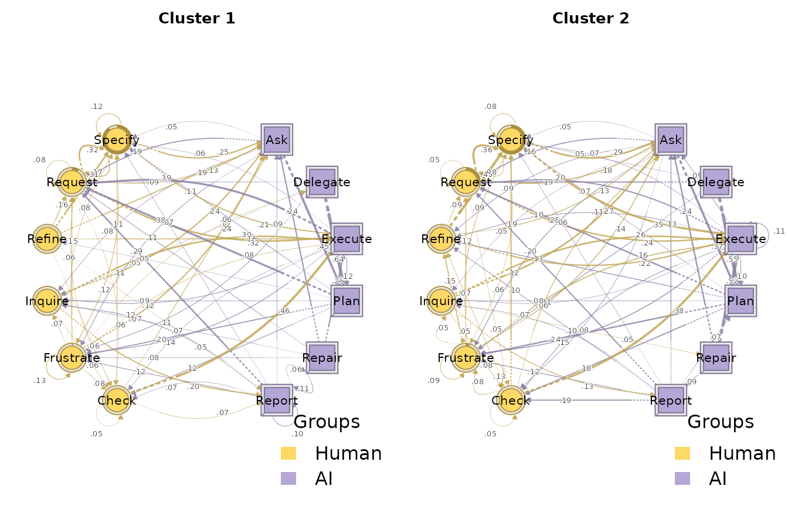
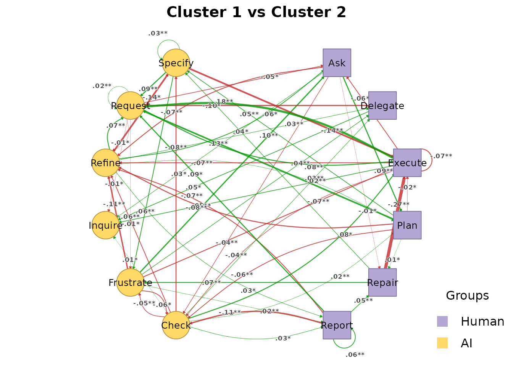

# Clustering inputs

A network estimated from all sessions describes an average interaction.
When the sessions follow different patterns, such as some in which the
human specifies and the AI executes in long runs and others in which the
two alternate rapidly, the average network describes none of them well.
Grouping the sessions by a known variable (a condition, a phase of a
course) is one answer; when no such variable exists, the groups have to
be found from the sessions themselves. Two families of methods do this.
Distance-based clustering groups sessions whose sequences are similar
under a distance measure. A mixture of Markov chains groups sessions by
the transition process most likely to have generated them, so each
cluster is a network in its own right.

[`build_htna()`](https://sonsoles.me/htna/reference/build_htna.md) takes
a fitted clustering of an htna network and returns one heterogeneous
network per cluster, each with the actor partition of the original
network. The result is a grouped network, the same kind of object that
`build_htna(..., group = )` returns, so every function that works on
cohorts works on clusters. This guide fits both kinds of clustering,
shows how to choose the number of clusters, and compares the resulting
cluster networks.

``` r

library(htna)
```

## Data

`human_ai` holds 429 sessions of human-AI pair programming; each row is
one coded event.

- **Session**: `session_id`; the unit that is clustered.
- **Code**: `code`; six human and six AI codes.
- **Actor type**: `actor_type`, `"Human"` or `"AI"`.
- **Order**: `order_in_session`.

The clusterings start from the htna network of all sessions, which
carries the sequences and the actor partition.

``` r

data(human_ai)
net <- build_htna(human_ai, actor_type = "actor_type")
```

## Clustering sessions by sequence similarity

[`Nestimate::build_clusters()`](https://pak.dynasite.org/Nestimate/reference/build_clusters.html)
computes a dissimilarity between every pair of sessions (Hamming
distance by default) and partitions them with partitioning around
medoids into `k` clusters.

``` r

fit_distance <- Nestimate::build_clusters(net, k = 2, seed = 1)
fit_distance
#> Sequence Clustering [pam]
#>   Sequences: 429  |  Clusters: 2
#>   Dissimilarity: hamming
#>   Quality: silhouette = 0.300
#> 
#>   Cluster  N            Mean within-dist  Medoid
#>   1        288 (67.1%)  36.300            44
#>   2        141 (32.9%)  93.620            303
```

The two clusters hold 288 and 141 sessions, but the partition is weak:
the average silhouette is 0.300, and the second cluster has a mean
within-cluster distance of 93.6 against 36.3 for the first. The
per-cluster diagnostics make the problem explicit.

``` r

Nestimate::cluster_diagnostics(fit_distance)
#> Cluster Diagnostics (distance) [pam / hamming]
#>   Sequences: 429  |  Clusters: 2
#>   Quality: silhouette = 0.300
#> 
#>   Cluster  N            Mean within-dist  Silhouette
#>   1        288 (67.1%)  36.300            0.552
#>   2        141 (32.9%)  93.620            -0.215
```

The second cluster has a negative silhouette (-0.215): on average its
sessions are closer to the other cluster’s medoid than to their own. It
is a remainder of long, dissimilar sessions rather than a coherent
group, which is common for Hamming distances on sequences of very
different lengths.

## How many clusters?

[`Nestimate::cluster_choice()`](https://pak.dynasite.org/Nestimate/reference/cluster_choice.html)
fits the distance-based clustering for a range of `k` and reports the
silhouette and the cluster sizes.

``` r

Nestimate::cluster_choice(net, k = 2:4)
#> Cluster Choice (sweep: k)
#> 
#>  k silhouette within_dist sizes     ratio best    
#>  2 0.756      56.3        [11, 418] 38.0  <-- best
#>  3 0.501      49.3        [11, 349] 31.7          
#>  4 0.503      48.8        [5, 349]  69.8
```

The highest silhouette (0.756 at `k = 2`) belongs to a partition that
separates 11 sessions from the other 418, a ratio of 38 between the
largest and the smallest cluster. A high silhouette for a small
satellite and one large cluster does not describe two kinds of
collaboration, so the size column has to be read with the silhouette.
Neither criterion supports a distance-based clustering of these
sessions.

## Clustering sessions by their transition process

[`Nestimate::cluster_mmm()`](https://pak.dynasite.org/Nestimate/reference/cluster_mmm.html)
fits a mixture of first-order Markov chains with the EM algorithm. Every
session receives a posterior probability of belonging to each component,
and each component has its own transition matrix.

``` r

fit_mmm <- Nestimate::cluster_mmm(net, k = 2, seed = 1)
fit_mmm
#> Mixed Markov Model
#>   Sequences: 429  |  Clusters: 2  |  States: 12
#>   ICs: LL = -36345.268  |  BIC = 74430.175  |  AIC = 73264.537  |  ICL = 74510.272
#>   Quality: AvePP = 0.921  |  Entropy = 0.266  |  Class.Err = 7.9%
#> 
#>   Cluster  N            Mix%   AvePP
#>   1        280 (65.3%)  64.2%  0.932
#>   2        149 (34.7%)  35.8%  0.902
```

The two components hold 280 and 149 sessions. The average posterior
probability of the assigned component is 0.921 (0.932 and 0.902 per
cluster), and the classification error is 7.9%, so the sessions are
assigned with confidence.
[`Nestimate::compare_mmm()`](https://pak.dynasite.org/Nestimate/reference/compare_mmm.html)
compares mixtures with different numbers of components.

``` r

Nestimate::compare_mmm(net, k = 2:3, seed = 1)
#> MMM Model Comparison
#> 
#>  k log_likelihood AIC   BIC   ICL   AvePP Entropy converged best   
#>  2 -36345         73265 74430 74510 0.921 0.266   TRUE      <-- BIC
#>  3 -36115         73093 74843 74933 0.914 0.197   TRUE
```

BIC and ICL both prefer two components (BIC 74,430 against 74,843),
while the log-likelihood and AIC improve slightly with a third. The
two-component mixture is the model to interpret.

## One network per cluster

[`build_htna()`](https://sonsoles.me/htna/reference/build_htna.md) turns
either fit into a grouped network, one heterogeneous network per
cluster. The fit is not rerun; the assignments are those of the fit.

``` r

clusters <- build_htna(fit_mmm)
as.data.frame(summary(clusters), what = "actor_pairs")
#>       group source_actor target_actor n_edges
#> 1 Cluster 1        Human        Human      36
#> 2 Cluster 1        Human           AI      36
#> 3 Cluster 1           AI        Human      36
#> 4 Cluster 1           AI           AI      36
#> 5 Cluster 2        Human        Human      36
#> 6 Cluster 2        Human           AI      36
#> 7 Cluster 2           AI        Human      36
#> 8 Cluster 2           AI           AI      36
```

Both cluster networks have the same actor partition, and all 36 edges of
every actor-pair block are non-zero. The weights of a cluster network
are the fitted transition probabilities of its mixture component, which
give every transition a non-zero probability, including the transitions
never observed in the data. The networks are drawn side by side:

``` r

op <- par(mfrow = c(1, 2), mar = c(1, 1, 3, 1))
plot_htna(clusters)
```



``` r

par(op)
```

The distance-based fit is converted in the same way, with
`build_htna(fit_distance)`.

## How do the clusters differ?

[`compare_htna()`](https://sonsoles.me/htna/reference/compare_htna.md)
compares every pair of clusters and summarizes the differences by
actor-pair block.

``` r

comparison <- compare_htna(clusters)
comparison
#> HTNA network comparisons: 1 cohort pair
#> 
#> --- Cluster 1 vs Cluster 2 ---
#>   Pearson correlation of edge weights: 0.877
#>   Mean absolute difference:            0.0336
#>  source target cells changed mean_diff mean_abs_diff max_abs_diff
#>   Human  Human    36      36  -0.00666        0.0308        0.139
#>   Human     AI    36      36   0.00666        0.0319        0.142
#>      AI  Human    36      36   0.00449        0.0475        0.182
#>      AI     AI    36      36  -0.00449        0.0243        0.268
```

The two transition processes are more different than the early and late
sessions of the [Comparing
networks](https://sonsoles.me/htna/articles/comparing-networks.md)
guide: the correlation of their edge weights is 0.877 and the mean
absolute difference 0.0336. The actor-pair table locates the differences
(`Cluster 1` minus `Cluster 2`). A human code is followed by another
human code with a probability about 0.040 lower in the first cluster
(six target codes times -0.00666 per cell) and by an AI code
correspondingly more often, and an AI code hands back to the human about
0.027 more often (6 x 0.00449). The first cluster is the more
alternating collaboration. The largest single difference, 0.268, lies in
the AI-to-AI block. The similarity, correlation and distance measures of
the two weight matrices are returned with `what = "metrics"`.

``` r

as.data.frame(comparison, what = "metrics")
#>                comparison             category               metric   value
#> 1  Cluster 1 vs Cluster 2    Weight Deviations      Mean Abs. Diff.  0.0336
#> 2  Cluster 1 vs Cluster 2    Weight Deviations    Median Abs. Diff.  0.0189
#> 3  Cluster 1 vs Cluster 2    Weight Deviations            RMS Diff.  0.0521
#> 4  Cluster 1 vs Cluster 2    Weight Deviations       Max Abs. Diff.  0.2684
#> 5  Cluster 1 vs Cluster 2    Weight Deviations Rel. Mean Abs. Diff.  0.4035
#> 6  Cluster 1 vs Cluster 2    Weight Deviations             CV Ratio  1.0124
#> 7  Cluster 1 vs Cluster 2         Correlations              Pearson  0.8772
#> 8  Cluster 1 vs Cluster 2         Correlations             Spearman  0.8549
#> 9  Cluster 1 vs Cluster 2         Correlations              Kendall  0.6823
#> 10 Cluster 1 vs Cluster 2         Correlations             Distance  0.8616
#> 11 Cluster 1 vs Cluster 2      Dissimilarities            Euclidean  0.6253
#> 12 Cluster 1 vs Cluster 2      Dissimilarities            Manhattan  4.8419
#> 13 Cluster 1 vs Cluster 2      Dissimilarities             Canberra 40.7741
#> 14 Cluster 1 vs Cluster 2      Dissimilarities          Bray-Curtis  0.2017
#> 15 Cluster 1 vs Cluster 2      Dissimilarities            Frobenius  0.2553
#> 16 Cluster 1 vs Cluster 2         Similarities               Cosine  0.9246
#> 17 Cluster 1 vs Cluster 2         Similarities              Jaccard  0.6642
#> 18 Cluster 1 vs Cluster 2         Similarities                 Dice  0.7983
#> 19 Cluster 1 vs Cluster 2         Similarities              Overlap  0.7983
#> 20 Cluster 1 vs Cluster 2         Similarities                   RV  0.8917
#> 21 Cluster 1 vs Cluster 2 Pattern Similarities       Rank Agreement  0.8258
#> 22 Cluster 1 vs Cluster 2 Pattern Similarities       Sign Agreement  1.0000
```

A permutation test of the same pair asks whether the differences exceed
what random splits of the sessions produce. Because the clusters were
formed to differ, a significant result is expected and confirms only
that the mixture separated distinct processes; the useful output is
where the differences lie.

``` r

perm <- permutation_htna(clusters, iter = 200, seed = 1)
perm
#> Grouped Permutation Test
#> Groups: Cluster 1 vs Cluster 2 
#> 
#> -- Cluster 1 vs Cluster 2 --
#> Permutation Test: Transition Network (relative probabilities) [directed]
#>   Iterations: 200  |  Alpha: 0.05
#>   Nodes: 12  |  Edges tested: 144  |  Significant: 66
#>   Global test (networks differ overall?): M = 4.842 (p = 0.00498)  |  S = 0.268 (p = 0.00498)
plot_htna_diff(perm)
```



Both global statistics reach the smallest p-value attainable with 200
permutations (0.00498), and 66 of the 144 edges differ at an unadjusted
p-value below 0.05; green edges in the plot are stronger in the first
cluster, red edges in the second. The [Comparing
networks](https://sonsoles.me/htna/articles/comparing-networks.md) guide
explains the three comparisons in detail.

## Which clustering to use

| Question | Function |
|----|----|
| Group sessions by the similarity of their sequences | [`Nestimate::build_clusters()`](https://pak.dynasite.org/Nestimate/reference/build_clusters.html), then `build_htna(fit)` |
| Group sessions by the transition process that generated them | [`Nestimate::cluster_mmm()`](https://pak.dynasite.org/Nestimate/reference/cluster_mmm.html), then `build_htna(fit)` |
| Choose `k` for distance-based clusters | [`Nestimate::cluster_choice()`](https://pak.dynasite.org/Nestimate/reference/cluster_choice.html) (read sizes with the silhouette) |
| Choose `k` for a mixture | [`Nestimate::compare_mmm()`](https://pak.dynasite.org/Nestimate/reference/compare_mmm.html) (BIC, ICL) |
| Check one fitted partition | [`Nestimate::cluster_diagnostics()`](https://pak.dynasite.org/Nestimate/reference/cluster_diagnostics.html) |
| Compare the cluster networks | [`compare_htna()`](https://sonsoles.me/htna/reference/compare_htna.md), [`permutation_htna()`](https://sonsoles.me/htna/reference/permutation_htna.md) |

For heterogeneous networks the mixture of Markov chains is usually the
more informative choice, because its clusters are defined by transition
processes, the same object the networks describe.
