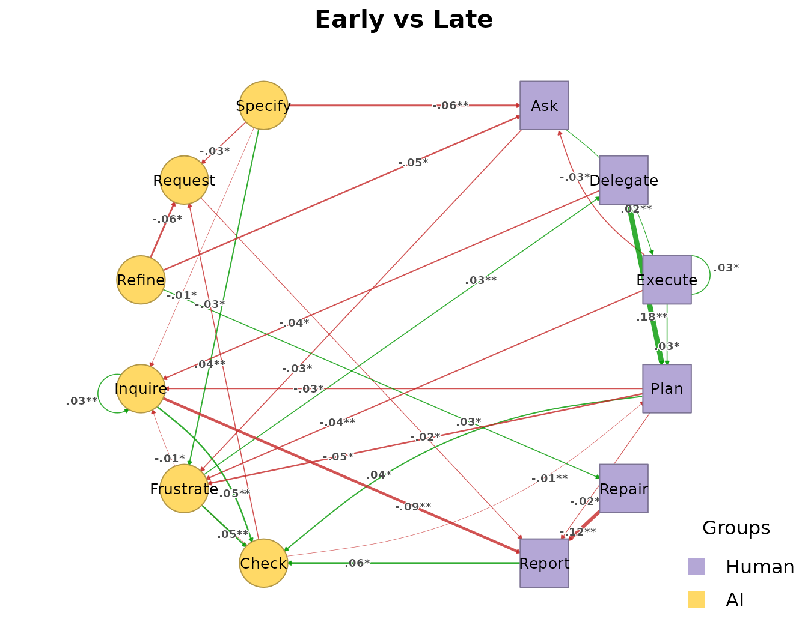
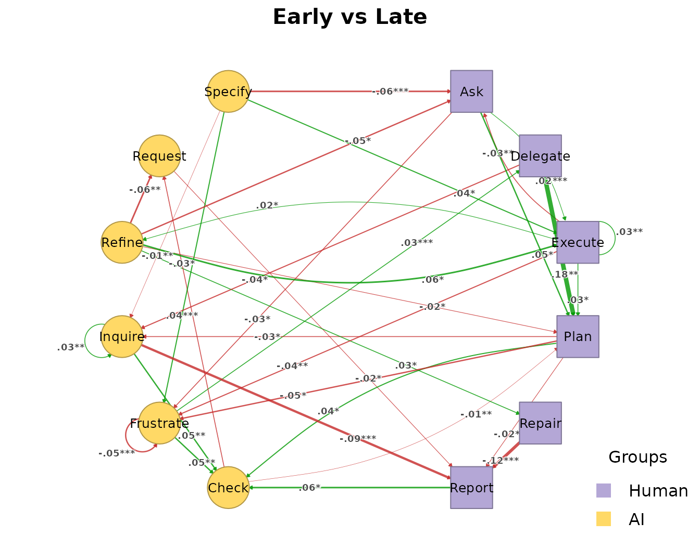

# Comparing networks

Many questions about human-AI interaction are comparative: whether
learners who received AI feedback regulate their work differently from
those who did not, whether a tutoring dialogue changes as learners gain
experience, or whether the division of labor between a programmer and a
coding assistant shifts over a course. In a heterogeneous transition
network each of these questions becomes a comparison of two weight
matrices that share the same codes and the same actor partition. The
comparison has three parts, which answer different questions and should
not be confused. A descriptive comparison says how similar the two
networks are and where their differences lie. A permutation test says
whether the differences are larger than the variation expected between
two random halves of the same sessions. A Bayesian comparison says how
large each difference plausibly is and how precisely the data estimate
it.

This guide applies the three comparisons to the early and late sessions
of the bundled vibe-coding data. In a heterogeneous network the
descriptive comparison has one further element that a homogeneous
network lacks: the differences can be summarized by actor-pair block,
separating changes in how each actor continues its own work from changes
in how the actors hand over to each other.

``` r

library(htna)
```

## Data

`human_ai` holds 429 sessions of human-AI pair programming, coded into
six human and six AI codes. Each row is one coded event.

- **Session**: `session_id`; the unit that is resampled and permuted.
- **Code**: `code`; the node of the network.
- **Actor type**: `actor_type`, `"Human"` or `"AI"`; the actor
  partition.
- **Order**: `order_in_session`; the position of the event in its
  session.
- **Cohort**: `phase`, a factor with levels `Early` (the first 214
  sessions in chronological order) and `Late` (the remaining 215).

One network is built per cohort with `group`. The cohorts follow the
levels of `phase`, so every comparison below is `Early` minus `Late`.

``` r

data(human_ai)
grp <- build_htna(human_ai, actor_type = "actor_type", group = "phase")
```

## How similar are the two networks?

[`compare_htna()`](https://sonsoles.me/htna/reference/compare_htna.md)
computes the descriptive comparison of every pair of cohorts in a
grouped network; here there is one pair. Printing the result gives the
correlation and mean absolute difference of the edge weights and the
summary of the differences in each actor-pair block.

``` r

cmp <- compare_htna(grp)
cmp
#> HTNA network comparisons: 1 cohort pair
#> 
#> --- Early vs Late ---
#>   Pearson correlation of edge weights: 0.959
#>   Mean absolute difference:            0.0192
#>  source target cells changed mean_diff mean_abs_diff max_abs_diff
#>   Human  Human    36      35   0.00168        0.0159       0.0631
#>   Human     AI    36      36  -0.00168        0.0179       0.0922
#>      AI  Human    36      36  -0.00622        0.0216       0.0571
#>      AI     AI    36      28   0.00622        0.0212       0.1810
```

The two networks are close: the Pearson correlation of their 144 edge
weights is 0.959 and the mean absolute difference is 0.0192, on a scale
on which every row of transition probabilities sums to one. The
actor-pair table locates the differences. Because each row sums to one,
the within-actor and between-actor blocks of the same source actor are
mirror images: the mean difference is 0.00622 per cell in the AI-to-AI
block and -0.00622 in the AI-to-human block. Summed over the six target
codes, an AI code was followed by another AI code with a probability
about 0.037 higher in the early sessions than in the late ones (6 x
0.00622), and handed back to the human correspondingly less often. The
changes for human source codes are smaller (0.00168 per cell). The
largest single difference, 0.181, lies in the AI-to-AI block.

The full set of similarity, correlation and distance measures is
returned by
[`as.data.frame()`](https://rdrr.io/r/base/as.data.frame.html) with
`what = "metrics"`.

``` r

as.data.frame(cmp, what = "metrics")
#>       comparison             category               metric   value
#> 1  Early vs Late    Weight Deviations      Mean Abs. Diff.  0.0192
#> 2  Early vs Late    Weight Deviations    Median Abs. Diff.  0.0107
#> 3  Early vs Late    Weight Deviations            RMS Diff.  0.0310
#> 4  Early vs Late    Weight Deviations       Max Abs. Diff.  0.1812
#> 5  Early vs Late    Weight Deviations Rel. Mean Abs. Diff.  0.2300
#> 6  Early vs Late    Weight Deviations             CV Ratio  1.0957
#> 7  Early vs Late         Correlations              Pearson  0.9594
#> 8  Early vs Late         Correlations             Spearman  0.9365
#> 9  Early vs Late         Correlations              Kendall  0.7948
#> 10 Early vs Late         Correlations             Distance  0.9435
#> 11 Early vs Late      Dissimilarities            Euclidean  0.3717
#> 12 Early vs Late      Dissimilarities            Manhattan  2.7602
#> 13 Early vs Late      Dissimilarities             Canberra 26.5679
#> 14 Early vs Late      Dissimilarities          Bray-Curtis  0.1150
#> 15 Early vs Late      Dissimilarities            Frobenius  0.1518
#> 16 Early vs Late         Similarities               Cosine  0.9744
#> 17 Early vs Late         Similarities              Jaccard  0.7937
#> 18 Early vs Late         Similarities                 Dice  0.8850
#> 19 Early vs Late         Similarities              Overlap  0.8850
#> 20 Early vs Late         Similarities                   RV  0.9673
#> 21 Early vs Late Pattern Similarities       Rank Agreement  0.8788
#> 22 Early vs Late Pattern Similarities       Sign Agreement  0.9931
```

The rank-based measures agree with the Pearson correlation (Spearman
0.9365, cosine similarity 0.9744), and the rank agreement of the edges
is 0.8788. The descriptive comparison therefore shows two networks with
the same overall structure and modest differences concentrated in what
the AI does after its own moves.

The edge-level differences behind the block summaries are in the edge
table, one row per edge, with both weights and the actors of the edge.

``` r

head(as.data.frame(cmp, what = "edges"))
#>      comparison    source target weight_x weight_y raw_difference absolute_difference
#> 1 Early vs Late     Check  Check   0.0590   0.0374        0.02159             0.02159
#> 2 Early vs Late Frustrate  Check   0.1288   0.0780        0.05077             0.05077
#> 3 Early vs Late   Inquire  Check   0.0940   0.0458        0.04821             0.04821
#> 4 Early vs Late    Refine  Check   0.0590   0.0299        0.02907             0.02907
#> 5 Early vs Late   Request  Check   0.0573   0.0535        0.00381             0.00381
#> 6 Early vs Late   Specify  Check   0.0181   0.0153        0.00282             0.00282
#>   squared_difference relative_difference similarity_strength_index difference_index
#> 1           4.66e-04              0.2241                      1.58           0.5777
#> 2           2.58e-03              0.2455                      1.65           0.6507
#> 3           2.32e-03              0.3450                      2.05           1.0534
#> 4           8.45e-04              0.3272                      1.97           0.9726
#> 5           1.45e-05              0.0344                      1.07           0.0712
#> 6           7.94e-06              0.0842                      1.18           0.1839
#>   rank_difference percentile_difference logarithmic_ratio standardized_weight_x
#> 1              26                0.1806           0.02060               -0.2239
#> 2              25                0.1736           0.04602                0.4180
#> 3              33                0.2292           0.04507                0.0978
#> 4              30                0.2083           0.02784               -0.2240
#> 5               9                0.0625           0.00361               -0.2391
#> 6               6                0.0417           0.00277               -0.5994
#>   standardized_weight_y standardized_score_inflation source_actor target_actor
#> 1               -0.4628                        0.484        Human        Human
#> 2               -0.0534                       -7.827        Human        Human
#> 3               -0.3784                       -0.259        Human        Human
#> 4               -0.5383                        0.416        Human        Human
#> 5               -0.3004                        0.796        Human        Human
#> 6               -0.6851                        0.875        Human        Human
```

A scatter plot of the edge weights of the two networks shows the same
agreement graphically: points on the diagonal are edges with equal
weights.

``` r

plot(cmp, type = "scatter")
```

## Are the differences larger than chance?

A descriptive difference can arise from sampling alone.
[`permutation_htna()`](https://sonsoles.me/htna/reference/permutation_htna.md)
pools the sessions of both cohorts, reassigns them at random to two
groups of the original sizes, and rebuilds both networks 500 times. Each
edge’s observed difference is compared with the differences between the
shuffled networks, and the networks as a whole are tested with the sum
(M) and the maximum (S) of the absolute differences. Because whole
sessions are shuffled, the nesting of transitions in sessions is
respected.

``` r

perm <- permutation_htna(grp, iter = 500, seed = 1)
perm
#> Grouped Permutation Test
#> Groups: Early vs Late 
#> 
#> -- Early vs Late --
#> Permutation Test: Transition Network (relative probabilities) [directed]
#>   Iterations: 500  |  Alpha: 0.05
#>   Nodes: 12  |  Edges tested: 135  |  Significant: 30
#>   Global test (networks differ overall?): M = 2.760 (p = 0.002)  |  S = 0.181 (p = 0.016)
```

The global test rejects the hypothesis that the two cohorts come from
the same process: the summed absolute difference M = 2.760 has p = 0.002
and the largest difference S = 0.181 has p = 0.016. At the level of
single edges, 30 of the 135 tested edges have an unadjusted p-value
below 0.05.
[`plot_htna_diff()`](https://sonsoles.me/htna/reference/plot_htna_diff.md)
draws these edges with the actor layout of the network: green edges are
stronger in the early sessions, red edges in the late ones.

``` r

plot_htna_diff(perm)
```



With 135 tests, about seven edges would fall below 0.05 by chance alone,
so the individual edges have to be read with a correction for multiple
testing. The Benjamini-Hochberg correction controls the false discovery
rate.

``` r

permutation_htna(grp, iter = 500, seed = 1, adjust = "BH")
#> Grouped Permutation Test
#> Groups: Early vs Late 
#> 
#> -- Early vs Late --
#> Permutation Test: Transition Network (relative probabilities) [directed]
#>   Iterations: 500  |  Alpha: 0.05  |  Adjust: BH
#>   Nodes: 12  |  Edges tested: 135  |  Significant: 0
#>   Global test (networks differ overall?): M = 2.760 (p = 0.002)  |  S = 0.181 (p = 0.016)
```

After the correction no single edge remains significant, while the
global test is unchanged. The cohorts differ as wholes, but the evidence
is spread over many small edge differences rather than concentrated in a
few strong ones. Statements about individual transitions changing
between the phases are not supported by this test; the statement that
the interaction changed is.

## How large are the differences, and how precisely are they estimated?

The permutation test answers whether a difference exceeds chance, not
how large it plausibly is.
[`bayes_compare_htna()`](https://sonsoles.me/htna/reference/bayes_compare_htna.md)
models the transitions out of each code as a multinomial draw with a
Dirichlet prior and gives, for each edge, the posterior mean difference,
a 95% credible interval and the probability that the difference lies on
its side of zero.

``` r

bc <- bayes_compare_htna(grp, draws = 4000, seed = 1)
head(summary(bc))
#>      comparison from        to weight_x weight_y count_x count_y      diff effect_size
#> 1 Early vs Late  Ask       Ask   0.0186   0.0185      21      22  9.62e-05      0.0174
#> 2 Early vs Late  Ask     Check   0.0688   0.0580      79      70  1.08e-02      1.0952
#> 3 Early vs Late  Ask   Execute   0.0333   0.0119      38      14  2.14e-02      3.4519
#> 4 Early vs Late  Ask Frustrate   0.0991   0.1313     114     159 -3.21e-02     -2.5119
#> 5 Early vs Late  Ask   Inquire   0.0541   0.0720      62      87 -1.79e-02     -1.8191
#> 6 Early vs Late  Ask      Plan   0.4316   0.3840     498     466  4.77e-02      2.3541
#>   ci_lower ci_upper ci_width p_difference p_value   sig
#> 1 -0.01041  0.01125   0.0217        0.500  0.9995 FALSE
#> 2 -0.00825  0.03022   0.0385        0.874  0.2515 FALSE
#> 3  0.00897  0.03355   0.0246        1.000  0.0005  TRUE
#> 4 -0.05745 -0.00728   0.0502        0.993  0.0150  TRUE
#> 5 -0.03745  0.00127   0.0387        0.965  0.0705 FALSE
#> 6  0.00670  0.08676   0.0801        0.989  0.0220  TRUE
```

The first rows show the information the permutation test lacks. The
transition from `Ask` to `Execute` is 0.0214 more probable in the early
sessions, with a credible interval from 0.00897 to 0.03355 that excludes
zero, while the larger difference for `Ask` to `Plan` (0.0477) has a
wider interval, from 0.0067 to 0.0868. The number of edges flagged as
credibly different is counted with
[`xtabs()`](https://rdrr.io/r/stats/xtabs.html) on the summary table.

``` r

xtabs(~ sig, data = summary(bc))
#> sig
#> FALSE  TRUE 
#>   101    34
```

Thirty-four edges have credible intervals that exclude zero and pass the
default thresholds. No correction for multiple comparisons is applied,
and the model treats every transition as an independent draw, ignoring
the nesting of transitions in sessions; the count is therefore larger
than a corrected permutation test would give and should be read as a
ranking of where the differences are largest. The two analyses largely
agree on which edges these are:

``` r

both <- merge(summary(perm), summary(bc), by = c("from", "to"))
xtabs(~ sig.x + sig.y, data = both)
#>        sig.y
#> sig.x   FALSE TRUE
#>   FALSE    99    6
#>   TRUE      2   28
```

Of the 30 edges with an unadjusted permutation p-value below 0.05
(`sig.x`), 28 are also credibly different in the Bayesian comparison
(`sig.y`). The grouped Bayesian result is drawn in the same way as the
permutation result.

``` r

plot_htna_diff(bc)
```



## Which comparison to use

| Question | Function | Reads |
|----|----|----|
| How similar are the networks, and in which actor-pair block do they differ? | [`compare_htna()`](https://sonsoles.me/htna/reference/compare_htna.md) | [`print()`](https://rdrr.io/r/base/print.html), [`summary()`](https://rdrr.io/r/base/summary.html), `as.data.frame(x, what = )` |
| Do the networks differ more than chance, overall and edge by edge? | [`permutation_htna()`](https://sonsoles.me/htna/reference/permutation_htna.md) | [`print()`](https://rdrr.io/r/base/print.html) (global test), [`summary()`](https://rdrr.io/r/base/summary.html), [`plot_htna_diff()`](https://sonsoles.me/htna/reference/plot_htna_diff.md) |
| How large is each difference, with what uncertainty? | [`bayes_compare_htna()`](https://sonsoles.me/htna/reference/bayes_compare_htna.md) | [`summary()`](https://rdrr.io/r/base/summary.html), [`plot_htna_diff()`](https://sonsoles.me/htna/reference/plot_htna_diff.md) |
| Which longer patterns differ between the cohorts? | [`sequence_compare_htna()`](https://sonsoles.me/htna/reference/sequence_compare_htna.md) | see [Sequences and patterns](https://sonsoles.me/htna/articles/sequences-and-patterns.md) |

The three comparisons are complementary and are best reported together:
the descriptive comparison for the size and location of the differences,
the permutation test with a multiple-testing correction for the
inferential claim, and the Bayesian intervals for the precision of
individual edges. When the cohorts contain repeated sessions of the same
people, pass `actor` to
[`permutation_htna()`](https://sonsoles.me/htna/reference/permutation_htna.md)
so that whole persons are shuffled. Comparisons of more than two cohorts
work in the same way and return one result per pair; the [Case study:
early and late sessions of vibe
coding](https://sonsoles.me/htna/articles/case-early-late.md) interprets
this comparison in substantive terms.
