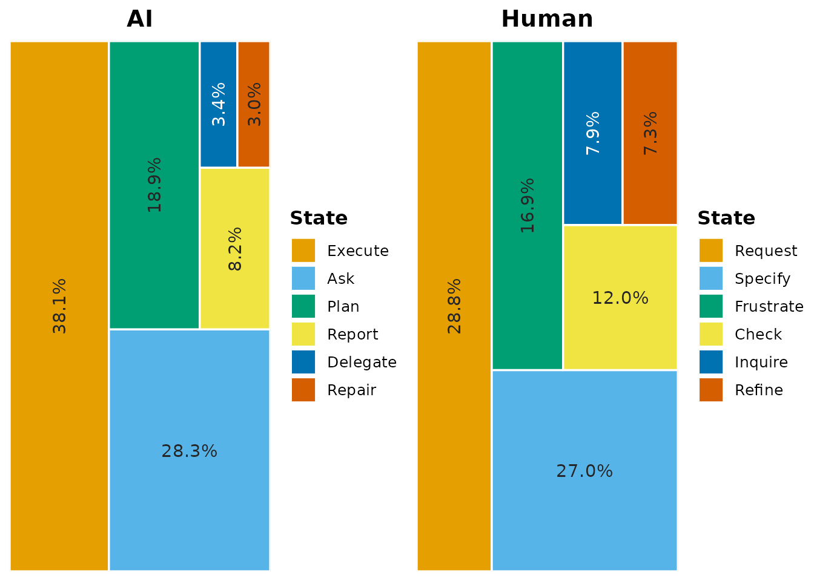
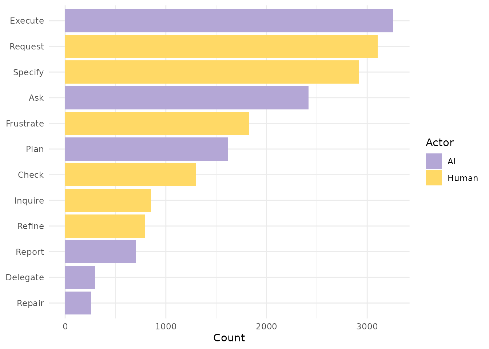
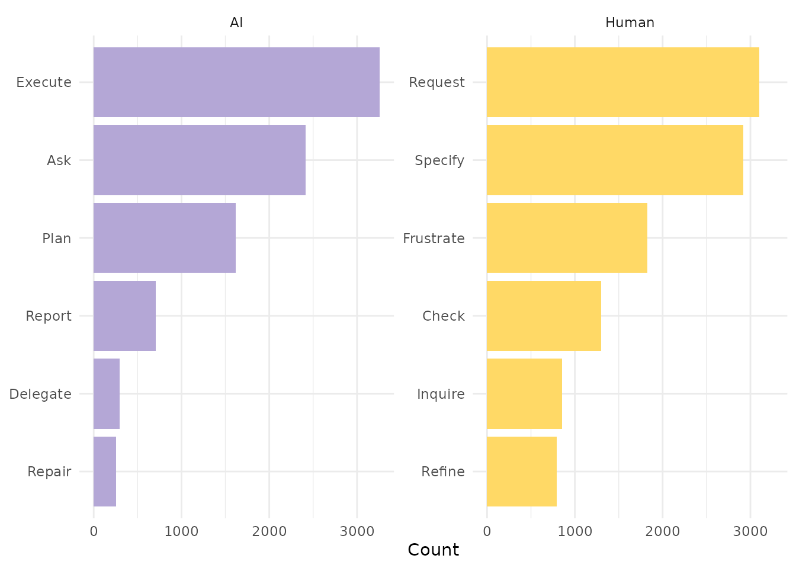
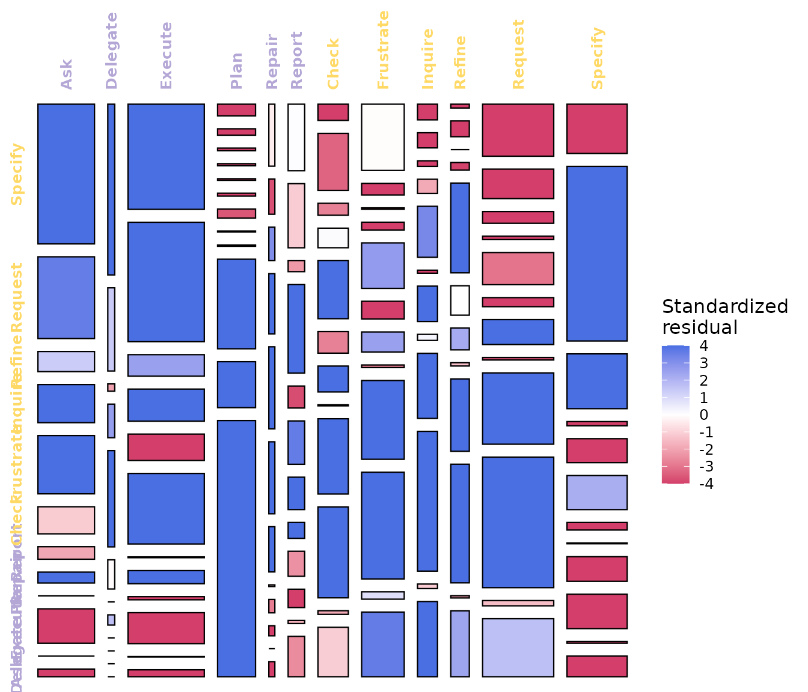

# Frequencies and mosaic plots

A transition network describes how the actors move between codes, but
not how often each code occurs in the first place. The two kinds of
information are read together. A transition out of a rare code can carry
a high probability on a handful of events, and a code that dominates one
actor’s activity shapes the edges of the whole network. In a
heterogeneous network the frequencies have a further role: they show how
each actor divides its activity over its own codes, which is the first
description of the division of labor between a human and an AI.

This guide covers two summaries that precede and accompany the network.
The frequency tables and plots give the distribution of the codes within
each actor and over the whole interaction. The mosaic plot gives the
joint distribution of consecutive codes, with each cell shaded by how
far its count departs from the count expected if the next code did not
depend on the current one.

``` r

library(htna)
```

## Data

`human_ai` holds 429 sessions of human-AI pair programming; each row is
one coded event.

- **Session**: `session_id`.
- **Code**: `code`; six human and six AI codes.
- **Actor type**: `actor_type`, `"Human"` or `"AI"`.
- **Order**: `order_in_session`.

The frequency summaries use the relative network. The mosaic tests
counts, so it needs the network of transition counts
(`method = "frequency"`).

``` r

data(human_ai)
net <- build_htna(human_ai, actor_type = "actor_type")
net_counts <- build_htna(human_ai, actor_type = "actor_type",
                         method = "frequency")
```

## How does each actor divide its activity?

[`frequencies_htna()`](https://sonsoles.me/htna/reference/frequencies_htna.md)
counts every code and reports it under its actor, with its share of that
actor’s events. The shares sum to one within each actor.

``` r

frequencies_htna(net)
#>    group     state count proportion
#> 1     AI   Execute  3258     0.3810
#> 2  Human   Request  3104     0.2875
#> 3  Human   Specify  2920     0.2705
#> 4     AI       Ask  2416     0.2825
#> 5  Human Frustrate  1829     0.1694
#> 6     AI      Plan  1620     0.1895
#> 7  Human     Check  1298     0.1202
#> 8  Human   Inquire   853     0.0790
#> 9  Human    Refine   792     0.0734
#> 10    AI    Report   705     0.0824
#> 11    AI  Delegate   295     0.0345
#> 12    AI    Repair   257     0.0301
```

The AI’s activity is concentrated: executions are 38.1% of its events
and asks 28.3%, while delegations (3.45%) and repairs (3.01%) are rare.
The human’s activity is spread over requests (28.8%), specifications
(27.1%) and expressions of frustration (16.9%). Edges out of `Delegate`
and `Repair` rest on fewer than 300 events each and have wider intervals
than edges out of `Execute` (see [Model
assessment](https://sonsoles.me/htna/articles/model-assessment.md)).

The treemap shows the same table, one panel per actor, with each tile’s
area proportional to the code’s share of its actor.

``` r

plot_frequencies_htna(net)
```



## Which codes dominate the interaction as a whole?

[`state_frequencies_htna()`](https://sonsoles.me/htna/reference/state_frequencies_htna.md)
gives the pooled table: each code’s share of all events, whichever actor
produced it.

``` r

state_frequencies_htna(net)
#>        state count proportion
#> 1    Execute  3258     0.1684
#> 2    Request  3104     0.1604
#> 3    Specify  2920     0.1509
#> 4        Ask  2416     0.1249
#> 5  Frustrate  1829     0.0945
#> 6       Plan  1620     0.0837
#> 7      Check  1298     0.0671
#> 8    Inquire   853     0.0441
#> 9     Refine   792     0.0409
#> 10    Report   705     0.0364
#> 11  Delegate   295     0.0152
#> 12    Repair   257     0.0133
```

Pooled over both actors, the AI’s executions (16.8% of all events) and
the human’s requests (16.0%) and specifications (15.1%) together make up
almost half of the interaction. The bar view puts both actors on one
axis, sorted by count and coloured by actor, for this comparison across
actors.

``` r

plot_frequencies_htna(net, view = "bars")
```



Because the two actors produce different numbers of events, the faceted
view, with a separate axis per actor, is the better display when the
question is the profile within each actor.

``` r

plot_frequencies_htna(net, view = "facet")
```



## Which transitions occur more often than chance?

[`mosaic_plot_htna()`](https://sonsoles.me/htna/reference/mosaic_plot_htna.md)
draws the table of consecutive codes, source codes in columns and target
codes stacked within them. The width of a column is the share of
transitions from that code and the height of a tile the share of its
target, so the area of a tile is the share of that transition. Each tile
is shaded by its standardised residual against independence of source
and target: blue tiles are transitions that occur more often than
independence predicts, red tiles less often. The residuals are estimated
by permutation (500 permutations by default), which needs no
large-sample approximation; `residuals = "asymptotic"` gives the
closed-form chi-square residuals instead. The axis labels are coloured
by actor. Clipping the colour scale to plus or minus 4 keeps a few
extreme cells from washing out the rest.

``` r

mosaic_plot_htna(net_counts, range = c(-4, 4), seed = 1L)
```



The mosaic is the cell-level counterpart of the turn-taking templates of
the [Sequences and
patterns](https://sonsoles.me/htna/articles/sequences-and-patterns.md)
guide, where handovers between the actors occur 1.22 to 1.28 times as
often as independence predicts; here each tile shows which specific pair
of codes carries that excess. Reading the network together with the
mosaic distinguishes a strong edge that is strong because its target is
common from one that is strong because the source specifically leads to
it.

## Which summary to use

| Question | Function |
|----|----|
| How does each actor divide its activity over its codes? | [`frequencies_htna()`](https://sonsoles.me/htna/reference/frequencies_htna.md), [`plot_frequencies_htna()`](https://sonsoles.me/htna/reference/plot_frequencies_htna.md) |
| Which codes dominate the whole interaction? | [`state_frequencies_htna()`](https://sonsoles.me/htna/reference/state_frequencies_htna.md), `plot_frequencies_htna(view = "bars")` |
| Within-actor profiles when the actors differ in volume | `plot_frequencies_htna(view = "facet")` |
| Which consecutive pairs occur more or less often than chance? | [`mosaic_plot_htna()`](https://sonsoles.me/htna/reference/mosaic_plot_htna.md) on a frequency network |
