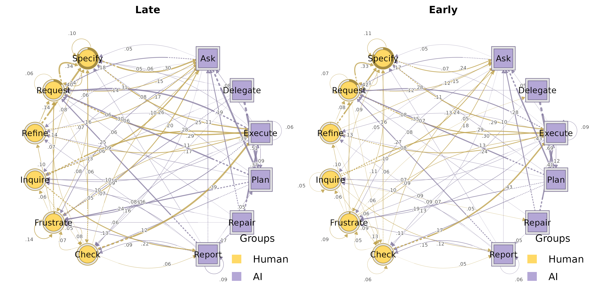
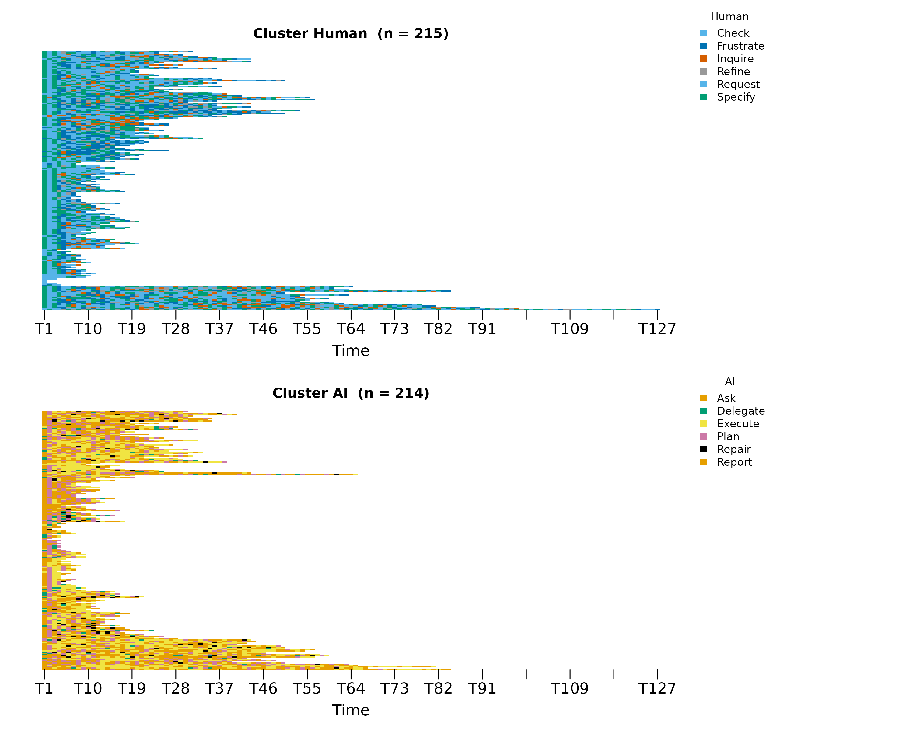
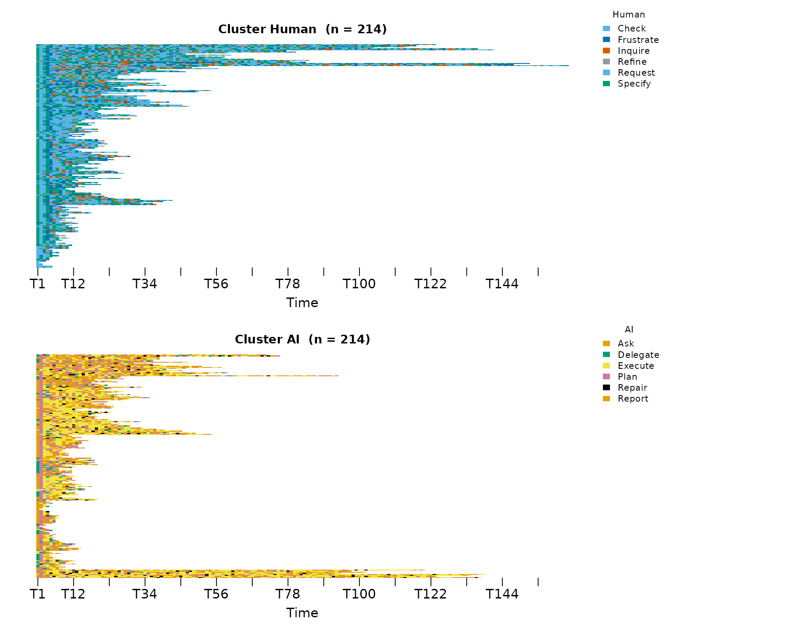
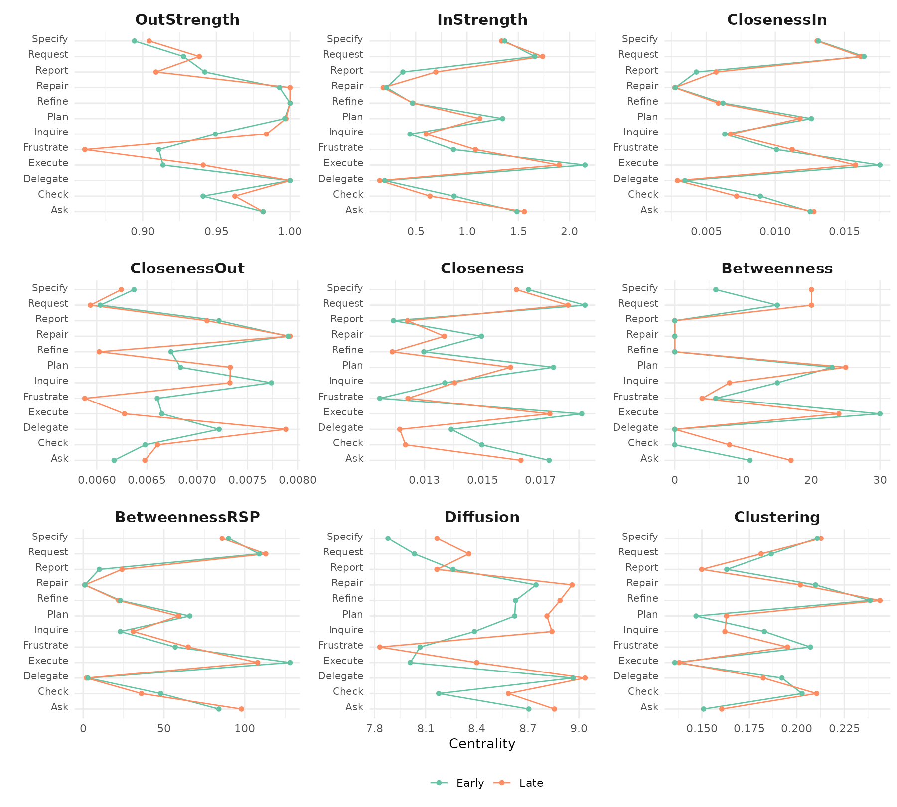
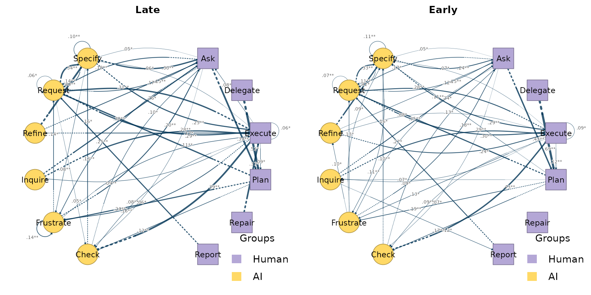
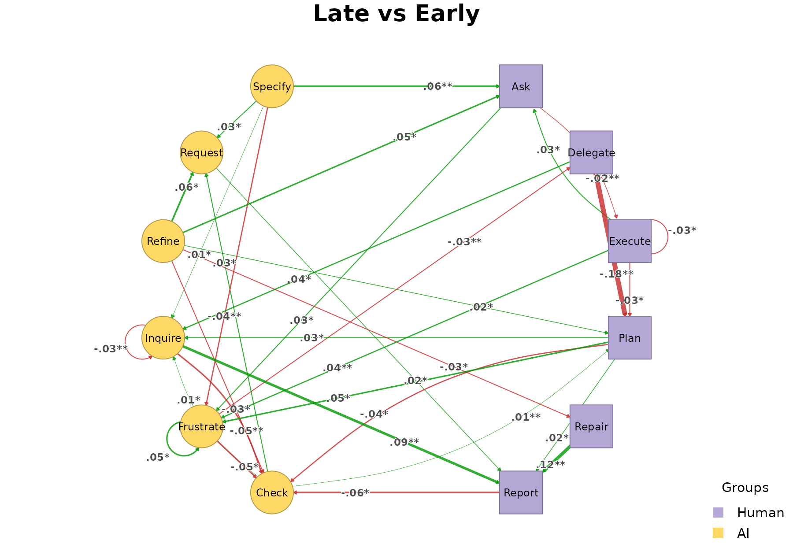
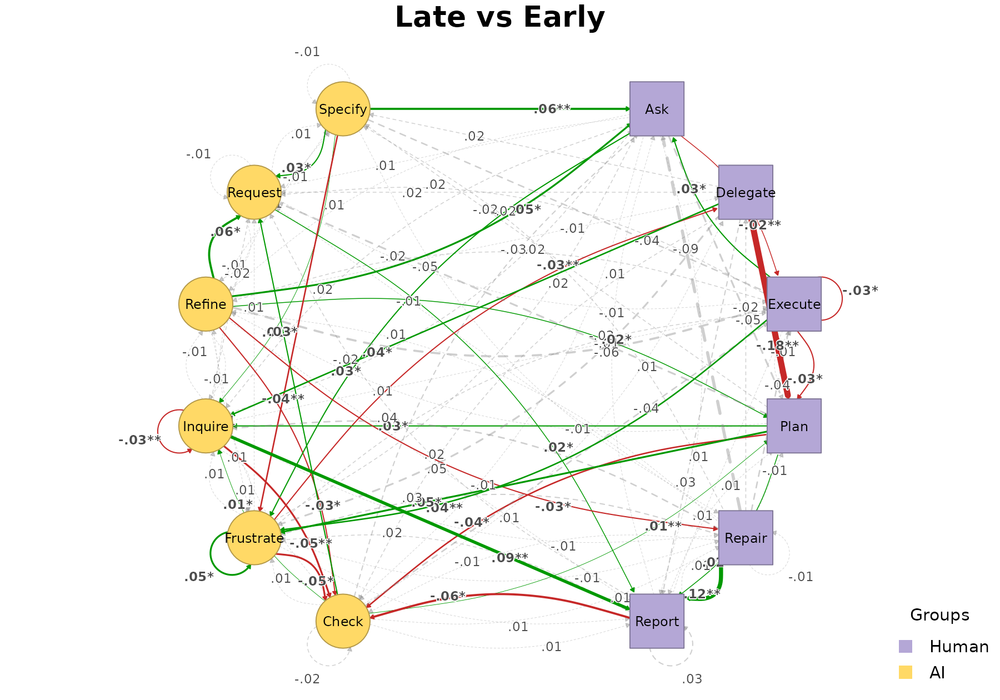

# Grouped HTNA

A common HTNA question is whether the same actor partition behaves
*differently* across cohorts – e.g. early-phase versus late-phase
sessions of an interaction corpus; control vs. experimental groups;
female vs. male, etc.
[`build_htna()`](https://sonsoles.me/htna/reference/build_htna.md)
supports this directly by passing the session-level grouping column to
the function. The result is **one network per cohort**, each preserving
the actor partition. Every other function in `htna` recognises the
grouped result and iterates over cohorts.

## An early / late example

We use the bundled `human_ai` corpus (Human + AI codes from
[`Nestimate::human_long`](https://pak.dynasite.org/Nestimate/reference/long-data.html)
/ `ai_long`, with a slightly simplified alphabet – see
[`?human_ai`](https://sonsoles.me/htna/reference/human_ai.md)). Sessions
are split chronologically: ordered by their first `session_date` (with
`session_id` as a deterministic tiebreak), the first half of the
sessions form the *Early* cohort and the rest form the *Late* cohort,
reflected in the `phase` column. The count below is the number of coded
events (rows) in each cohort:

``` r

library(htna)
data(human_ai)
xtabs(~ phase, data = human_ai)
#> phase
#> Early  Late 
#> 10170  9177
```

## Building one network per cohort

[`build_htna()`](https://sonsoles.me/htna/reference/build_htna.md) takes
the long data frame, the actor-type column, and a `group` argument
naming the session-level cohort column:

``` r

grp <- build_htna(
  human_ai,
  actor_type = "actor_type",
  group      = "phase"
)
names(grp)
#> [1] "Late"  "Early"
```

The result is a named list of HTNA networks of class `htna_group`, one
per cohort. [`summary()`](https://rdrr.io/r/base/summary.html) describes
every cohort in turn: its actor partition, how the non-zero edges
distribute across the actor blocks, and the network-level metrics.

``` r

summary(grp)
#> <htna_group: 2 cohorts (Late, Early)>
#> 
#> === Late ===
#> <htna network>
#>   Method:    relative
#>   Sessions:  215   (max 208 timesteps)
#>   Nodes:     12
#>   Edges:     134 / 144 (non-zero)
#> 
#> Actor types (2):
#>   Human (6 nodes):  Check, Frustrate, Inquire, Refine, Request, Specify
#>   AI    (6 nodes):  Ask, Delegate, Execute, Plan, Repair, Report
#> 
#> Edge counts by actor (rows = source, cols = target):
#>           Human    AI
#>   Human      35    36
#>   AI         36    27
#> 
#> Network metrics:
#>                       metric        value
#>                   Node Count 1.200000e+01
#>                   Edge Count 1.340000e+02
#>              Network Density 1.000000e+00
#>                Mean Distance 2.438201e-02
#>            Mean Out-Strength 1.000000e+00
#>              SD Out-Strength 6.109845e-01
#>             Mean In-Strength 1.000000e+00
#>               SD In-Strength 3.347448e-17
#>              Mean Out-Degree 1.116667e+01
#>                SD Out-Degree 9.374369e-01
#>  Centralization (Out-Degree) 5.785124e-02
#>   Centralization (In-Degree) 5.785124e-02
#>                  Reciprocity 9.600000e-01
#> 
#> === Early ===
#> <htna network>
#>   Method:    relative
#>   Sessions:  214   (max 287 timesteps)
#>   Nodes:     12
#>   Edges:     135 / 144 (non-zero)
#> 
#> Actor types (2):
#>   Human (6 nodes):  Check, Frustrate, Inquire, Refine, Request, Specify
#>   AI    (6 nodes):  Ask, Delegate, Execute, Plan, Repair, Report
#> 
#> Edge counts by actor (rows = source, cols = target):
#>           Human    AI
#>   Human      35    36
#>   AI         36    28
#> 
#> Network metrics:
#>                       metric        value
#>                   Node Count  12.00000000
#>                   Edge Count 135.00000000
#>              Network Density   1.00000000
#>                Mean Distance   0.02704448
#>            Mean Out-Strength   1.00000000
#>              SD Out-Strength   0.65969479
#>             Mean In-Strength   1.00000000
#>               SD In-Strength   0.00000000
#>              Mean Out-Degree  11.25000000
#>                SD Out-Degree   0.96530730
#>  Centralization (Out-Degree)   0.05785124
#>   Centralization (In-Degree)   0.05785124
#>                  Reciprocity   0.96000000
```

Because both cohorts were built from the same alphabet, both networks
have the **same nodes** – which is what
[`permutation_htna()`](https://sonsoles.me/htna/reference/permutation_htna.md)
and
[`plot_htna_diff()`](https://sonsoles.me/htna/reference/plot_htna_diff.md)
compare edge by edge.

## Plotting per cohort

[`plot_htna()`](https://sonsoles.me/htna/reference/plot_htna.md)
iterates over cohorts and draws one network per element. It does not
manage the layout grid – wrap with `par(mfrow = ...)` if you want a
panel:

``` r

op <- par(mfrow = c(1, 2))
plot_htna(grp)
```



``` r

par(op)
```

## Per-actor sequences per cohort

[`sequence_plot_htna()`](https://sonsoles.me/htna/reference/sequence_plot_htna.md)
works the same way:

``` r

sequence_plot_htna(grp,   type = "index")
```



## Centralities per cohort

`centralities_htna(grp)` returns one tidy data frame, with a leading
`group` column identifying the cohort:

``` r

ct <- centralities_htna(grp)
head(ct, 10)
#>    group      node actor OutStrength InStrength ClosenessIn ClosenessOut
#> 1   Late       Ask    AI   0.9818031  1.5589461 0.012787860  0.006478909
#> 2   Late     Check Human   0.9626168  0.6386122 0.007197319  0.006605395
#> 3   Late  Delegate    AI   1.0000000  0.1490735 0.002917657  0.007882479
#> 4   Late   Execute    AI   0.9411332  1.8979808 0.015804367  0.006276049
#> 5   Late Frustrate Human   0.8607443  1.0820451 0.011215144  0.005880667
#> 6   Late   Inquire Human   0.9839817  0.6005806 0.006753107  0.007325994
#> 7   Late      Plan    AI   0.9972028  1.1252050 0.011785910  0.007330088
#> 8   Late    Refine Human   1.0000000  0.4740402 0.005877737  0.006024616
#> 9   Late    Repair    AI   1.0000000  0.1826564 0.002721100  0.007924645
#> 10  Late    Report    AI   0.9090909  0.6955351 0.005709637  0.007097699
#>     Closeness Betweenness BetweennessRSP Diffusion Clustering
#> 1  0.01632119          17             98  8.856237  0.1604590
#> 2  0.01234619           8             36  8.586347  0.2104778
#> 3  0.01214724           0              2  9.035552  0.1823412
#> 4  0.01731834          24            108  8.400011  0.1380461
#> 5  0.01243172           4             65  7.830994  0.1951504
#> 6  0.01403984           8             31  8.842141  0.1621084
#> 7  0.01596275          25             59  8.812412  0.1629786
#> 8  0.01188981           0             22  8.889109  0.2437973
#> 9  0.01368159           0              1  8.960075  0.2019068
#> 10 0.01241482           0             24  8.166331  0.1499067
```

[`plot_centralities()`](https://sonsoles.me/htna/reference/plot_centralities.md)
draws one panel per measure and overlays one line-and-point profile per
cohort, so cohort-level differences on each measure read along the same
node axis:

``` r

plot_centralities(grp, by = "group")
```



## Bootstrap per cohort

`bootstrap_htna(grp)` runs the bootstrap on each cohort and returns a
group of bootstrap results.
[`plot_htna_bootstrap()`](https://sonsoles.me/htna/reference/plot_htna_bootstrap.md)
iterates again:

``` r

boots <- bootstrap_htna(grp, iter = 200)
op <- par(mfrow = c(1, 2))
plot_htna_bootstrap(boots, display = "significant")
```



``` r

par(op)
```

## Centrality stability per cohort

`centrality_stability_htna(grp)` runs the case-dropping centrality
stability check on each cohort and returns a named list of
`htna_stability` objects. Each cohort’s `cs` reports the largest
session-drop proportion at which `InStrength`, `OutStrength`, and
`Betweenness` still correlate with the originals at the default 0.7 /
0.95 threshold:

``` r

stab <- centrality_stability_htna(grp, iter = 100, seed = 1)
stab
#> HTNA Centrality Stability Analysis (Grouped)
#> ============================================
#> 
#> --- Group: Late ---
#> HTNA Centrality Stability Analysis
#> ===================================
#> Centrality Stability (100 iterations, threshold = 0.7)
#>   Drop proportions: 0.1, 0.2, 0.3, 0.4, 0.5, 0.6, 0.7, 0.8, 0.9
#> 
#>   CS-coefficients:
#>     InStrength       0.90
#>     OutStrength      0.90
#>     Betweenness      0.80
#> 
#> --- Group: Early ---
#> HTNA Centrality Stability Analysis
#> ===================================
#> Centrality Stability (100 iterations, threshold = 0.7)
#>   Drop proportions: 0.1, 0.2, 0.3, 0.4, 0.5, 0.6, 0.7, 0.8, 0.9
#> 
#>   CS-coefficients:
#>     InStrength       0.90
#>     OutStrength      0.80
#>     Betweenness      0.80
```

The report lists the CS-coefficient of each measure within each cohort.
By the Epskamp et al. (2018) convention, CS \> 0.25 is acceptable and CS
\> 0.5 is preferred for inferential use; the maximum reportable value is
the upper bound of the drop-proportion grid. A cohort comparison of
centralities is only meaningful for measures that are stable in *both*
cohorts.

## Comparing the two cohorts

Both networks share an alphabet, so their edges can be compared one by
one. Pass the grouped network as it is to
[`permutation_htna()`](https://sonsoles.me/htna/reference/permutation_htna.md):
it tests every cohort pair and returns one result per pair, named
`"<first> vs <second>"`.
[`plot_htna_diff()`](https://sonsoles.me/htna/reference/plot_htna_diff.md)
draws each pair as the difference network *first minus second*, titled
with the pair name; positive differences are green, negative red, and
only the edges that differ significantly are drawn:

``` r

perm <- permutation_htna(grp, iter = 500, seed = 1)
plot_htna_diff(perm)
```



With `show_nonsig = TRUE` the non-significant differences are added as
dashed grey edges, so the full difference network is visible together
with the significance verdict:

``` r

plot_htna_diff(perm, show_nonsig = TRUE)
```



## Cohort-level pattern comparison

[`permutation_htna()`](https://sonsoles.me/htna/reference/permutation_htna.md)
tests edge-level differences between cohorts. For *pattern*-level
differences — recurring k-grams that characterise one cohort over the
other — see the [sequence comparison
vignette](https://sonsoles.me/htna/articles/sequence-comparison.md). The
same grouped network feeds directly into
[`sequence_compare_htna()`](https://sonsoles.me/htna/reference/sequence_compare_htna.md),
which also supports a `level = "type"` option that runs the comparison
on meta-paths (e.g. `Human -> AI -> Human`) rather than concrete state
codes.

## Working with the grouped object

Pass the result of `build_htna(..., group = ...)` as it is to the
functions above; each one iterates over the cohorts (or, for
[`permutation_htna()`](https://sonsoles.me/htna/reference/permutation_htna.md),
[`bayes_compare_htna()`](https://sonsoles.me/htna/reference/bayes_compare_htna.md)
and
[`compare_htna()`](https://sonsoles.me/htna/reference/compare_htna.md),
over the cohort pairs) and labels its output with the cohort names.
There is no need to extract cohorts by hand. To analyse a single cohort
on its own, build it directly from that cohort’s sessions, e.g.
`build_htna(subset(human_ai, phase == "Early"), actor_type = "actor_type")`,
which yields the same network as the `Early` element of `grp`.
