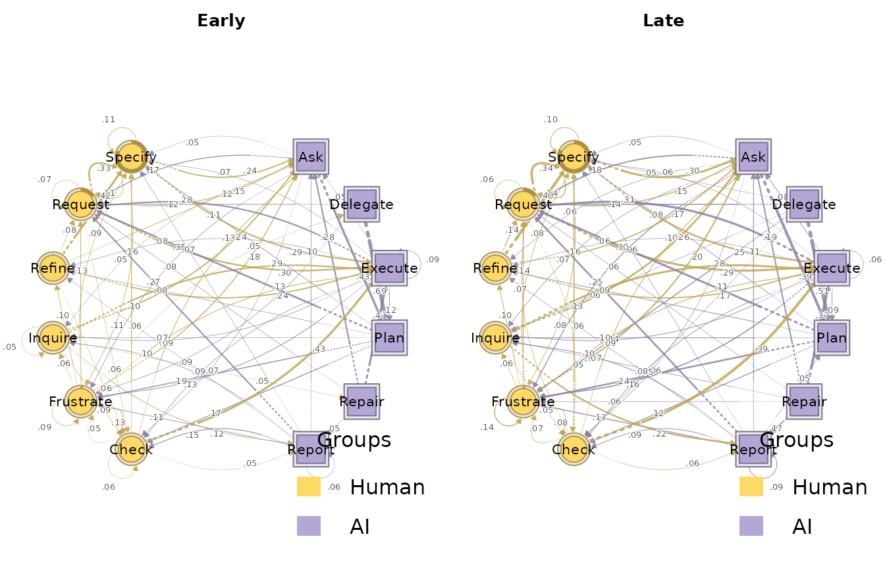
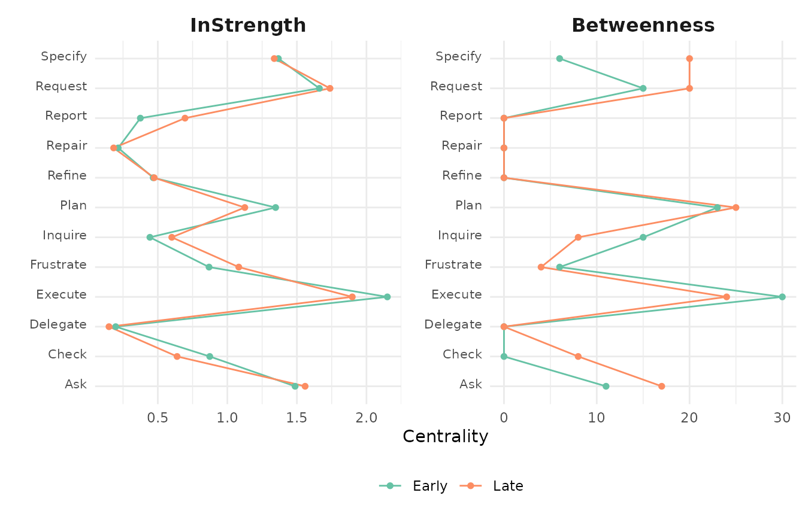
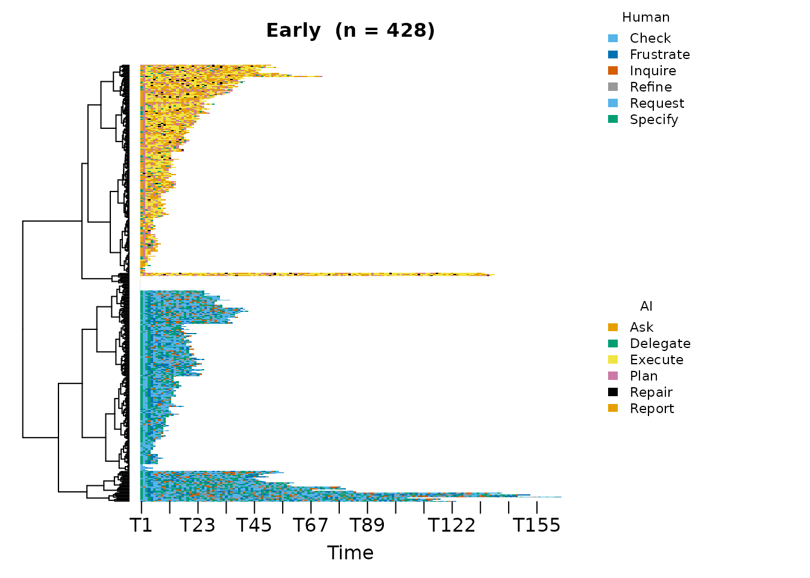
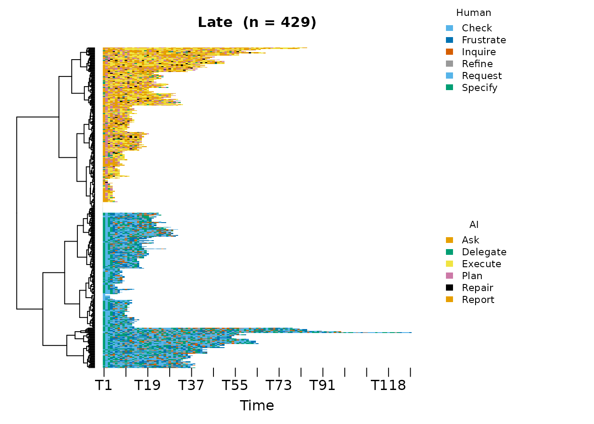
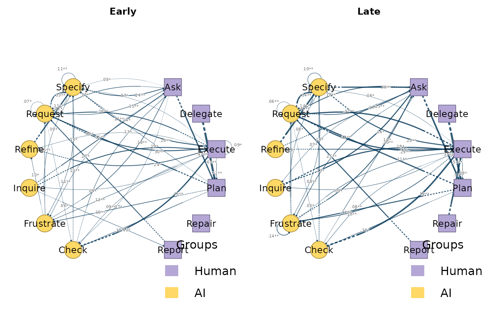
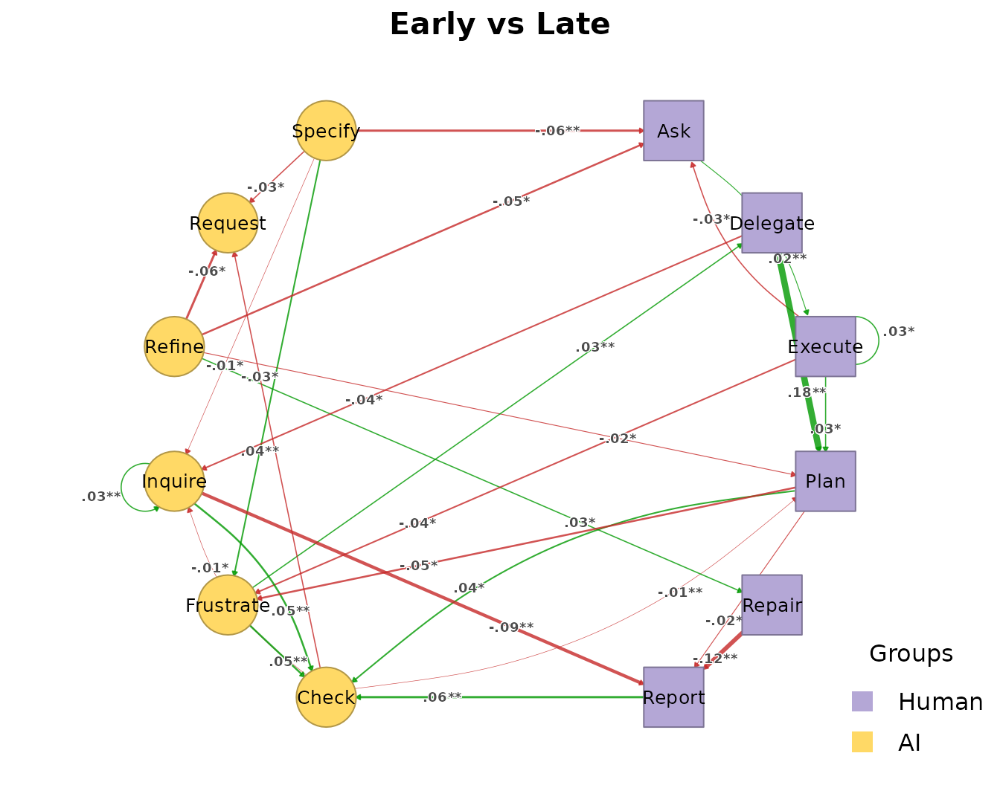

# Grouped heterogeneous transition networks

Many questions about interactions between actors are comparative. Does
the way students work with an AI assistant change over a course? Do
teams in an experimental condition hand work to the AI differently from
teams in a control condition? Answering them requires one heterogeneous
transition network per group of sessions, estimated over the same codes
and the same actor partition so that the networks can be set side by
side, described with the same measures and assessed with the same
procedures.

A grouped heterogeneous transition network is such a set: one network
per cohort, each built from the sessions of that cohort, all sharing the
actor types.
[`build_htna()`](https://sonsoles.me/htna/reference/build_htna.md)
creates it from a session-level grouping column, and the other functions
of the package accept the grouped network as it is and work cohort by
cohort (or, for comparisons, pair by pair). This vignette builds,
describes and assesses a grouped network of early and late sessions; the
comparison of networks is treated in depth in the guide [Comparing
networks](https://sonsoles.me/htna/articles/comparing-networks.html).

``` r

library(htna)
```

## Data

`human_ai` holds the coded turns of 429 sessions in which programmers
worked with an AI coding agent. The variables used here are:

- **Session and order:** `session_id`, `order_in_session`.
- **Code and actor type:** `code` (six human and six AI codes) and
  `actor_type` (`"Human"`, `"AI"`).
- **Cohort:** `phase`, a factor with levels `Early` and `Late`: the
  sessions ordered by their first date and split in half.

``` r

xtabs(~ phase, data = unique(subset(human_ai, select = c(session_id, phase))))
#> phase
#> Early  Late 
#>   214   215
xtabs(~ phase, data = human_ai)
#> phase
#> Early  Late 
#> 10170  9177
```

The early cohort has 214 sessions with 10,170 coded events and the late
cohort 215 sessions with 9,177 events.

## One network per cohort

Passing the name of the cohort column as `group` gives one network per
cohort, in the order of the factor levels.

``` r

grp <- build_htna(human_ai, actor_type = "actor_type", group = "phase")
grp
#> Group Networks (2 groups)
#> 
#>   Group  Nodes  Edges  Weights
#>   Early  12     135    [0.001, 0.689]
#>   Late   12     134    [0.001, 0.508]
```

``` r

as.data.frame(summary(grp), what = "actor_pairs")
#>   group source_actor target_actor n_edges
#> 1 Early        Human        Human      35
#> 2 Early        Human           AI      36
#> 3 Early           AI        Human      36
#> 4 Early           AI           AI      28
#> 5  Late        Human        Human      35
#> 6  Late        Human           AI      36
#> 7  Late           AI        Human      36
#> 8  Late           AI           AI      27
```

Both cohorts use all twelve codes, and their non-zero edges fall in the
actor-pair blocks in almost the same way: the only difference is one AI
to AI transition that occurs in the early sessions (28 edges) but not in
the late ones (27). The cohorts differ, if at all, in the weights of the
transitions rather than in which transitions occur.

## The networks side by side

[`plot_htna()`](https://sonsoles.me/htna/reference/plot_htna.md) draws
one network per cohort, titled with its name, with the same layout and
colours.

``` r

op <- par(mfrow = c(1, 2))
plot_htna(grp)
```



``` r

par(op)
```

## Centralities per cohort

The centralities of a grouped network come in one table with a `group`
column.

``` r

centralities_htna(grp, measures = c("InStrength", "Betweenness"))
#>    group      node actor InStrength Betweenness
#> 1  Early       Ask    AI      1.487          11
#> 2  Early     Check Human      0.873           0
#> 3  Early  Delegate    AI      0.197           0
#> 4  Early   Execute    AI      2.150          30
#> 5  Early Frustrate Human      0.868           6
#> 6  Early   Inquire Human      0.443          15
#> 7  Early      Plan    AI      1.347          23
#> 8  Early    Refine Human      0.467           0
#> 9  Early    Repair    AI      0.215           0
#> 10 Early    Report    AI      0.375           0
#> 11 Early   Request Human      1.662          15
#> 12 Early   Specify Human      1.367           6
#> 13  Late       Ask    AI      1.559          17
#> 14  Late     Check Human      0.639           8
#> 15  Late  Delegate    AI      0.149           0
#> 16  Late   Execute    AI      1.898          24
#> 17  Late Frustrate Human      1.082           4
#> 18  Late   Inquire Human      0.601           8
#> 19  Late      Plan    AI      1.125          25
#> 20  Late    Refine Human      0.474           0
#> 21  Late    Repair    AI      0.183           0
#> 22  Late    Report    AI      0.696           0
#> 23  Late   Request Human      1.738          20
#> 24  Late   Specify Human      1.337          20
```

`Execute` is the code with the most incoming weight in both cohorts, but
its in-strength falls from 2.15 to 1.90. The human `Frustrate` gains
incoming weight (0.87 to 1.08), as does the AI `Report` (0.38 to 0.70),
while the human `Check` loses it (0.87 to 0.64). The profile plot shows
the two cohorts on the same axis.

``` r

plot_centralities(grp, measures = c("InStrength", "Betweenness"))
```



## The sessions of each cohort

A sequence plot per cohort shows the sessions themselves, one row per
session and actor, coloured by code.

``` r

sequence_plot_htna(grp, type = "heatmap")
```



## Assessing each cohort

Each cohort is estimated from about half of the sessions, so its edges
are less certain than those of the pooled network. The bootstrap of a
grouped network resamples the sessions of each cohort separately.

``` r

boots <- bootstrap_htna(grp, iter = 100, seed = 1)
boots
#> HTNA bootstrap, 2 cohorts
#> 
#> --- Early ---
#>   Edge                   Mean     95% CI          p
#>   -----------------------------------------------
#>   Delegate → Plan        0.689  [0.624, 0.781]  ** 
#>   Ask → Plan             0.435  [0.398, 0.472]  ** 
#>   Check → Execute        0.430  [0.387, 0.470]  ** 
#>   Refine → Specify       0.418  [0.342, 0.508]  *  
#>   Plan → Request         0.344  [0.301, 0.377]  ** 
#>   ... and 36 more significant edges
#> 
#> Bootstrap Network  [Transition Network (relative) | directed]
#>   Iterations : 100  |  Nodes : 12
#>   Edges      : 41 significant / 135 total
#>   CI         : 95%  |  Inference: stability  |  CR [0.75, 1.25]
#> 
#> --- Late ---
#>   Edge                   Mean     95% CI          p
#>   -----------------------------------------------
#>   Delegate → Plan        0.518  [0.419, 0.604]  ** 
#>   Refine → Specify       0.412  [0.355, 0.461]  ** 
#>   Ask → Plan             0.385  [0.351, 0.427]  ** 
#>   Check → Execute        0.384  [0.334, 0.422]  ** 
#>   Repair → Execute       0.370  [0.302, 0.446]  *  
#>   ... and 34 more significant edges
#> 
#> Bootstrap Network  [Transition Network (relative) | directed]
#>   Iterations : 100  |  Nodes : 12
#>   Edges      : 39 significant / 134 total
#>   CI         : 95%  |  Inference: stability  |  CR [0.75, 1.25]
```

With 100 resamples, 41 of the 135 early edges and 39 of the 134 late
edges are reproduced within the consistency range. The strongest edge in
both cohorts, `Delegate` to `Plan`, has a mean weight of 0.689 in the
early sessions and 0.518 in the late ones, with intervals (0.624 to
0.781 and 0.419 to 0.604) that do not overlap. `summary(boots)` returns
the edges of both cohorts in one table. The plots keep only the
significant edges.

``` r

op <- par(mfrow = c(1, 2))
plot_htna_bootstrap(boots, display = "significant")
```



``` r

par(op)
```

Centrality stability is computed per cohort in the same way.

``` r

stab <- centrality_stability_htna(grp, iter = 100, seed = 1)
as.data.frame(stab)
#>   group     measure  cs
#> 1 Early  InStrength 0.9
#> 2 Early OutStrength 0.8
#> 3 Early Betweenness 0.8
#> 4  Late  InStrength 0.9
#> 5  Late OutStrength 0.9
#> 6  Late Betweenness 0.8
```

Every coefficient is 0.8 or 0.9, above the recommended 0.5 (Epskamp,
Borsboom, & Fried, 2018), so the centralities of each cohort can be
interpreted and compared.

## A first comparison

The descriptive comparison summarizes how the cohorts differ, overall
and within each actor-pair block.

``` r

compare_htna(grp)
#> HTNA network comparisons: 1 cohort pair
#> 
#> --- Early vs Late ---
#>   Pearson correlation of edge weights: 0.959
#>   Mean absolute difference:            0.0192
#>  source target cells changed mean_diff mean_abs_diff max_abs_diff
#>   Human  Human    36      35   0.00168        0.0159       0.0631
#>   Human     AI    36      36  -0.00168        0.0179       0.0922
#>      AI  Human    36      36  -0.00622        0.0216       0.0571
#>      AI     AI    36      28   0.00622        0.0212       0.1810
```

The edge weights of the two cohorts correlate at 0.959 and differ by
0.019 on average. The largest single difference, 0.181, lies in the
AI-to-AI block. A permutation test asks which differences exceed what
reshuffling the sessions between the cohorts produces.

``` r

perm <- permutation_htna(grp, iter = 200, seed = 1)
perm
#> Grouped Permutation Test
#> Groups: Early vs Late 
#> 
#> -- Early vs Late --
#> Permutation Test: Transition Network (relative probabilities) [directed]
#>   Iterations: 200  |  Alpha: 0.05
#>   Nodes: 12  |  Edges tested: 135  |  Significant: 28
#>   Global test (networks differ overall?): M = 2.760 (p = 0.00498)  |  S = 0.181 (p = 0.0199)
```

With 200 permutations, 28 of the 135 edges differ significantly, and the
global test rejects equal networks (p = 0.005 for the sum of absolute
differences). The difference network draws the significant edges, green
where the early cohort is higher and red where the late cohort is.

``` r

plot_htna_diff(perm)
```



The guide [Comparing
networks](https://sonsoles.me/htna/articles/comparing-networks.html)
adds the Bayesian comparison and the full comparison tables, and the
case study [early and late sessions of vibe
coding](https://sonsoles.me/htna/articles/case-early-late.html)
interprets the differences.

## Working with the grouped object

Every function of the package accepts the grouped network as it is:
[`summary()`](https://rdrr.io/r/base/summary.html),
[`plot_htna()`](https://sonsoles.me/htna/reference/plot_htna.md),
[`centralities_htna()`](https://sonsoles.me/htna/reference/centralities_htna.md),
[`sequence_plot_htna()`](https://sonsoles.me/htna/reference/sequence_plot_htna.md),
[`bootstrap_htna()`](https://sonsoles.me/htna/reference/bootstrap_htna.md),
[`centrality_stability_htna()`](https://sonsoles.me/htna/reference/centrality_stability_htna.md)
and
[`casedrop_reliability_htna()`](https://sonsoles.me/htna/reference/casedrop_reliability_htna.md)
work cohort by cohort;
[`compare_htna()`](https://sonsoles.me/htna/reference/compare_htna.md),
[`permutation_htna()`](https://sonsoles.me/htna/reference/permutation_htna.md),
[`bayes_compare_htna()`](https://sonsoles.me/htna/reference/bayes_compare_htna.md)
and
[`sequence_compare_htna()`](https://sonsoles.me/htna/reference/sequence_compare_htna.md)
work on the pairs of cohorts. A single cohort is analyzed on its own by
building it from its sessions, for example
`build_htna(subset(human_ai, phase == "Early"), actor_type = "actor_type")`.

## References

Epskamp, S., Borsboom, D., & Fried, E. I. (2018). Estimating
psychological networks and their accuracy: A tutorial paper. *Behavior
Research Methods*, *50*(1), 195–212.
<https://doi.org/10.3758/s13428-017-0862-1>
