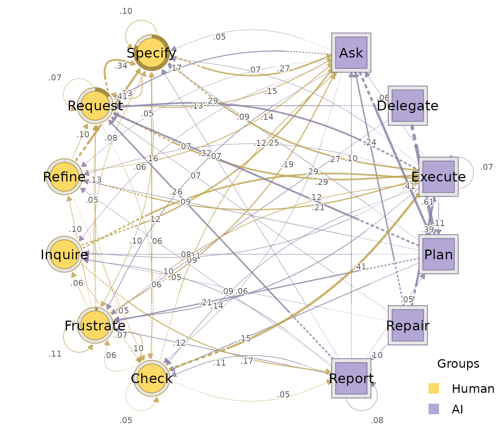
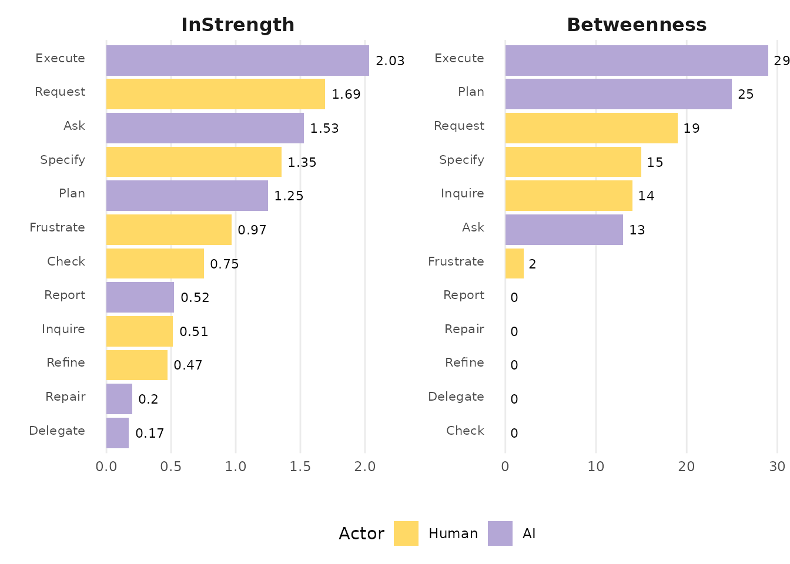
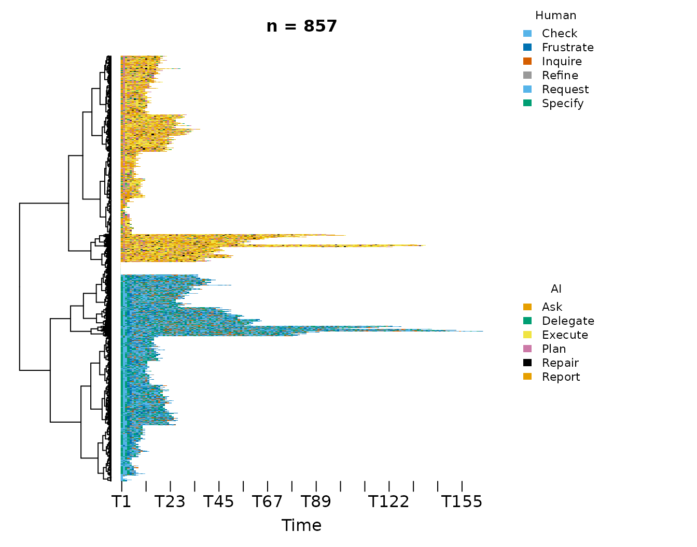
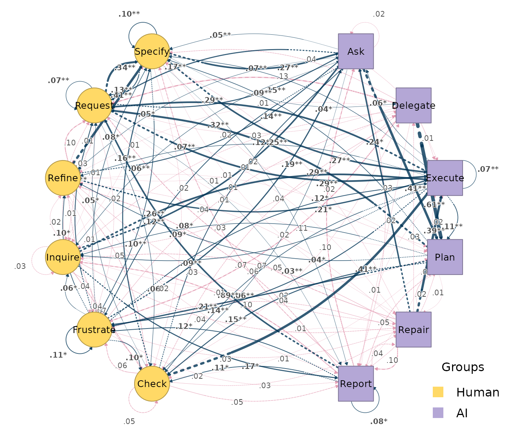

# Heterogeneous transition network analysis

Many interactions in education and work are carried out by actors of
different kinds: a learner and a tutor, a student and a generative AI
assistant, a programmer and a coding agent. A record of such an
interaction is a sequence of coded events in which the actors take
turns, and the questions it raises concern both what each actor does and
how the actors respond to each other. Transition network analysis (TNA)
models a sequence of events as a network whose nodes are the codes and
whose weighted, directed edges are the probabilities of moving from one
code to the next. Applied to a mixed sequence, ordinary TNA treats all
codes alike and loses the information that some codes belong to one
actor and some to another.

Heterogeneous transition network analysis (HTNA) keeps that information.
Each code is assigned to one actor type, the network is estimated over
the interleaved sequence so that transitions within and between actors
are counted from the same events, and the actor partition is carried
through every subsequent step: the layout and colours of the plot, the
summaries of transitions within and between actors, and the patterns of
turn-taking (López-Pernas, Misiejuk, & Saqr, 2026). This vignette sets
out the formulation and follows one analysis from data to assessed
conclusions.

``` r

library(htna)
```

## The model

A session is a sequence of coded events $`c_1, c_2, \ldots, c_T`$, and
every code $`i`$ belongs to exactly one actor type $`a(i)`$, for example
Human or AI. Counting, over all sessions, how often code $`i`$ is
directly followed by code $`j`$ gives the counts $`n_{ij}`$. The
relative transition network has the weights

``` math
w_{ij} = \frac{n_{ij}}{\sum_k n_{ik}},
```

the estimated probability that an event coded $`i`$ is followed by an
event coded $`j`$. The actor partition divides the weight matrix $`W`$
into blocks $`W_{AB}`$, holding the transitions from codes of actor
$`A`$ to codes of actor $`B`$. The diagonal blocks ($`A = B`$) describe
how an actor continues its own turn, and the off-diagonal blocks
describe the handovers between actors. Because each row of $`W`$ sums to
one, the row sum of code $`i`$ within block $`W_{AB}`$,
$`\sum_{j:\,a(j) = B} w_{ij}`$, is the probability that an event coded
$`i`$ is followed by an event of actor $`B`$. A meta-path is the
sequence of actor types that a path of codes passes through, such as
Human $`\to`$ AI $`\to`$ Human.

## Data

`human_ai` holds the coded turns of 429 sessions in which programmers
worked with an AI coding agent (“vibe coding”), from 34 projects. Each
row is one coded event; a message can carry several codes.

- **Session:** `session_id` identifies the sequence; transitions are
  counted within sessions.
- **Order:** `order_in_session` orders the events within a session.
- **Code:** `code` is the event code, six for the human (`Check`,
  `Frustrate`, `Inquire`, `Refine`, `Request`, `Specify`) and six for
  the AI (`Ask`, `Delegate`, `Execute`, `Plan`, `Repair`, `Report`).
- **Actor type:** `actor_type` (`"Human"` or `"AI"`) assigns each event
  to its actor.
- **Phase:** `phase` (`Early`, `Late`) splits the sessions
  chronologically in half; it is used in the grouped vignette.

``` r

with(human_ai, table(actor_type))
#> actor_type
#>    AI Human 
#>  8551 10796
```

The 19,347 events consist of 10,796 human and 8,551 AI events.

## Building the network

The network is estimated with
[`build_htna()`](https://sonsoles.me/htna/reference/build_htna.md),
which takes the data and the name of the column that assigns each event
to its actor.

``` r

net <- build_htna(human_ai, actor_type = "actor_type")
summary(net)
#> <htna network>
#>   Method:    relative
#>   Sessions:  429   (max 287 timesteps)
#>   Nodes:     12
#>   Edges:     135 / 144 (non-zero)
#> 
#> Actor types (2):
#>   Human (6 nodes):  Check, Frustrate, Inquire, Refine, Request, Specify
#>   AI    (6 nodes):  Ask, Delegate, Execute, Plan, Repair, Report
#> 
#> Edge counts by actor (rows = source, cols = target):
#>           Human    AI
#>   Human      35    36
#>   AI         36    28
#> 
#> Network metrics:
#>                       metric    value
#>                   Node Count  12.0000
#>                   Edge Count 135.0000
#>              Network Density   1.0000
#>                Mean Distance   0.0274
#>            Mean Out-Strength   1.0000
#>              SD Out-Strength   0.0000
#>             Mean In-Strength   1.0000
#>               SD In-Strength   0.6309
#>              Mean Out-Degree  11.2500
#>                SD Out-Degree   0.9653
#>  Centralization (Out-Degree)   0.0579
#>   Centralization (In-Degree)   0.0579
#>                  Reciprocity   0.9600
```

The network has 12 nodes, six per actor, and 135 of its 144 possible
edges are non-zero. Within the human codes 35 of the 36 possible
transitions occur, and in each between-actor block all 36. The AI block
is the sparsest, with 28 non-zero edges: some AI codes rarely follow one
another directly.

## How the actors hand over

The edge table lists every non-zero transition with the actor types of
its source and target, so that within-actor transitions and handovers
can be read side by side.

``` r

head(as.data.frame(net))
#>   from        to weight source_actor target_actor
#> 1  Ask       Ask 0.0182           AI           AI
#> 2  Ask     Check 0.0632           AI        Human
#> 3  Ask   Execute 0.0221           AI           AI
#> 4  Ask Frustrate 0.1158           AI        Human
#> 5  Ask   Inquire 0.0632           AI        Human
#> 6  Ask      Plan 0.4088           AI           AI
```

Each row is one edge; for example, an AI `Ask` is followed by a human
`Frustrate` with probability 0.116 and by an AI `Plan` with probability
0.409. The counts per actor-pair block summarize the same table.

``` r

as.data.frame(summary(net), what = "actor_pairs")
#>   source_actor target_actor n_edges
#> 1        Human        Human      35
#> 2        Human           AI      36
#> 3           AI        Human      36
#> 4           AI           AI      28
```

## The network plot

[`plot_htna()`](https://sonsoles.me/htna/reference/plot_htna.md) draws
the network with the codes of each actor on their own arc, in the
actor’s colour and shape; edges below 0.05 are not drawn.

``` r

plot_htna(net)
```



Edge width is proportional to the weight, and only the 73 edges with a
weight of at least 0.05 are drawn (the same edges that the pruning step
below keeps), so the plot shows the transitions that carry the
interaction.

## Which codes are central

Centralities rank the codes by their position in the network.
In-strength is the total transition weight flowing into a code,
out-strength the weight leaving it, and betweenness the number of
shortest paths through it.

``` r

centralities_htna(net, measures = c("InStrength", "OutStrength",
                                    "Betweenness"))
#>         node actor InStrength OutStrength Betweenness
#> 1        Ask    AI      1.527       0.982          13
#> 2      Check Human      0.752       0.950           0
#> 3   Delegate    AI      0.174       1.000           0
#> 4    Execute    AI      2.034       0.926          29
#> 5  Frustrate Human      0.967       0.886           2
#> 6    Inquire Human      0.515       0.967          14
#> 7       Plan    AI      1.250       0.997          25
#> 8     Refine Human      0.470       1.000           0
#> 9     Repair    AI      0.200       0.996           0
#> 10    Report    AI      0.525       0.923           0
#> 11   Request Human      1.693       0.933          19
#> 12   Specify Human      1.353       0.899          15
```

`Execute` receives the most transition weight (in-strength 2.03) and
lies on the most shortest paths (betweenness 29), followed on
in-strength by the human `Request` (1.69). The out-strengths are all
close to one because each row of a relative network sums to one, less
any self-transition. The interaction is organized around the
request-and-execute exchange.

``` r

plot_centralities(net, measures = c("InStrength", "Betweenness"),
                  by = "group")
```



## Focusing on the strong transitions

Pruning sets weak edges aside so that the structure carried by the
strong transitions can be read.

``` r

pruned <- prune_htna(net, threshold = 0.05)
as.data.frame(summary(pruned), what = "actor_pairs")
#>   source_actor target_actor n_edges
#> 1        Human        Human      19
#> 2        Human           AI      14
#> 3           AI        Human      27
#> 4           AI           AI      13
```

At a threshold of 0.05, 73 edges remain. The AI-to-human block keeps 27
of its 36 edges, more than any other block, while the AI-to-AI block
keeps 13: after an AI action the next event is most often a human one.

## Turn-taking patterns

Meta-paths describe the order in which the actors take turns, regardless
of the specific codes.

``` r

extract_meta_paths(net, level = "type", length = 3)
#> Meta-paths (type-level) over 429 sequences
#> Rows: 8 | Lengths: 3 | Gaps: 0
#>               schema length gap count n_seq support frequency lift
#>     Human->AI->Human      3   0  3593   402   0.937     0.194 1.41
#>     Human->Human->AI      3   0  3172   422   0.984     0.172 1.25
#>     AI->Human->Human      3   0  2828   403   0.939     0.153 1.11
#>        AI->Human->AI      3   0  2744   383   0.893     0.148 1.36
#>        Human->AI->AI      3   0  2189   403   0.939     0.118 1.09
#>        AI->AI->Human      3   0  2100   397   0.925     0.114 1.04
#>  Human->Human->Human      3   0  1472   396   0.923     0.080 0.46
#>           AI->AI->AI      3   0   392   165   0.385     0.021 0.25
```

The alternating meta-path Human $`\to`$ AI $`\to`$ Human is the most
frequent (3,593 occurrences in 402 sessions) and occurs 1.41 times as
often as the frequencies of the two actors would predict. Runs within
one actor are rare by the same standard: three consecutive human events
have a lift of 0.46 and three AI events of 0.25. The interaction is a
dialogue of short turns.

A schema lists the concrete paths behind one meta-path.

``` r

print(extract_meta_paths(net, schema = "Human->AI->Human"), n = 5)
#> State-level instances of schema 'Human->AI->Human' over 429 sequences
#> Rows: 163 | Lengths: 3 | Gaps: 0
#>                     schema      meta_schema length gap count n_seq support frequency lift
#>  Request->Execute->Request Human->AI->Human      3   0   401   194   0.452     0.112 5.00
#>  Specify->Execute->Request Human->AI->Human      3   0   176   107   0.249     0.049 2.33
#>      Request->Ask->Request Human->AI->Human      3   0   130    91   0.212     0.036 2.19
#>    Check->Execute->Request Human->AI->Human      3   0   123    96   0.224     0.034 3.67
#>      Specify->Ask->Request Human->AI->Human      3   0   120    84   0.196     0.033 2.15
#> ... (158 more)
```

The most frequent is a request, an AI execution and a further request
(401 occurrences in 194 sessions, five times as often as expected), the
iterative loop of directing the agent.

## The sessions over time

The network pools the transitions of all sessions and positions. A
sequence plot shows the sessions themselves, one row per session and
actor, with each cell coloured by its code.

``` r

sequence_plot_htna(net, type = "heatmap")
```



## How certain are the edges

The bootstrap resamples the sessions and re-estimates the network to
show which edge weights the data determine precisely.

``` r

boot <- bootstrap_htna(net, iter = 100, seed = 1)
boot
#>   Edge                   Mean     95% CI          p
#>   -----------------------------------------------
#>   Delegate → Plan        0.609  [0.541, 0.670]  ** 
#>   Refine → Specify       0.412  [0.360, 0.468]  ** 
#>   Ask → Plan             0.411  [0.384, 0.437]  ** 
#>   Check → Execute        0.411  [0.382, 0.444]  ** 
#>   Repair → Execute       0.389  [0.333, 0.454]  ** 
#>   ... and 55 more significant edges
#> 
#> Bootstrap Network  [Transition Network (relative) | directed]
#>   Iterations : 100  |  Nodes : 12
#>   Edges      : 60 significant / 135 total
#>   CI         : 95%  |  Inference: stability  |  CR [0.75, 1.25]
```

With 100 resamples, 60 of the 135 edges are reproduced within the
consistency range and marked significant; the strongest, `Delegate` to
`Plan`, has a mean weight of 0.609 with a 95% interval from 0.541 to
0.670. A real analysis would use the default 1,000 resamples. The plot
draws the non-significant edges dashed.

``` r

plot_htna_bootstrap(boot)
```



## Are the conclusions stable

Two checks ask whether the conclusions depend on the particular sessions
observed. Centrality stability drops increasing shares of the sessions
and correlates the centralities with those of the full network (Epskamp,
Borsboom, & Fried, 2018).

``` r

cs <- centrality_stability_htna(net, iter = 100, seed = 1)
as.data.frame(cs)
#>       measure  cs
#> 1  InStrength 0.9
#> 2 OutStrength 0.9
#> 3 Betweenness 0.9
```

All three measures keep a correlation above 0.7 until 90% of the
sessions are dropped (CS coefficient 0.90), well above the recommended
0.5, so the centrality ranking can be reported. Split-half reliability
estimates the network from two random halves of the sessions and
compares them.

``` r

rel <- reliability_htna(net, iter = 100, seed = 1)
summary(rel)
#>      model     metric   mean       sd
#> 1 relative   mean_dev 0.0125 0.001146
#> 2 relative median_dev 0.0075 0.000883
#> 3 relative        cor 0.9820 0.004916
#> 4 relative    max_dev 0.0982 0.031284
```

The edge weights of the two halves correlate at 0.982 on average and
differ by 0.0125 on average, so the estimated structure does not depend
on which sessions happened to be observed.

## Further reading

- [Grouped heterogeneous transition
  networks](https://sonsoles.me/htna/articles/grouped.html): one network
  per cohort.
- [Input formats](https://sonsoles.me/htna/articles/input-formats.html),
  [Comparing
  networks](https://sonsoles.me/htna/articles/comparing-networks.html),
  [Model
  assessment](https://sonsoles.me/htna/articles/model-assessment.html),
  [Markov-order
  adequacy](https://sonsoles.me/htna/articles/markov-order.html),
  [Sequences and
  patterns](https://sonsoles.me/htna/articles/sequences-and-patterns.html),
  [Frequencies and mosaic
  plots](https://sonsoles.me/htna/articles/frequencies-and-mosaic.html),
  [Clustering inputs](https://sonsoles.me/htna/articles/clustering.html)
  and [Three or more actor
  groups](https://sonsoles.me/htna/articles/multigroup.html).
- Case studies: [early and late sessions of vibe
  coding](https://sonsoles.me/htna/articles/case-early-late.html) and
  [help-seeking in vibe
  coding](https://sonsoles.me/htna/articles/case-vibe-coding.html).

## References

Epskamp, S., Borsboom, D., & Fried, E. I. (2018). Estimating
psychological networks and their accuracy: A tutorial paper. *Behavior
Research Methods*, *50*(1), 195–212.
<https://doi.org/10.3758/s13428-017-0862-1>

López-Pernas, S., Misiejuk, K., & Saqr, M. (2026). How AI-generated
feedback hinders or helps learning: A heterogeneous TNA study of
learning dynamics. *Journal of Computer Assisted Learning*, *42*(4),
e70285. <https://doi.org/10.1002/jcal.70285>
