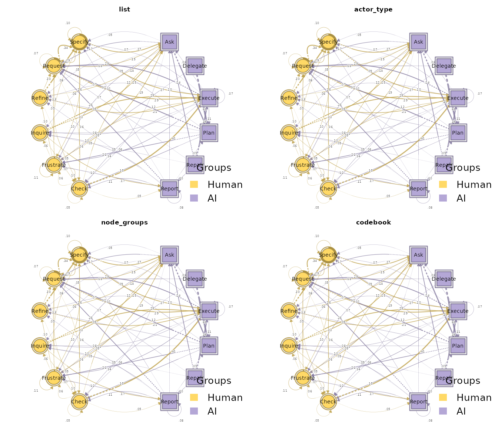
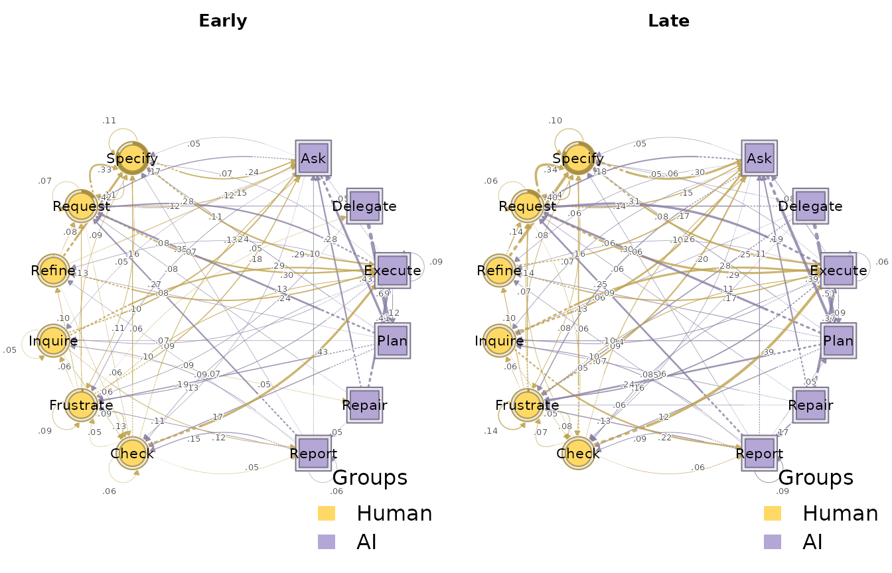

# Input formats

A heterogeneous transition network needs two pieces of information that
ordinary event logs store in different ways: the order of the coded
events within each session, and the actor type that owns each code. Some
studies keep one table per actor, because the two streams were coded
separately (the messages of a learner and the replies of a chatbot, for
example); others keep one table of all events with a column naming the
actor; and others keep the events in one table and the coding scheme,
which assigns every code to an actor, in a codebook. The analysis should
not depend on which of these layouts the data happen to arrive in.

[`build_htna()`](https://sonsoles.me/htna/reference/build_htna.md)
accepts all three layouts and resolves them to the same interleaved
sequence per session, so the resulting networks are identical. This
guide shows each layout on the bundled data, verifies that they give the
same network, and then covers two arguments that work with any layout:
`disambiguate`, for a code label used by more than one actor, and
`group`, for one network per cohort of sessions. Fitted clustering
results are a fourth kind of input, covered in [Clustering
inputs](https://sonsoles.me/htna/articles/clustering.md).

``` r

library(htna)
```

## Data

The package ships the same vibe-coding sessions (429 sessions of
human-AI pair programming) in the three layouts.

- **`human_simplified`, `ai_simplified`**: one long table per actor;
  each row is one coded event of that actor.
- **`human_ai`**: both tables stacked, with the actor in `actor_type`
  (`"Human"` or `"AI"`) and a session-level cohort tag `phase`
  (`"Early"`, `"Late"`).
- **`human_ai_codebook`**: the coding scheme, one row per code, with
  columns `code` and `actor_type`.

All tables share the columns
[`build_htna()`](https://sonsoles.me/htna/reference/build_htna.md) reads
by default:

- **Session**: `session_id` (argument `session`).
- **Code**: `code` (argument `action`).
- **Order**: `order_in_session` (argument `order`), a time index shared
  by both actors within a session, so the two streams interleave in the
  order in which the events happened.

``` r

data(human_ai, human_simplified, ai_simplified, human_ai_codebook)
human_ai_codebook
#>         code actor_type
#> 1    Specify      Human
#> 2    Request      Human
#> 3  Frustrate      Human
#> 4      Check      Human
#> 5    Inquire      Human
#> 6     Refine      Human
#> 7   Delegate         AI
#> 8       Plan         AI
#> 9    Execute         AI
#> 10       Ask         AI
#> 11    Repair         AI
#> 12    Report         AI
```

The codebook assigns six codes to each actor: the human specifies,
requests, checks, inquires, refines and expresses frustration; the AI
delegates, plans, executes, asks, repairs and reports.

## One table per actor

When each actor’s events are in a separate table, the tables are passed
as a named list. The names become the actor types, in the order given.

``` r

net_list <- build_htna(list(Human = human_simplified, AI = ai_simplified))
summary(net_list)
#> <htna network>
#>   Method:    relative
#>   Sessions:  429   (max 287 timesteps)
#>   Nodes:     12
#>   Edges:     135 / 144 (non-zero)
#> 
#> Actor types (2):
#>   Human (6 nodes):  Check, Frustrate, Inquire, Refine, Request, Specify
#>   AI    (6 nodes):  Ask, Delegate, Execute, Plan, Repair, Report
#> 
#> Edge counts by actor (rows = source, cols = target):
#>           Human    AI
#>   Human      35    36
#>   AI         36    28
#> 
#> Network metrics:
#>                       metric    value
#>                   Node Count  12.0000
#>                   Edge Count 135.0000
#>              Network Density   1.0000
#>                Mean Distance   0.0274
#>            Mean Out-Strength   1.0000
#>              SD Out-Strength   0.0000
#>             Mean In-Strength   1.0000
#>               SD In-Strength   0.6309
#>              Mean Out-Degree  11.2500
#>                SD Out-Degree   0.9653
#>  Centralization (Out-Degree)   0.0579
#>   Centralization (In-Degree)   0.0579
#>                  Reciprocity   0.9600
```

The network has 12 nodes, six per actor, built from 429 sessions. Of the
144 possible directed edges 135 are non-zero, and the edge counts by
actor show that transitions occur in every block: 35 within the human
codes, 36 from human to AI, 36 from AI to human and 28 within the AI
codes.

## One table with an actor column

When all events are in one table, the column that names the actor of
each row is passed as `actor_type`. The actor order follows the levels
of that column if it is a factor, and the order of first appearance
otherwise.

``` r

net_actor_type <- build_htna(human_ai, actor_type = "actor_type")
```

## One table and a codebook

When the event table has no actor column, the assignment of codes to
actors is declared with `node_groups`, either as a named list of codes
or as a two-column codebook whose code column is named like `action`
(here `code`).

``` r

net_codes <- build_htna(
  human_ai,
  node_groups = list(
    Human = c("Specify", "Request", "Frustrate", "Check", "Inquire", "Refine"),
    AI    = c("Delegate", "Plan", "Execute", "Ask", "Repair", "Report")
  )
)
net_codebook <- build_htna(human_ai, node_groups = human_ai_codebook)
```

A code in the data that is missing from `node_groups`, or listed under
two actors, raises an error, so the declared scheme is checked against
the data.

## Do the layouts give the same network?

The edge table of a network
([`as.data.frame()`](https://rdrr.io/r/base/as.data.frame.html)) lists
every non-zero transition with its weight and the actors of its two
codes. If the four networks agree, their edge tables are equal.

``` r

edges_list <- as.data.frame(net_list)
all.equal(edges_list, as.data.frame(net_actor_type))
#> [1] TRUE
all.equal(edges_list, as.data.frame(net_codes))
#> [1] TRUE
all.equal(edges_list, as.data.frame(net_codebook))
#> [1] TRUE
```

All three comparisons return `TRUE`: the 135 edges, their weights and
their actor assignments are the same whichever layout the data came in.
The choice of layout is therefore a matter of how the data are stored,
not of the analysis. A named list of networks is drawn one network per
element:

``` r

op <- par(mfrow = c(2, 2), mar = c(1, 1, 3, 1))
plot_htna(list(list = net_list, actor_type = net_actor_type,
               node_groups = net_codes, codebook = net_codebook))
```



``` r

par(op)
```

The four panels are indistinguishable, as the edge tables predicted.

## What if two actors use the same code label?

Some coding schemes give the same label to a move of either actor, for
example `Ask` for a question from the human and a clarification request
from the AI. Such codes are different behaviours, and merging them into
one node would mix the two actors.
[`build_htna()`](https://sonsoles.me/htna/reference/build_htna.md)
therefore stops when a label occurs under more than one actor. The small
table below has `Ask` and `Reply` for both actors in each of three
sessions.

``` r

overlap <- data.frame(
  session_id       = rep(c("s1", "s2", "s3"), each = 6),
  code             = rep(c("Ask", "Reply", "Ask", "Reply", "Ask", "Reply"), 3),
  actor_type       = rep(c("Human", "Human", "AI", "AI", "Human", "AI"), 3),
  order_in_session = rep(seq_len(6), 3)
)
```

Building the network as usual raises an error of class
`htna_actor_conflict` that names the shared labels.

``` r

build_htna(overlap, actor_type = "actor_type")
#> Error:
#> ! Code(s) appear in more than one actor group: Ask, Reply. Pass `disambiguate = TRUE` to prefix codes with the actor label.
```

With `disambiguate = TRUE` every code is prefixed with its actor, so the
two `Ask` codes become the separate nodes `Human:Ask` and `AI:Ask`.

``` r

net_dis <- build_htna(overlap, actor_type = "actor_type",
                      disambiguate = TRUE)
as.data.frame(net_dis, what = "nodes")
#>          node actor
#> 1      AI:Ask    AI
#> 2    AI:Reply    AI
#> 3   Human:Ask Human
#> 4 Human:Reply Human
```

The network has four nodes, two per actor, and each keeps its actor
type.

## How is one network built per cohort?

Any layout can be split into one network per cohort of sessions with
`group`, which names a session-level column. `human_ai` has the column
`phase`, which places the first 214 sessions in chronological order in
`Early` and the remaining 215 in `Late`. The result is a grouped network
(an `htna_group`) whose cohorts follow the factor levels of `phase`.

``` r

grp <- build_htna(human_ai, actor_type = "actor_type", group = "phase")
as.data.frame(summary(grp), what = "actor_pairs")
#>   group source_actor target_actor n_edges
#> 1 Early        Human        Human      35
#> 2 Early        Human           AI      36
#> 3 Early           AI        Human      36
#> 4 Early           AI           AI      28
#> 5  Late        Human        Human      35
#> 6  Late        Human           AI      36
#> 7  Late           AI        Human      36
#> 8  Late           AI           AI      27
```

Both cohorts have the same actor partition; the early network has 28
non-zero AI-to-AI edges and the late network 27, and the other blocks
have the same counts in both. A grouped network is passed as it is to
the other functions
([`plot_htna()`](https://sonsoles.me/htna/reference/plot_htna.md),
[`bootstrap_htna()`](https://sonsoles.me/htna/reference/bootstrap_htna.md),
[`permutation_htna()`](https://sonsoles.me/htna/reference/permutation_htna.md),
[`compare_htna()`](https://sonsoles.me/htna/reference/compare_htna.md)
and the rest), which work through its cohorts. The [Grouped
heterogeneous transition
networks](https://sonsoles.me/htna/articles/grouped.md) vignette and the
[Comparing
networks](https://sonsoles.me/htna/articles/comparing-networks.md) guide
continue from here.

``` r

op <- par(mfrow = c(1, 2), mar = c(1, 1, 3, 1))
plot_htna(grp)
```



``` r

par(op)
```

## Which layout to use

| Data at hand | Call |
|----|----|
| One table per actor | `build_htna(list(Human = h, AI = a))` |
| One table with an actor column | `build_htna(d, actor_type = "actor_type")` |
| One table and a codebook | `build_htna(d, node_groups = codebook)` |
| One table and code lists | `build_htna(d, node_groups = list(Human = ..., AI = ...))` |
| A fitted clustering of sessions | `build_htna(fit)`; see [Clustering inputs](https://sonsoles.me/htna/articles/clustering.md) |
| A label shared by two actors | add `disambiguate = TRUE` |
| One network per cohort | add `group = "phase"` |
