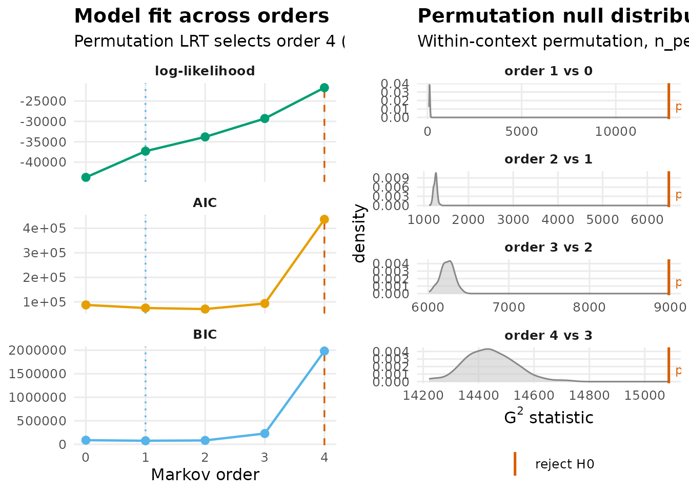

# Markov-order adequacy

A transition network is a first-order Markov model: the probability of
the next code is assumed to depend only on the current code, not on the
codes before it. The assumption reduces a session to a square matrix of
transition probabilities and makes the whole network analysis possible
(Saqr et al., 2025), but it is an empirical claim about the data. When
the next move of a programmer depends on the last two exchanges with the
assistant rather than on the last one, a first-order network averages
over that memory and represents the process as more random than it is.

The Markov-order test fits Markov models of increasing order to the
session sequences and tests whether each step up in order improves the
fit more than expected under the lower order. The likelihood-ratio
statistic of each step is judged against a permutation null, and the
information criteria AIC and BIC are reported for every order. In a
heterogeneous network the question has a second dimension. The order of
the combined sequence describes the joint human-AI process, while the
order of each actor’s own events describes that actor’s process. When
the combined process needs a higher order than either actor alone, the
memory lies in the coupling between the actors, in how a reply depends
on the exchange that led to it.

``` r

library(htna)
```

## Data

The test is applied to three sets of sequences from the 429 vibe-coding
sessions.

- **Human events**: `human_simplified`, the human codes of each session
  in their order (six codes).
- **AI events**: `ai_simplified`, the AI codes of each session in their
  order (six codes).
- **Combined**: `human_ai`, the interleaved human and AI events of each
  session, as stored on the htna network (twelve codes).

All three tables have the session in `session_id`, the code in `code`
and the order in `order_in_session`. The per-actor sequences are
single-actor networks, built with
[`Nestimate::build_network()`](https://pak.dynasite.org/Nestimate/reference/build_network.html);
the combined sequence is the htna network.

``` r

data(human_ai, human_simplified, ai_simplified)
human_net <- Nestimate::build_network(human_simplified, method = "relative",
                                      action = "code", session = "session_id",
                                      order = "order_in_session")
ai_net <- Nestimate::build_network(ai_simplified, method = "relative",
                                   action = "code", session = "session_id",
                                   order = "order_in_session")
net <- build_htna(human_ai, actor_type = "actor_type")
```

## Does the human’s next move depend on more than the current one?

[`markov_order_test_htna()`](https://sonsoles.me/htna/reference/markov_order_test_htna.md)
tests orders 1 to `max_order` in turn. Order 0 is the model in which
codes occur independently of what came before. With `n_perm = 200`, the
smallest attainable p-value is 1/201 = 0.00498.

``` r

mo_human <- markov_order_test_htna(human_net, max_order = 4L, n_perm = 200L,
                                   seed = 1L)
mo_human
#> Markov Order Test  [within-w permutation, n_perm = 200, alpha = 0.050]
#>   425 sequences / 10792 observations / 6 states
#> 
#>   Selected order  BIC: 1   AIC: 2   permutation-LRT: 4
#> 
#>  order loglik   AIC   BIC   df   g2 p_permutation p_asymptotic significant
#>      0 -17913 35836 35873   NA   NA            NA           NA          NA
#>      1 -17269 34607 34862   25 1261       0.00498    2.21e-250        TRUE
#>      2 -16898 34226 35793  150  638       0.00498     1.78e-61        TRUE
#>      3 -16143 34875 44312  900 1461       0.00498     2.01e-29        TRUE
#>      4 -13757 43065 99718 4111 4630       0.00995     1.88e-08        TRUE
```

The test uses 425 of the human sequences (and, below, 425 AI and 428
combined sequences), with 10,792 human events. For the human events
every step up to order 4 is significant under the permutation test, so
the selected order saturates at the largest order tested. The
information criteria disagree with the test: AIC prefers order 2 and BIC
order 1. The reason is in the degrees of freedom: the step from order 3
to order 4 adds 4,111 parameters for 10,792 observations, so the
higher-order tables are sparse and the gain in likelihood is bought with
a large number of rarely observed contexts.

## Does the AI’s next move depend on more than the current one?

The same test on the AI events is directly comparable, since it uses the
same orders, permutations and seed.

``` r

mo_ai <- markov_order_test_htna(ai_net, max_order = 4L, n_perm = 200L,
                                seed = 1L)
mo_ai
#> Markov Order Test  [within-w permutation, n_perm = 200, alpha = 0.050]
#>   425 sequences / 8548 observations / 6 states
#> 
#>   Selected order  BIC: 1   AIC: 1   permutation-LRT: 3
#> 
#>  order loglik   AIC   BIC   df   g2 p_permutation p_asymptotic significant
#>      0 -12541 25092 25128   NA   NA            NA           NA          NA
#>      1 -11594 23258 23504   25 1852       0.00498     0.00e+00        TRUE
#>      2 -11421 23273 24789  150  317       0.00498     5.09e-14        TRUE
#>      3 -10996 24582 33716  675  837       0.00498     1.98e-05        TRUE
#>      4 -10036 35621 90462 1761 1886       0.19403     1.95e-02       FALSE
```

For the AI events the steps up to order 3 are significant and the step
to order 4 is not (p = 0.194), so the permutation test selects order 3.
Both AIC and BIC prefer order 1. The AI’s sequence of its own moves
therefore carries less memory than the human’s.

## Does the joint process depend on more than the current move?

The combined test treats the interleaved sequence as one process over
the twelve codes. Dependence in this view can come from within-actor
memory or from the coupling between actors that the per-actor tests
cannot see.

``` r

mo_combined <- markov_order_test_htna(net, max_order = 4L, n_perm = 200L,
                                      seed = 1L)
mo_combined
#> Markov Order Test  [within-w permutation, n_perm = 200, alpha = 0.050]
#>   428 sequences / 19346 observations / 12 states
#> 
#>   Selected order  BIC: 1   AIC: 2   permutation-LRT: 4
#> 
#>  order loglik    AIC     BIC    df    g2 p_permutation p_asymptotic significant
#>      0 -43742  87506   87592    NA    NA            NA           NA          NA
#>      1 -37316  74900   75955   121 12816       0.00498     0.00e+00        TRUE
#>      2 -33813  70683   82717  1272  6482       0.00498     0.00e+00        TRUE
#>      3 -29298  93262  229677  7242  8983       0.00498     1.53e-41        TRUE
#>      4 -21731 436236 1981849 16296 15087       0.00498     1.00e+00        TRUE
```

Every step is significant under the permutation test (order 4 selected),
AIC prefers order 2 and BIC order 1. At order 4 the model has 16,296
degrees of freedom for 19,346 observations; the asymptotic p-value of
that step is 1.00 while the permutation p-value is 0.00498, which shows
how far the chi-square approximation fails on such sparse tables and why
the permutation test is used.

``` r

plot(mo_combined)
```



The plot shows the log-likelihood and the information criteria of each
order beside the permutation null distributions of the test statistics.
In the table, the log-likelihood keeps rising with the order, while BIC
is lowest at order 1 (75,955) and AIC at order 2 (70,683).

## What do the three tests say together?

| Sequences    | Permutation        | AIC | BIC |
|--------------|--------------------|-----|-----|
| Human events | 4 (largest tested) | 2   | 1   |
| AI events    | 3                  | 1   | 1   |
| Combined     | 4 (largest tested) | 2   | 1   |

None of the three sets is first-order under the permutation test, and
the human events and the combined process show memory beyond the largest
order tested. The penalized criteria favor a first- or second-order
model in every case, because the higher-order contexts are too many to
be estimated from about 430 sequences. The first-order heterogeneous
network is therefore a simplification of these data: it describes the
aggregate transitions between codes and actors faithfully, but it does
not represent how a move depends on the exchange before it. Claims about
turn-taking that span several moves, such as a human request, an AI plan
and the following AI execution, are better examined with the patterns of
the [Sequences and
patterns](https://sonsoles.me/htna/articles/sequences-and-patterns.md)
guide than with single edges.

When the selected order equals `max_order`, the test has not found the
order of the process, only a lower bound for it; `max_order` can be
raised at the cost of still sparser tables. The number of parameters at
order *k* grows roughly as the number of codes to the power *k* + 1.

## What if the first-order assumption is rejected?

The first-order network remains a valid description of transition
frequencies; what changes is the claim it can support. Three
alternatives address different reasons for the rejection.

| Reason for the rejection | Model |
|----|----|
| The next code depends on several preceding codes | Higher-order networks: [`Nestimate::build_hon()`](https://pak.dynasite.org/Nestimate/reference/build_hon.html), [`Nestimate::build_honem()`](https://pak.dynasite.org/Nestimate/reference/build_honem.html), [`Nestimate::build_hypa()`](https://pak.dynasite.org/Nestimate/reference/build_hypa.html), [`Nestimate::build_mogen()`](https://pak.dynasite.org/Nestimate/reference/build_mogen.html) |
| The sessions mix several first-order processes, which together look higher-order | A mixture of Markov chains, [`Nestimate::cluster_mmm()`](https://pak.dynasite.org/Nestimate/reference/cluster_mmm.html); see [Clustering inputs](https://sonsoles.me/htna/articles/clustering.md) |
| Influence fades over several steps rather than ending after one | `build_htna(..., method = "attention")` |

The actor partition is not carried by higher-order networks, whose nodes
are contexts of several codes rather than single codes; a mixture of
Markov chains keeps the partition and returns one heterogeneous network
per cluster.

## References

Saqr, M., López-Pernas, S., Törmänen, T., Kaliisa, R., Misiejuk, K., &
Tikka, S. (2025). Transition network analysis: A novel framework for
modeling, visualizing, and identifying the temporal patterns of learners
and learning processes. *Proceedings of the 15th International Learning
Analytics and Knowledge Conference*, 351-361.
<https://doi.org/10.1145/3706468.3706513>
