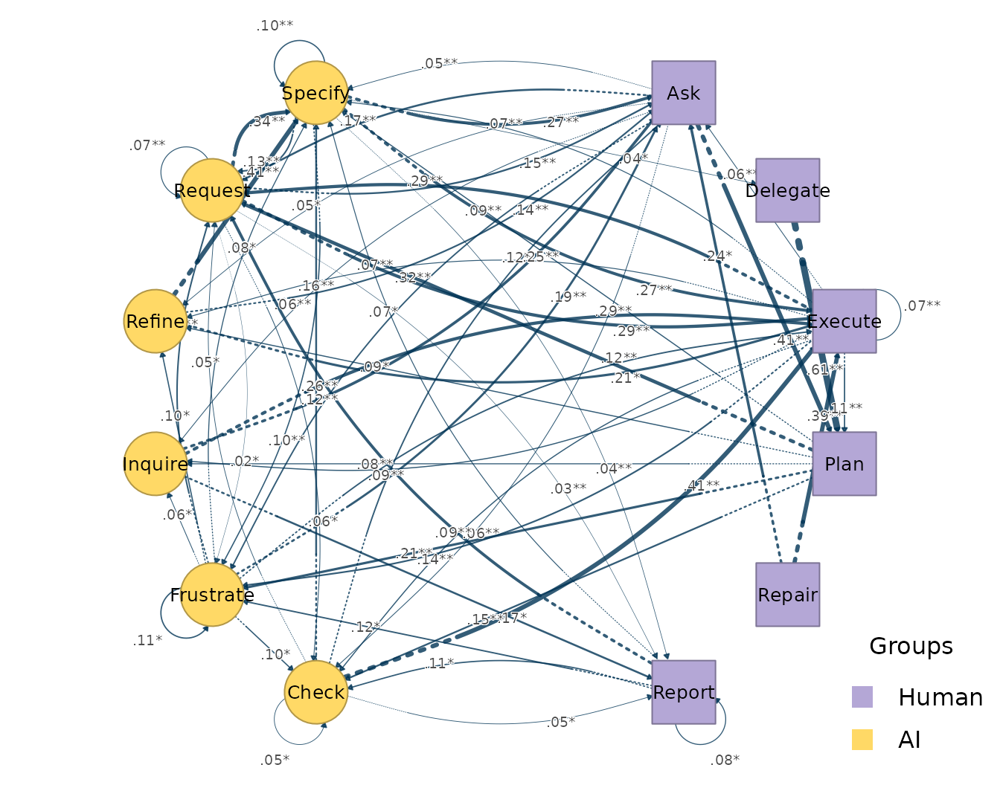
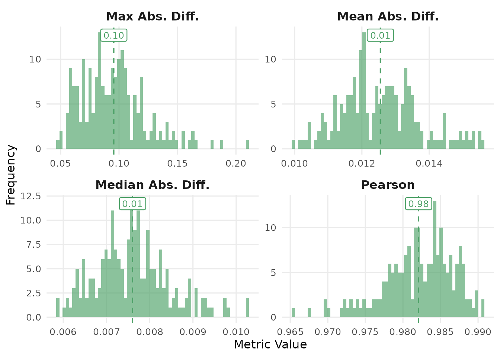
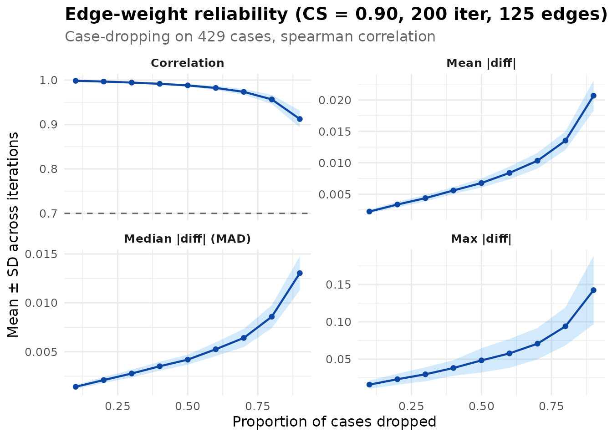
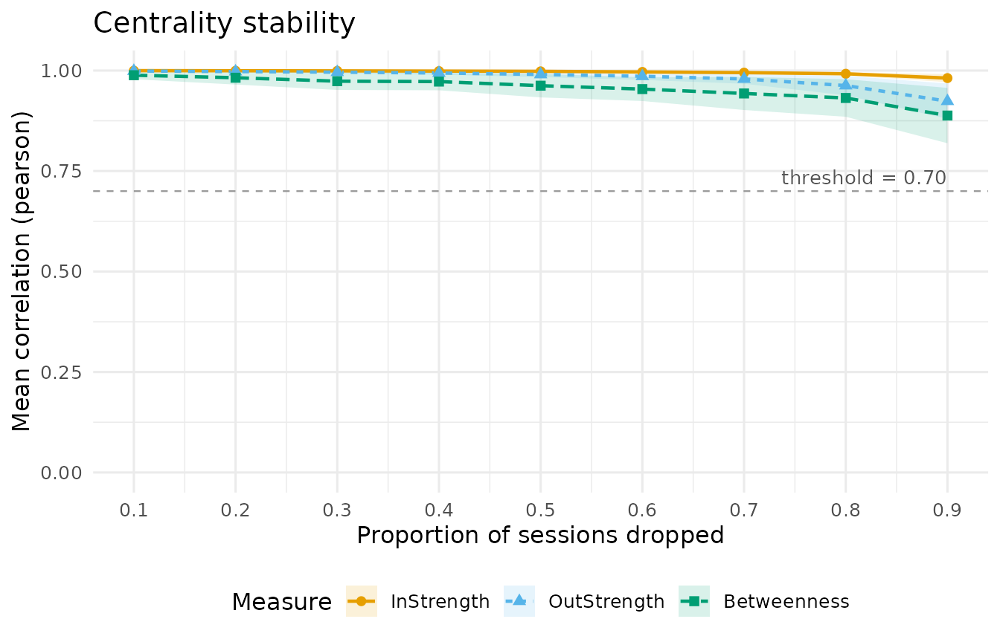

# Model assessment

A heterogeneous transition network is an estimate. Every edge weight is
a proportion computed from the sessions that happened to be observed,
and every centrality is a function of those proportions. Claims drawn
from one estimate, that a transition from a human request to an AI
action is strong, that one code is more central than another, or that
the AI hands back to the human more often than it continues on its own,
rest on the assumption that another sample of sessions would give a
similar network. Model assessment quantifies how far that assumption
holds before the network is used as evidence (Saqr et al., 2025).

The assessments answer different questions and sit at different levels
of the network. The bootstrap and its closed-form counterpart ask which
individual edges are estimated precisely enough to interpret. Split-half
reliability asks whether the network as a whole would be the same in
another half of the data. Case-dropping stability asks how many sessions
can be lost before the ordering of the edges or of the node centralities
changes. A fourth question, whether a first-order network is adequate at
all, is the subject of the [Markov-order
adequacy](https://sonsoles.me/htna/articles/markov-order.md) guide.
Every function below takes an htna network or a grouped network, and
every result has a
[`plot()`](https://rdrr.io/r/graphics/plot.default.html) method.

``` r

library(htna)
```

## Data

`human_ai` holds 429 sessions of human-AI pair programming coded into
six human and six AI codes; each row is one coded event.

- **Session**: `session_id`; the unit that is resampled, split and
  dropped.
- **Code**: `code`; the node of the network.
- **Actor type**: `actor_type`, `"Human"` or `"AI"`.
- **Order**: `order_in_session`; the position of the event in its
  session.

The network assessed throughout is the relative transition network of
all sessions.

``` r

data(human_ai)
net <- build_htna(human_ai, actor_type = "actor_type")
```

## Which edges are estimated precisely?

[`bootstrap_htna()`](https://sonsoles.me/htna/reference/bootstrap_htna.md)
resamples the 429 sessions with replacement, rebuilds the network on
every resample and summarizes the distribution of each edge weight.
Under the default stability test, an edge is significant when its
resampled weights stay within 75% to 125% of the observed weight often
enough for the p-value to fall below 0.05.

``` r

boot <- bootstrap_htna(net, iter = 200, seed = 1)
boot
#>   Edge                   Mean     95% CI          p
#>   -----------------------------------------------
#>   Delegate → Plan        0.611  [0.546, 0.673]  ** 
#>   Refine → Specify       0.413  [0.363, 0.466]  ** 
#>   Check → Execute        0.411  [0.383, 0.441]  ** 
#>   Ask → Plan             0.411  [0.384, 0.437]  ** 
#>   Repair → Execute       0.389  [0.323, 0.457]  ** 
#>   ... and 59 more significant edges
#> 
#> Bootstrap Network  [Transition Network (relative) | directed]
#>   Iterations : 200  |  Nodes : 12
#>   Edges      : 64 significant / 135 total
#>   CI         : 95%  |  Inference: stability  |  CR [0.75, 1.25]
```

Of the 135 non-zero edges, 64 are reproduced by the resamples within the
consistency range. The strongest edge, from the AI’s `Delegate` to its
own `Plan`, has a bootstrap mean of 0.611 with a 95% interval from 0.546
to 0.673. The edge table, one row per edge, holds the interval and the
p-value of every edge.

``` r

head(summary(boot))
#>   from        to weight   mean      sd p_value   sig ci_lower ci_upper cr_lower cr_upper
#> 1  Ask       Ask 0.0182 0.0185 0.00312 0.15423 FALSE   0.0129   0.0242   0.0137   0.0228
#> 2  Ask     Check 0.0632 0.0635 0.00508 0.00995  TRUE   0.0537   0.0732   0.0474   0.0790
#> 3  Ask   Execute 0.0221 0.0223 0.00336 0.07960 FALSE   0.0165   0.0289   0.0165   0.0276
#> 4  Ask Frustrate 0.1158 0.1152 0.00747 0.00498  TRUE   0.1004   0.1284   0.0868   0.1447
#> 5  Ask   Inquire 0.0632 0.0626 0.00518 0.00498  TRUE   0.0526   0.0727   0.0474   0.0790
#> 6  Ask      Plan 0.4088 0.4108 0.01389 0.00498  TRUE   0.3840   0.4369   0.3066   0.5110
```

Weak edges fail the stability test even when they are clearly present:
the self-transition of `Ask` has a weight of 0.0182 and an interval from
0.0129 to 0.0242 that excludes zero, but its resampled weights leave the
narrow consistency range around such a small weight too often (p =
0.154). The test asks whether a weight is reproduced, not whether it
differs from zero.
[`plot_htna_bootstrap()`](https://sonsoles.me/htna/reference/plot_htna_bootstrap.md)
draws the network with the edges that pass the test.

``` r

plot_htna_bootstrap(boot, display = "significant")
```



[`certainty_htna()`](https://sonsoles.me/htna/reference/certainty_htna.md)
derives the same quantities in closed form, from the Dirichlet posterior
of each row of transition counts, without resampling.

``` r

cert <- certainty_htna(net)
cert
#>   Edge                   Mean     95% CI          p
#>   -----------------------------------------------
#>   Delegate → Plan        0.600  [0.543, 0.656]  ***
#>   Refine → Specify       0.410  [0.377, 0.445]  ***
#>   Check → Execute        0.410  [0.383, 0.437]  ***
#>   Ask → Plan             0.408  [0.388, 0.428]  ***
#>   Repair → Execute       0.384  [0.326, 0.444]  ** 
#>   ... and 63 more certain edges
#> 
#> Certainty (Dirichlet)  [Transition Network (relative) | directed]
#>   Prior      : Dirichlet(0.50)  |  Nodes : 12
#>   Edges      : 68 certain / 135 total
#>   CI         : 95%  |  Inference: stability  |  CR [0.75, 1.25]
```

The closed-form analysis marks 68 edges as certain, and its intervals
for the strongest edges are close to the bootstrap ones (0.600, from
0.543 to 0.656, for `Delegate` to `Plan`). The two verdicts agree on
most edges:

``` r

both <- merge(summary(boot), summary(cert), by = c("from", "to"))
xtabs(~ sig.x + sig.y, data = both)
#>        sig.y
#> sig.x   FALSE TRUE
#>   FALSE    64    7
#>   TRUE      3   61
```

Of the 135 edges, 61 pass both tests and 64 fail both; the 10
disagreements are edges near the boundary of the consistency range. The
closed-form analysis treats every transition as independent and so
ignores the nesting of transitions in sessions, which the bootstrap
respects; it is the faster screen, and the bootstrap the analysis to
report.

## Would another half of the data give the same network?

[`reliability_htna()`](https://sonsoles.me/htna/reference/reliability_htna.md)
splits the sessions at random into two halves 200 times, estimates a
network from each half, and compares the two networks.

``` r

rel <- reliability_htna(net, iter = 200, seed = 1)
rel
#> Split-Half Reliability (200 iterations, split = 50%)
#>   Mean Abs. Diff.     mean = 0.0125  sd = 0.0012
#>   Median Abs. Diff.   mean = 0.0076  sd = 0.0009
#>   Pearson             mean = 0.9821  sd = 0.0047
#>   Max Abs. Diff.      mean = 0.0955  sd = 0.0280
```

Two networks estimated from disjoint halves of the sessions correlate at
0.982 on average (SD 0.0047), and their edge weights differ by 0.0125 on
average. Even the largest difference between the halves, 0.0955 on
average, is small beside the strongest edges of around 0.4 to 0.6. The
network as a whole does not depend on which sessions were sampled.

``` r

plot(rel)
```



## How many sessions can be lost before the edge ordering changes?

[`casedrop_reliability_htna()`](https://sonsoles.me/htna/reference/casedrop_reliability_htna.md)
drops increasing proportions of the sessions, from 10% to 90%,
re-estimates the network and correlates its edge weights with those of
the full network (Spearman correlation, off-diagonal edges). The
case-dropping stability (CS) coefficient is the largest proportion that
can be dropped while the correlation stays above 0.7 in at least 95% of
the 200 resamples per proportion (Epskamp et al., 2018).

``` r

cd <- casedrop_reliability_htna(net, iter = 200, seed = 1)
cd
#> Edge-weight Case-dropping Stability
#>   Cases (resampled)     : 429
#>   Edges assessed        : 125 (diagonal excluded)
#>   Iterations / prop     : 200
#>   Correlation method    : spearman
#>   CS-coefficient (r)    : 0.90  (threshold=0.70, certainty=0.95)
#> 
#> Model-level reliability across iterations (mean +/- sd per drop):
#>   drop_prop      p=0.1        p=0.2        p=0.3        p=0.4        p=0.5        p=0.6        p=0.7        p=0.8        p=0.9      
#>   mean|diff|      0.002+- 0.000   0.003+- 0.000   0.004+- 0.001   0.006+- 0.001   0.007+- 0.001   0.008+- 0.001   0.010+- 0.001   0.014+- 0.001   0.021+- 0.002
#>   median|diff|    0.001+- 0.000   0.002+- 0.000   0.003+- 0.000   0.004+- 0.000   0.004+- 0.001   0.005+- 0.001   0.006+- 0.001   0.009+- 0.001   0.013+- 0.002
#>   cor             0.998+- 0.001   0.997+- 0.001   0.994+- 0.002   0.992+- 0.002   0.988+- 0.003   0.982+- 0.005   0.973+- 0.007   0.956+- 0.010   0.912+- 0.019
#>   max|diff|       0.016+- 0.006   0.023+- 0.007   0.030+- 0.009   0.038+- 0.010   0.048+- 0.016   0.058+- 0.019   0.071+- 0.021   0.094+- 0.026   0.142+- 0.046
```

The CS coefficient is 0.90, the largest proportion tested: even with 90%
of the sessions dropped, the 125 off-diagonal edge weights correlate
with those of the full network at 0.912 on average. The ordering of the
edges is therefore stable well beyond the conventional criterion of 0.5.

``` r

plot(cd)
```



## Are the centrality rankings stable?

Analyses often interpret rankings of codes by centrality rather than
single edges.
[`centrality_stability_htna()`](https://sonsoles.me/htna/reference/centrality_stability_htna.md)
applies the case-dropping procedure to the in-strength, out-strength and
betweenness of the codes.

``` r

cs <- centrality_stability_htna(net, iter = 200, seed = 1)
as.data.frame(cs)
#>       measure  cs
#> 1  InStrength 0.9
#> 2 OutStrength 0.9
#> 3 Betweenness 0.9
```

All three measures reach the maximum CS coefficient of 0.9. The
correlation traces behind the coefficients show how much of that margin
each measure has:

``` r

as.data.frame(cs, what = "correlations")
#>        measure drop_prop mean_cor   sd_cor prop_above
#> 1   InStrength       0.1    1.000 0.000131      1.000
#> 2   InStrength       0.2    0.999 0.000345      1.000
#> 3   InStrength       0.3    0.999 0.000470      1.000
#> 4   InStrength       0.4    0.999 0.000670      1.000
#> 5   InStrength       0.5    0.998 0.001039      1.000
#> 6   InStrength       0.6    0.997 0.002379      1.000
#> 7   InStrength       0.7    0.995 0.003097      1.000
#> 8   InStrength       0.8    0.992 0.003883      1.000
#> 9   InStrength       0.9    0.981 0.010112      1.000
#> 10 OutStrength       0.1    0.999 0.000968      1.000
#> 11 OutStrength       0.2    0.997 0.001889      1.000
#> 12 OutStrength       0.3    0.996 0.002616      1.000
#> 13 OutStrength       0.4    0.994 0.004084      1.000
#> 14 OutStrength       0.5    0.990 0.006655      1.000
#> 15 OutStrength       0.6    0.986 0.009156      1.000
#> 16 OutStrength       0.7    0.979 0.011859      1.000
#> 17 OutStrength       0.8    0.963 0.024170      1.000
#> 18 OutStrength       0.9    0.924 0.043973      1.000
#> 19 Betweenness       0.1    0.988 0.010053      1.000
#> 20 Betweenness       0.2    0.982 0.016976      1.000
#> 21 Betweenness       0.3    0.974 0.021773      1.000
#> 22 Betweenness       0.4    0.973 0.021666      1.000
#> 23 Betweenness       0.5    0.962 0.029148      1.000
#> 24 Betweenness       0.6    0.954 0.029645      1.000
#> 25 Betweenness       0.7    0.943 0.041148      1.000
#> 26 Betweenness       0.8    0.932 0.046697      1.000
#> 27 Betweenness       0.9    0.888 0.068852      0.975
```

In-strength barely moves (a mean correlation of 0.981 with 90% of the
sessions dropped), out-strength falls to 0.924, and betweenness, which
depends on shortest paths and reacts to small changes in the weights,
falls to 0.888, with 97.5% of the resamples still above the threshold.
All three rankings are stable enough to report; betweenness is the one
to read with the most care.

``` r

plot(cs)
```



## Which assessment to use

| Question | Function | Criterion used here |
|----|----|----|
| Which edges are reproduced by resampling? | [`bootstrap_htna()`](https://sonsoles.me/htna/reference/bootstrap_htna.md) | p \< 0.05 under the stability test |
| The same, in closed form | [`certainty_htna()`](https://sonsoles.me/htna/reference/certainty_htna.md) | interval within the consistency range |
| Is the whole network the same in another half of the data? | [`reliability_htna()`](https://sonsoles.me/htna/reference/reliability_htna.md) | mean split-half correlation |
| How many sessions can be lost before the edge order changes? | [`casedrop_reliability_htna()`](https://sonsoles.me/htna/reference/casedrop_reliability_htna.md) | CS coefficient above 0.5 |
| Are centrality rankings stable? | [`centrality_stability_htna()`](https://sonsoles.me/htna/reference/centrality_stability_htna.md) | CS coefficient above 0.5 per measure |
| Is a first-order network adequate? | [`markov_order_test_htna()`](https://sonsoles.me/htna/reference/markov_order_test_htna.md) | see [Markov-order adequacy](https://sonsoles.me/htna/articles/markov-order.md) |

The assessments are complementary and are best reported together. In
these data every criterion is met: the network is reliable across
halves, its edge order and centrality rankings survive the loss of most
sessions, and about half of its edges are individually reproducible. For
a grouped network, every function returns one result per cohort; the
[Grouped heterogeneous transition
networks](https://sonsoles.me/htna/articles/grouped.md) vignette shows
the grouped forms.

## References

Epskamp, S., Borsboom, D., & Fried, E. I. (2018). Estimating
psychological networks and their accuracy: A tutorial paper. *Behavior
Research Methods*, 50(1), 195-212.
<https://doi.org/10.3758/s13428-017-0862-1>

Saqr, M., López-Pernas, S., Törmänen, T., Kaliisa, R., Misiejuk, K., &
Tikka, S. (2025). Transition network analysis: A novel framework for
modeling, visualizing, and identifying the temporal patterns of learners
and learning processes. *Proceedings of the 15th International Learning
Analytics and Knowledge Conference*, 351-361.
<https://doi.org/10.1145/3706468.3706513>
