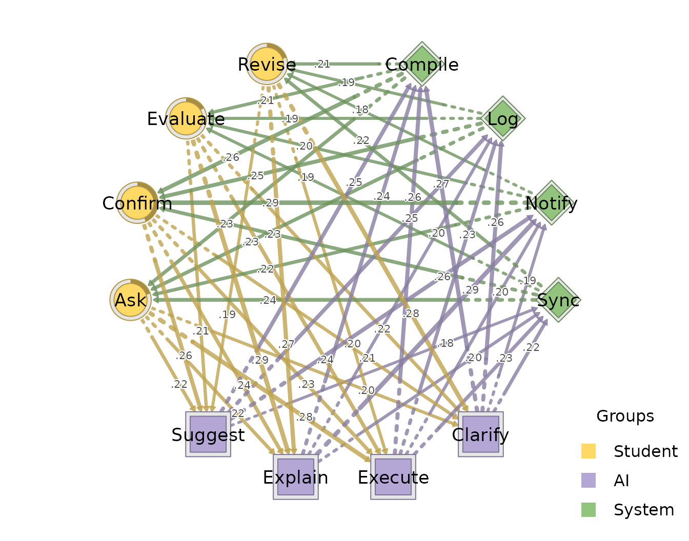
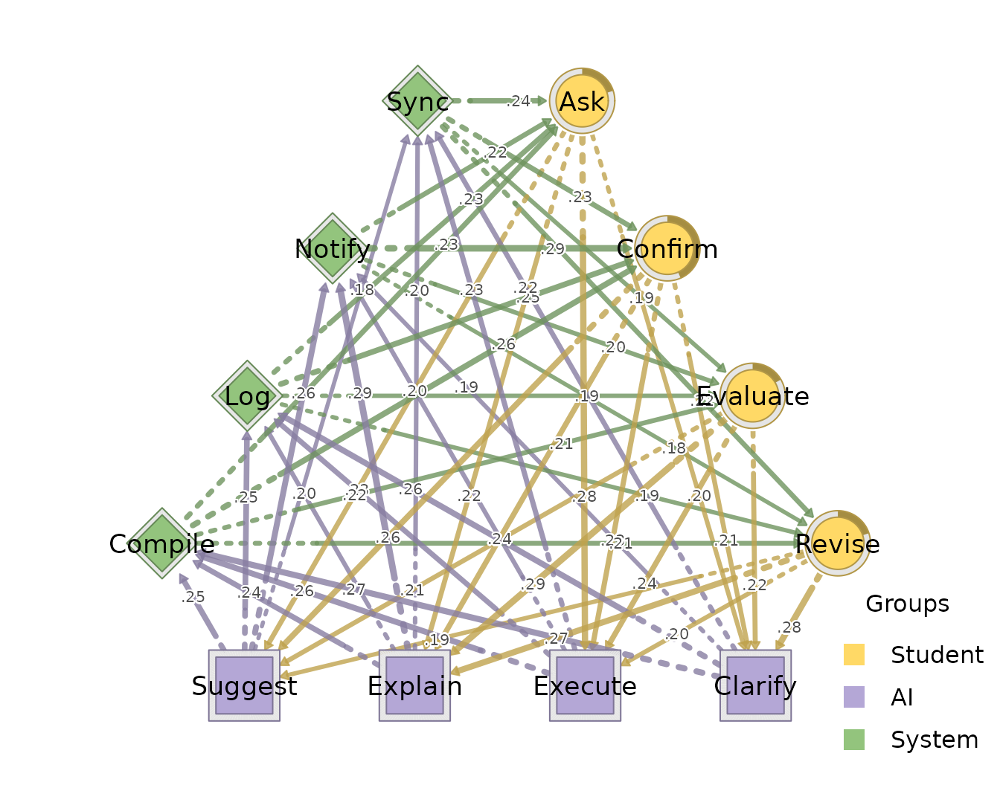
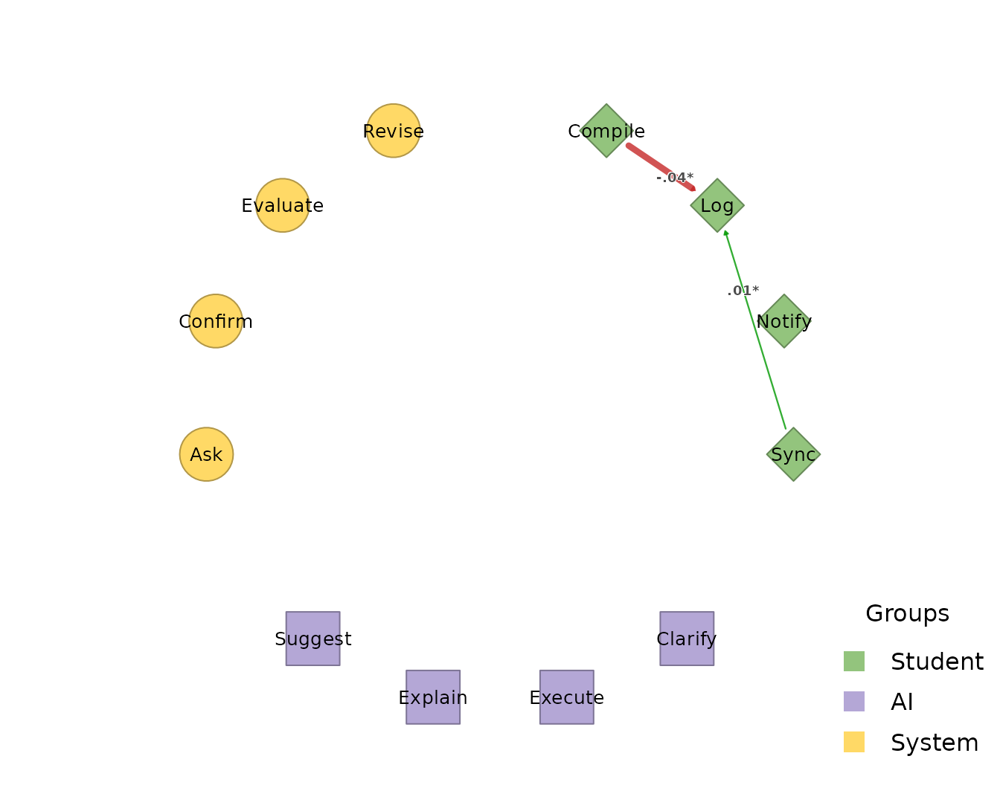
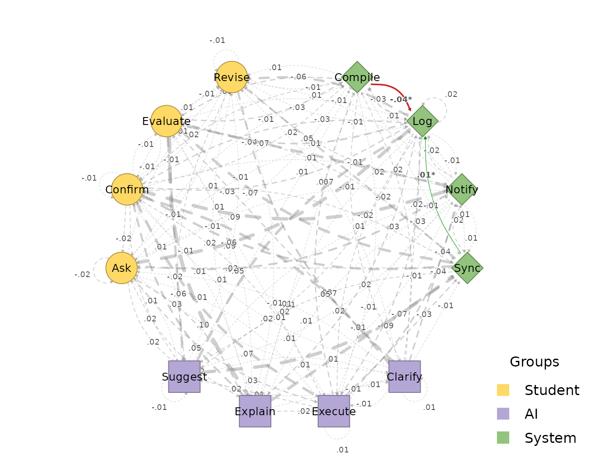

# Three or more actor groups

Many learning settings involve more than two kinds of actor. A student
working with an AI assistant inside a programming environment interacts
with the assistant and with the environment itself, whose compiler
messages, notifications and logs are events of a third kind. A classroom
dialogue can involve a teacher, students and a conversational agent.
Heterogeneous transition network analysis does not depend on there being
two actors: the actor partition can have any number of groups, and the
weight matrix is then partitioned into one block for every ordered pair
of actors. With three actors there are three within-actor blocks and six
between-actor blocks, so the question of who hands over to whom has six
answers instead of two.

This guide builds a three-actor network, reads its actor-pair structure,
draws it in the layouts available for several groups, counts the
three-actor meta-paths, and compares two networks. Every function used
for two actors works unchanged.

``` r

library(htna)
```

## Data

The package has no bundled data with three actor types, so the guide
uses a small simulated study of 30 sessions in which a Student, an AI
assistant and a System (the programming environment) act in turn. Each
actor has four codes.

- **Student**: `Ask`, `Confirm`, `Revise`, `Evaluate`.
- **AI**: `Suggest`, `Explain`, `Execute`, `Clarify`.
- **System**: `Log`, `Notify`, `Compile`, `Sync`.
- **Session and order**: `session_id` and `order_in_session`. In each
  session the three actors act in the fixed cycle Student, AI, System
  for as long as each has events (15 to 25 per actor and session), and
  the codes within an actor are drawn at random.

The turn order is therefore built into the data, and the codes carry no
structure. The analyses below should recover the cycle and nothing else.

``` r

set.seed(42)
student_codes <- c("Ask", "Confirm", "Revise", "Evaluate")
ai_codes      <- c("Suggest", "Explain", "Execute", "Clarify")
system_codes  <- c("Log", "Notify", "Compile", "Sync")
sessions      <- sprintf("S%03d", seq_len(30))

make_events <- function(codes, sessions, offset) {
  rows <- lapply(sessions, function(sid) {
    n <- sample(15:25, 1)
    data.frame(session_id = sid, code = sample(codes, n, replace = TRUE),
               order_in_session = seq_len(n) * 3L - offset)
  })
  do.call(rbind, rows)
}

student_data <- make_events(student_codes, sessions, 2L)
ai_data      <- make_events(ai_codes, sessions, 1L)
system_data  <- make_events(system_codes, sessions, 0L)
```

## Building a network with three actors

The three tables are passed as a named list; the names become the actor
types, in the order given. A single table with an actor column or a
codebook works in the same way (see [Input
formats](https://sonsoles.me/htna/articles/input-formats.md)).

``` r

net3 <- build_htna(list(Student = student_data, AI = ai_data,
                        System = system_data))
summary(net3)
#> <htna network>
#>   Method:    relative
#>   Sessions:  30   (max 70 timesteps)
#>   Nodes:     12
#>   Edges:     116 / 144 (non-zero)
#> 
#> Actor types (3):
#>   Student (4 nodes):  Ask, Confirm, Evaluate, Revise
#>   AI      (4 nodes):  Clarify, Execute, Explain, Suggest
#>   System  (4 nodes):  Compile, Log, Notify, Sync
#> 
#> Edge counts by actor (rows = source, cols = target):
#>             Student      AI  System
#>   Student         3      16      14
#>   AI             13       9      16
#>   System         16      15      14
#> 
#> Network metrics:
#>                       metric    value
#>                   Node Count  12.0000
#>                   Edge Count 116.0000
#>              Network Density   0.8788
#>                Mean Distance   0.0188
#>            Mean Out-Strength   1.0000
#>              SD Out-Strength   0.0000
#>             Mean In-Strength   1.0000
#>               SD In-Strength   0.0916
#>              Mean Out-Degree   9.6667
#>                SD Out-Degree   1.5570
#>  Centralization (Out-Degree)   0.1818
#>   Centralization (In-Degree)   0.1818
#>                  Reciprocity   0.8727
```

The network has 12 nodes, four per actor, and 116 of its 144 possible
edges are non-zero. The edge counts by actor form a three-by-three
table. As a tidy table, one row per directed actor pair:

``` r

as.data.frame(summary(net3), what = "actor_pairs")
#>   source_actor target_actor n_edges
#> 1      Student      Student       3
#> 2      Student           AI      16
#> 3      Student       System      14
#> 4           AI      Student      13
#> 5           AI           AI       9
#> 6           AI       System      16
#> 7       System      Student      16
#> 8       System           AI      15
#> 9       System       System      14
```

The block structure reflects the turn cycle: the Student-to-Student
block has only 3 non-zero edges, because a student event is followed by
another student event only where the other actors have run out of
events, while the blocks of the cycle (Student to AI, AI to System,
System to Student) have 16 each, all possible edges. The other blocks
are filled at the ends of sessions, where the remaining actors continue
among themselves.

## Drawing three actor groups

With the default circular layout each actor occupies one arc of the
circle, coloured and shaped by actor.

``` r

plot_htna(net3)
```



`layout = "polygon"` places each actor along one side of a regular
polygon, a triangle for three actors, which separates the groups more
clearly.

``` r

plot_htna(net3, layout = "polygon")
```



## Which three-actor templates recur?

[`extract_meta_paths()`](https://sonsoles.me/htna/reference/extract_meta_paths.md)
at the type level counts runs of actor types. With three actors there
are 27 possible templates of length three.

``` r

print(extract_meta_paths(net3, level = "type", length = 3), n = 6)
#> Meta-paths (type-level) over 30 sequences
#> Rows: 17 | Lengths: 3 | Gaps: 0
#>                   schema length gap count n_seq support frequency lift
#>      Student->AI->System      3   0   510    30   1.000     0.295 7.98
#>      AI->System->Student      3   0   497    30   1.000     0.288 7.78
#>      System->Student->AI      3   0   487    30   1.000     0.282 7.62
#>           AI->System->AI      3   0    41    10   0.333     0.024 0.62
#>       System->AI->System      3   0    37    10   0.333     0.021 0.56
#>  System->Student->System      3   0    32    10   0.333     0.019 0.50
#> ... (11 more)
```

The three rotations of the cycle (`Student->AI->System`,
`AI->System->Student`, `System->Student->AI`) occur in all 30 sessions
and account for 0.295, 0.288 and 0.282 of the runs, about eight times as
often as expected from the actors’ overall shares (lift 7.62 to 7.98).
The next most frequent template, `AI->System->AI`, occurs 41 times in 10
sessions, less often than expected (lift 0.62). The meta-paths recover
the built-in turn order exactly. A schema returns the concrete instances
of one template:

``` r

print(extract_meta_paths(net3, schema = "Student->AI->System"), n = 6)
#> State-level instances of schema 'Student->AI->System' over 30 sequences
#> Rows: 64 | Lengths: 3 | Gaps: 0
#>                      schema         meta_schema length gap count n_seq support frequency
#>   Confirm->Clarify->Compile Student->AI->System      3   0    15    14   0.467     0.029
#>   Confirm->Execute->Compile Student->AI->System      3   0    13    12   0.400     0.025
#>  Evaluate->Explain->Compile Student->AI->System      3   0    13    12   0.400     0.025
#>      Confirm->Suggest->Sync Student->AI->System      3   0    13    11   0.367     0.025
#>        Ask->Explain->Notify Student->AI->System      3   0    12    11   0.367     0.024
#>    Confirm->Explain->Notify Student->AI->System      3   0    12    12   0.400     0.024
#>   lift
#>  11.86
#>  10.08
#>  13.00
#>  12.66
#>  11.07
#>   9.53
#> ... (58 more)
```

All 64 combinations of four codes per actor occur, and because the codes
within each actor were drawn at random they have similar counts (the
most frequent, `Confirm->Clarify->Compile`, occurs 15 times); no
particular student move leads to a particular AI move. Their high lifts
come from the turn cycle, not from the codes.

## Do two samples from the same process differ?

A second set of 30 sessions is simulated from the same process. A
permutation test of the two networks should find no difference.

``` r

set.seed(7)
net3b <- build_htna(list(
  Student = make_events(student_codes, sessions, 2L),
  AI      = make_events(ai_codes, sessions, 1L),
  System  = make_events(system_codes, sessions, 0L)
))
perm3 <- permutation_htna(net3, net3b, iter = 200, seed = 1)
perm3
#> Permutation Test: Transition Network (relative probabilities) [directed]
#>   Iterations: 200  |  Alpha: 0.05
#>   Nodes: 12  |  Edges tested: 136  |  Significant: 2
#>   Global test (networks differ overall?): M = 2.693 (p = 0.587)  |  S = 0.103 (p = 0.846)
```

The global test finds no difference (M = 2.693, p = 0.587; S = 0.103, p
= 0.846), and 2 of the 136 tested edges fall below 0.05, fewer than the
seven expected by chance at that level. The test behaves as it should
when the two networks come from one process. The difference network
draws the two nominally significant edges:

``` r

plot_htna_diff(perm3)
```



With `show_nonsig = TRUE`, the non-significant differences are added as
dashed edges.

``` r

plot_htna_diff(perm3, show_nonsig = TRUE)
```



## What changes with more actors

| Step | Two actors | Three or more actors |
|----|----|----|
| Actor-pair blocks | 4 | the number of actors squared (9 for three) |
| Layout | circular, two arcs | circular arcs, or `layout = "polygon"` |
| Meta-paths of length three | 8 templates | the number of actors cubed (27 for three) |
| Comparison and assessment | [`compare_htna()`](https://sonsoles.me/htna/reference/compare_htna.md), [`permutation_htna()`](https://sonsoles.me/htna/reference/permutation_htna.md), [`bootstrap_htna()`](https://sonsoles.me/htna/reference/bootstrap_htna.md) | unchanged |

The number of blocks and templates grows quickly with the number of
actors, so more sessions are needed to estimate every block; the
actor-pair table of [`summary()`](https://rdrr.io/r/base/summary.html)
shows which blocks rest on few edges.
