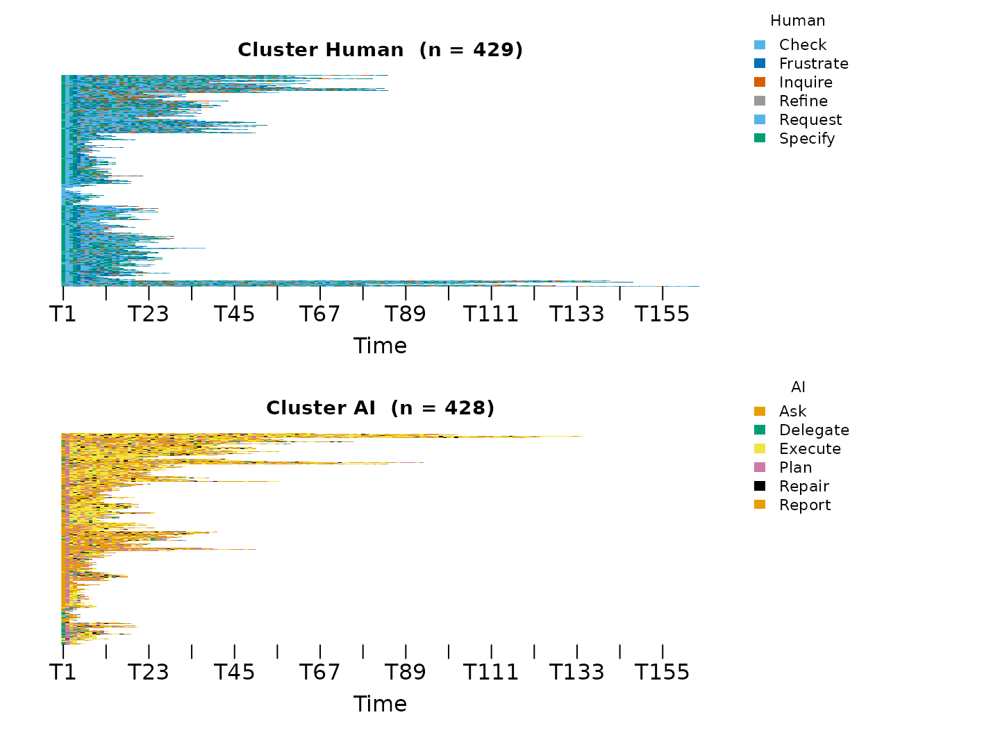
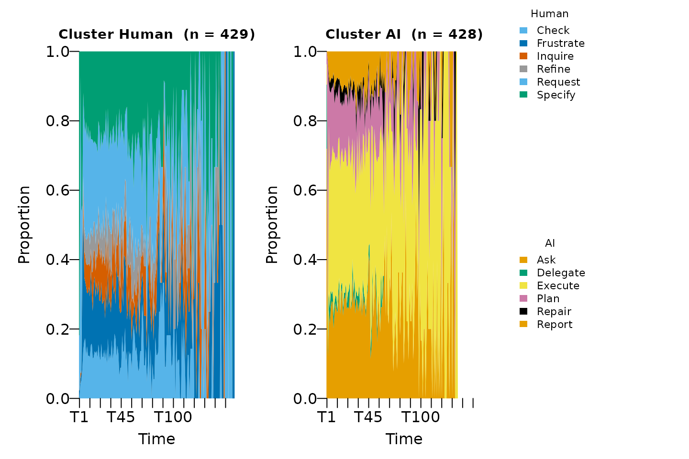
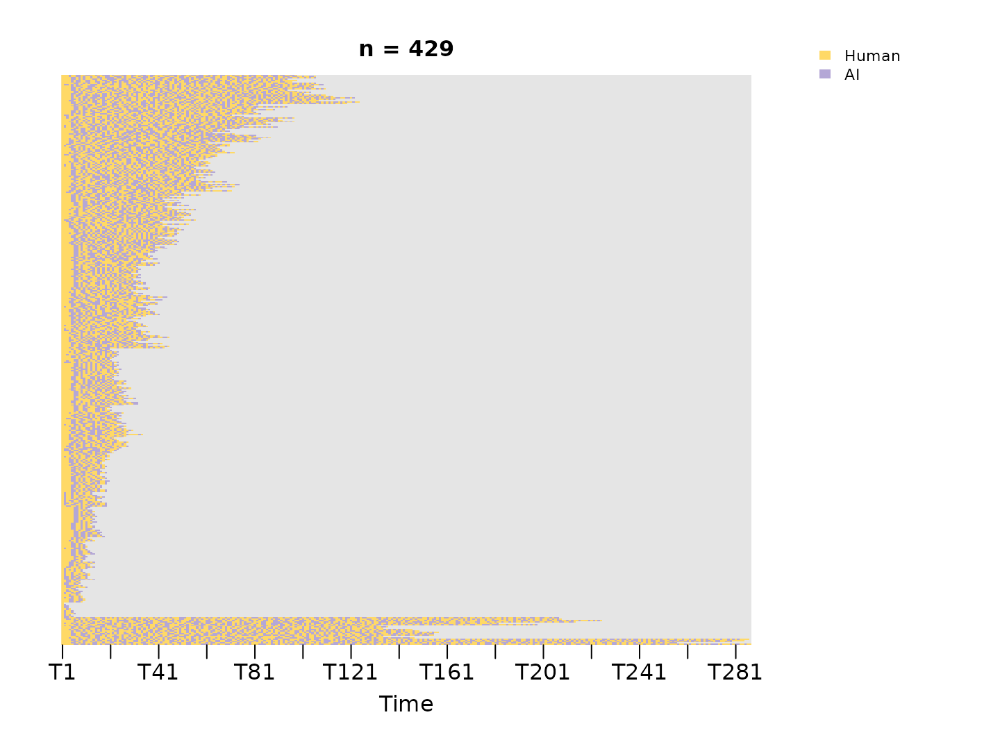
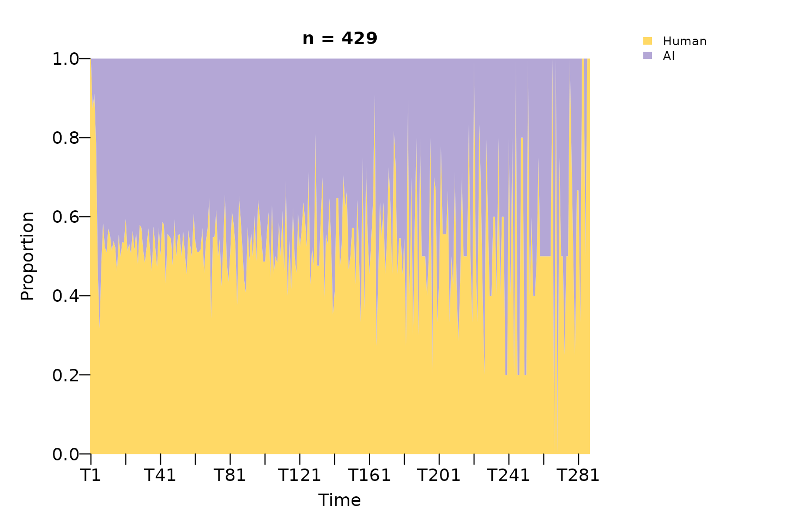
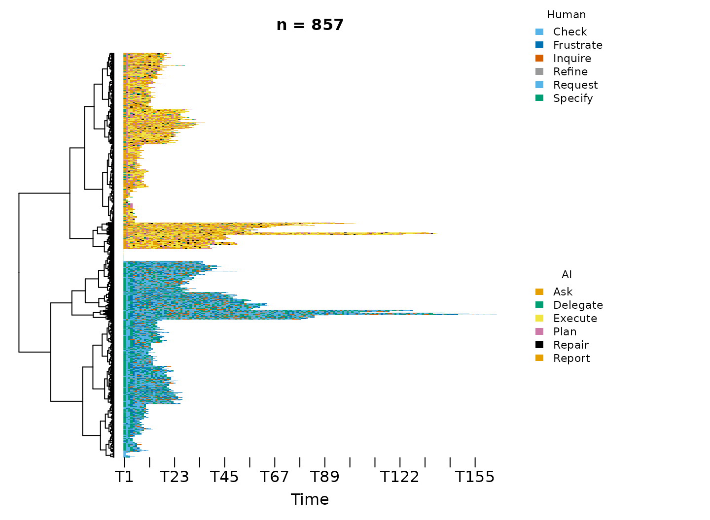
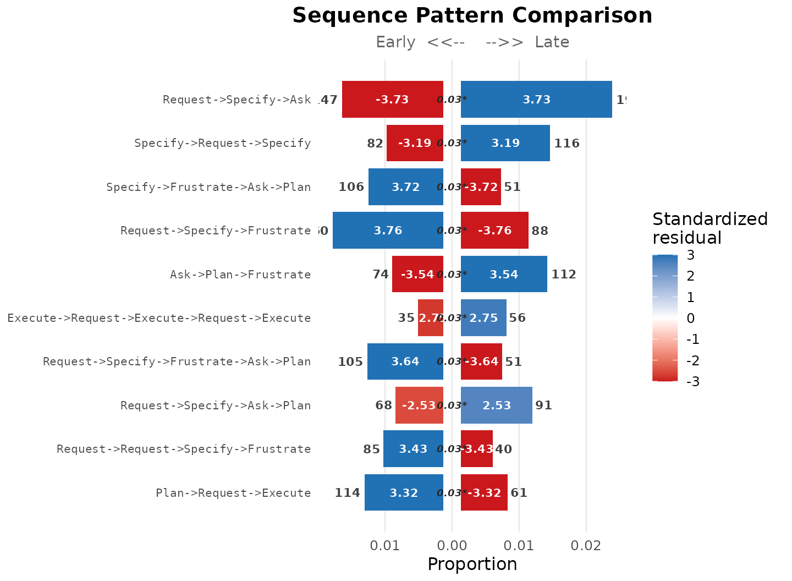

# Sequences and patterns

A transition network compresses a set of sessions into one matrix of
single-step transitions. The compression keeps the structure of the
interaction, which codes lead to which, but it discards two things that
questions about human-AI collaboration often need. The first is time:
when in a session each actor acts, whether sessions open with a long
human specification or with an immediate request, and how long each
actor holds the turn. The second is longer patterns: a human request
answered by an AI execution and followed by another request is a unit of
collaboration that a network splits into two independent edges.

This guide covers the views of a heterogeneous network that keep these
features. Sequence plots draw every session as a row of coded events,
either coloured by code or by actor. Meta-paths count recurring runs of
codes and their actor templates, such as `Human->AI->Human`, and compare
them with the frequencies expected if the codes followed each other
independently. Association rules describe which codes occur together in
the same session, regardless of order. Sequence comparison tests which
patterns distinguish two groups of sessions.

``` r

library(htna)
```

## Data

`human_ai` holds 429 sessions of human-AI pair programming; each row is
one coded event.

- **Session**: `session_id`; one row of a sequence plot.
- **Code**: `code`; six human codes (Specify, Request, Frustrate, Check,
  Inquire, Refine) and six AI codes (Delegate, Plan, Execute, Ask,
  Repair, Report).
- **Actor type**: `actor_type`, `"Human"` or `"AI"`; the actor of each
  code.
- **Order**: `order_in_session`; the position of the event in its
  session.
- **Cohort**: `phase`, `Early` or `Late`; used for the group comparison.

``` r

data(human_ai)
net <- build_htna(human_ai, actor_type = "actor_type")
```

## How does each actor’s work unfold within a session?

[`sequence_plot_htna()`](https://sonsoles.me/htna/reference/sequence_plot_htna.md)
extracts each actor’s events from every session and draws them as one
row per session and actor, coloured by code. The default index layout
has one panel per actor, with sessions ordered so that similar sequences
lie next to each other.

``` r

sequence_plot_htna(net)
```



The human panel is dominated by requests and specifications and the AI
panel by executions and asks; long runs of one colour along a row are
the repeated moves that appear as self-transitions in the network. The
legend is split by actor, so each code is read under the actor that owns
it.

The distribution layout summarizes the same information over sessions:
at each position, the share of sessions in each code. Because each
actor’s row is empty at the positions where the other actor acted,
`na = FALSE` leaves those positions out, so the shares are within the
actor.

``` r

sequence_plot_htna(net, type = "distribution", na = FALSE)
```



## How do the actors take turns?

With `by = "group"`, every event of the combined session is coloured by
its actor, which turns the plot into a display of turn-taking. Rows with
many short stripes are sessions in which the actors alternate quickly;
long blocks of one colour are stretches in which one actor holds the
turn.

``` r

sequence_plot_htna(net, by = "group")
```



The distribution layout gives the share of sessions in which each actor
acts at each position, so it shows whether either actor dominates the
openings or the later stages of the sessions.

``` r

sequence_plot_htna(net, by = "group", type = "distribution")
```



The heatmap layout draws the sessions as one carpet, with the actors
separated by a white band; it compares session lengths and the
uniformity of the sessions at a glance.

``` r

sequence_plot_htna(net, type = "heatmap")
```



## Which turn-taking templates recur?

[`extract_meta_paths()`](https://sonsoles.me/htna/reference/extract_meta_paths.md)
with `level = "type"` replaces every code by its actor and counts the
resulting templates. For runs of two events, the four templates are the
four blocks of the network.

``` r

extract_meta_paths(net, level = "type", length = 2)
#> Meta-paths (type-level) over 429 sequences
#> Rows: 4 | Lengths: 2 | Gaps: 0
#>        schema length gap count n_seq support frequency lift
#>     Human->AI      2   0  5970   428   0.998     0.316 1.28
#>     AI->Human      2   0  5693   424   0.988     0.301 1.22
#>  Human->Human      2   0  4674   422   0.984     0.247 0.79
#>        AI->AI      2   0  2581   403   0.939     0.136 0.70
```

Handovers dominate: a human event is followed by an AI event 5,970 times
and an AI event by a human event 5,693 times, against 4,674 human-human
and 2,581 AI-AI pairs. The lift compares each count with the count
expected if consecutive events were independent given the overall share
of each actor; handovers occur 1.28 and 1.22 times as often as expected,
continuations of the same actor less often than expected (0.79 and
0.70). The interaction is alternating rather than a series of
monologues.

Longer templates show how the alternation is organized. For runs of four
events:

``` r

print(extract_meta_paths(net, level = "type", length = 4), n = 8)
#> Meta-paths (type-level) over 429 sequences
#> Rows: 16 | Lengths: 4 | Gaps: 0
#>                   schema length gap count n_seq support frequency lift
#>     AI->Human->Human->AI      4   0  2276   389   0.907     0.126 2.07
#>     AI->Human->AI->Human      4   0  1984   356   0.830     0.110 1.81
#>     Human->AI->Human->AI      4   0  1791   337   0.786     0.099 1.63
#>     Human->AI->AI->Human      4   0  1772   394   0.918     0.098 1.61
#>  Human->AI->Human->Human      4   0  1718   366   0.853     0.095 1.24
#>  Human->Human->AI->Human      4   0  1574   358   0.834     0.087 1.13
#>     Human->Human->AI->AI      4   0  1492   391   0.911     0.083 1.36
#>     AI->AI->Human->Human      4   0  1110   323   0.753     0.061 1.01
#> ... (8 more)
```

The most frequent four-event template is `AI->Human->Human->AI`, an AI
move answered by two human moves before the AI acts again (2,276
occurrences in 389 sessions, lift 2.07). Strict alternation
(`AI->Human->AI->Human`, lift 1.81) is next. The human more often takes
two consecutive turns between AI moves than the AI does between human
moves.

## Which concrete paths realize a template?

A `schema` restricts the search to one template and returns its concrete
instances, each with the template in `meta_schema`. Elements can be
actor types, codes or `*` for any element.

``` r

print(extract_meta_paths(net, schema = "Human->AI->Human"), n = 8)
#> State-level instances of schema 'Human->AI->Human' over 429 sequences
#> Rows: 163 | Lengths: 3 | Gaps: 0
#>                       schema      meta_schema length gap count n_seq support frequency
#>    Request->Execute->Request Human->AI->Human      3   0   401   194   0.452     0.112
#>    Specify->Execute->Request Human->AI->Human      3   0   176   107   0.249     0.049
#>        Request->Ask->Request Human->AI->Human      3   0   130    91   0.212     0.036
#>      Check->Execute->Request Human->AI->Human      3   0   123    96   0.224     0.034
#>        Specify->Ask->Request Human->AI->Human      3   0   120    84   0.196     0.033
#>  Specify->Execute->Frustrate Human->AI->Human      3   0   114    88   0.205     0.032
#>  Request->Execute->Frustrate Human->AI->Human      3   0   106    88   0.205     0.030
#>    Request->Execute->Inquire Human->AI->Human      3   0    97    76   0.177     0.027
#>  lift
#>  5.00
#>  2.33
#>  2.19
#>  3.67
#>  2.15
#>  2.57
#>  2.24
#>  4.40
#> ... (155 more)
```

The 163 concrete paths of the `Human->AI->Human` template are led by a
request, an AI execution and another request (401 occurrences in 194
sessions, 45.2% of the sessions), which occurs five times as often as
expected (lift 5.00). The request-execute-request loop is the backbone
of these sessions. Its mirror image, the AI side of the alternation, is
found with the template `AI->Human->AI`, here restricted to paths at
least twice as frequent as expected:

``` r

print(extract_meta_paths(net, schema = "AI->Human->AI", min_lift = 2), n = 8)
#> State-level instances of schema 'AI->Human->AI' over 429 sequences
#> Rows: 47 | Lengths: 3 | Gaps: 0
#>                     schema   meta_schema length gap count n_seq support frequency lift
#>  Execute->Request->Execute AI->Human->AI      3   0   391   180   0.420     0.142 4.65
#>     Plan->Request->Execute AI->Human->AI      3   0   175   145   0.338     0.064 4.18
#>      Execute->Request->Ask AI->Human->AI      3   0   129    90   0.210     0.047 2.07
#>    Execute->Check->Execute AI->Human->AI      3   0   124    78   0.182     0.045 3.52
#>       Plan->Check->Execute AI->Human->AI      3   0   105    97   0.226     0.038 6.00
#>  Execute->Inquire->Execute AI->Human->AI      3   0   104    64   0.149     0.038 4.50
#>         Plan->Request->Ask AI->Human->AI      3   0    75    60   0.140     0.027 2.42
#>      Execute->Inquire->Ask AI->Human->AI      3   0    52    49   0.114     0.019 3.03
#> ... (39 more)
```

`Execute->Request->Execute` is the AI-centered view of the same loop
(391 occurrences, lift 4.65). The pattern with the highest lift among
those shown, `Plan->Check->Execute` (lift 6.00), is a human check
between an AI plan and its execution.

Patterns need not be contiguous. With `type = "gapped"` the elements of
a path are `gap + 1` positions apart, which describes what happens two
moves later regardless of the move in between.

``` r

extract_meta_paths(net, level = "type", length = 3, type = "gapped", gap = 1)
#> Meta-paths (type-level) over 429 sequences
#> Rows: 8 | Lengths: 3 | Gaps: 1
#>               schema length gap count n_seq support frequency lift
#>     Human->AI->Human      3   1  3265   408   0.951     0.185 1.35
#>     Human->Human->AI      3   1  2722   413   0.963     0.154 1.12
#>        AI->Human->AI      3   1  2515   379   0.883     0.143 1.31
#>     AI->Human->Human      3   1  2242   391   0.911     0.127 0.92
#>  Human->Human->Human      3   1  2146   372   0.867     0.122 0.70
#>        Human->AI->AI      3   1  1748   384   0.895     0.099 0.91
#>        AI->AI->Human      3   1  1618   360   0.839     0.092 0.84
#>           AI->AI->AI      3   1  1382   304   0.709     0.078 0.91
```

Even with one event skipped between the elements, `Human->AI->Human`
remains the most frequent template (3,265 occurrences, lift 1.35).

## Which codes occur together in a session?

Association rules ignore order and ask which codes appear together in
the same session.
[`association_rules_htna()`](https://sonsoles.me/htna/reference/association_rules_htna.md)
treats each session as the set of its codes and keeps the rules above
the support, confidence and lift thresholds.

``` r

rules <- association_rules_htna(net, min_support = 0.3, min_confidence = 0.8,
                                max_length = 3L)
rules
#> Association Rules  [499 rules | 12 items | 429 transactions]
#>   Support >= 0.30  |  Confidence >= 0.80  |  Lift >= 1.00
#> 
#>   Top rules (by lift):
#>     1. Check, Report -> Inquire  (sup=0.401 conf=0.831 lift=1.37)
#>     2. Plan, Report -> Inquire  (sup=0.434 conf=0.812 lift=1.34)
#>     3. Execute, Report -> Inquire  (sup=0.424 conf=0.805 lift=1.32)
#>     4. Ask, Report -> Inquire  (sup=0.429 conf=0.803 lift=1.32)
#>     5. Frustrate, Report -> Inquire  (sup=0.429 conf=0.803 lift=1.32)
#>     6. Inquire, Refine -> Check  (sup=0.347 conf=0.937 lift=1.22)
#>     7. Inquire, Report -> Check  (sup=0.401 conf=0.915 lift=1.19)
#>     8. Refine -> Check, Frustrate  (sup=0.469 conf=0.863 lift=1.18)
#>     9. Refine, Report -> Check  (sup=0.322 conf=0.908 lift=1.18)
#>     10. Report -> Check, Frustrate  (sup=0.473 conf=0.857 lift=1.17)
#>     ... and 489 more rules
```

With support of at least 0.3 and confidence of at least 0.8, 499 rules
remain. The rules with the highest lift link the AI’s `Report` to the
human’s `Inquire`: sessions that contain an AI report together with a
human check, or with an AI plan, execution or ask, contain a human
inquiry in more than 80% of cases (confidence 0.803 to 0.831), 1.32 to
1.37 times as often as sessions in general. Session-level co-occurrence
is a coarser view than the paths above and complements them.

## Which patterns distinguish early from late sessions?

[`sequence_compare_htna()`](https://sonsoles.me/htna/reference/sequence_compare_htna.md)
counts every pattern of three to five codes in two cohorts of sessions
and tests, by permuting whole sessions between the cohorts, whether its
frequency differs between them. P-values are adjusted for the number of
patterns (false discovery rate). Each pattern also has a standardised
residual per cohort (Haberman, 1973): a positive residual means the
pattern is more frequent in that cohort than independence of pattern and
cohort predicts. The permutations are random, so a seed is set first.

``` r

set.seed(2026)
grp <- build_htna(human_ai, actor_type = "actor_type", group = "phase")
res <- sequence_compare_htna(grp, sub = 3:5, min_freq = 25L, iter = 500L)
res
#> Sequence Comparison  [106 patterns | 2 groups: Early, Late]
#>   Lengths: 3, 4, 5  |  min_freq: 25  |  permutation: 500 iter (fdr)
#> 
#>                                      pattern length freq_Early freq_Late prop_Early
#>                        Request->Specify->Ask      3        147       197    0.01509
#>                    Specify->Request->Specify      3         82       116    0.00842
#>                Specify->Frustrate->Ask->Plan      4        106        51    0.01112
#>                  Request->Specify->Frustrate      3        160        88    0.01642
#>                         Ask->Plan->Frustrate      3         74       112    0.00760
#>  Execute->Request->Execute->Request->Execute      5         35        56    0.00376
#>       Request->Specify->Frustrate->Ask->Plan      5        105        51    0.01127
#>                  Request->Specify->Ask->Plan      4         68        91    0.00714
#>         Request->Request->Specify->Frustrate      4         85        40    0.00892
#>                       Plan->Request->Execute      3        114        61    0.01170
#>  prop_Late resid_Early resid_Late effect_size p_value
#>    0.02252       -3.73       3.73        5.19  0.0326
#>    0.01326       -3.19       3.19        4.99  0.0326
#>    0.00598        3.72      -3.72        4.93  0.0326
#>    0.01006        3.76      -3.76        4.83  0.0326
#>    0.01280       -3.54       3.54        4.50  0.0326
#>    0.00673       -2.75       2.75        4.35  0.0326
#>    0.00613        3.64      -3.64        4.12  0.0326
#>    0.01066       -2.53       2.53        4.03  0.0326
#>    0.00469        3.43      -3.43        3.66  0.0326
#>    0.00697        3.32      -3.32        3.58  0.0326
#>   ... and 96 more patterns
```

Of the 106 patterns that occur at least 25 times in each cohort, the
comparison counts how many differ at an adjusted p-value below 0.05:

``` r

xtabs(~ p_value < 0.05, data = summary(res))
#> p_value < 0.05
#> FALSE  TRUE 
#>    93    13
```

Thirteen patterns distinguish the cohorts. The late sessions contain
more `Request->Specify->Ask` (residual 3.73 in the late cohort) and
`Ask->Plan->Frustrate`; the early sessions contain more
`Request->Specify->Frustrate` and `Specify->Frustrate->Ask->Plan`
(residuals 3.76 and 3.72 in the early cohort). Frustration therefore
sits at different points of the request-plan cycle in the two phases:
before the AI asks and plans in the early sessions, after it plans in
the late ones. The pyramid plot shows the most distinctive patterns with
their counts and residuals.

``` r

plot(res, style = "pyramid", show_residuals = TRUE)
```



With `level = "type"`, the comparison runs on actor templates instead of
codes.

``` r

sequence_compare_htna(grp, level = "type", sub = 3:5, min_freq = 25L,
                      iter = 500L)
#> Sequence Comparison  [52 patterns | 2 groups: Early, Late]
#>   Lengths: 3, 4, 5  |  min_freq: 25  |  permutation: 500 iter (fdr)
#> 
#>                         pattern length freq_Early freq_Late prop_Early prop_Late
#>  Human->Human->Human->AI->Human      5        112       196    0.01202   0.02355
#>  AI->Human->Human->Human->Human      5         41        71    0.00440   0.00853
#>            Human->Human->AI->AI      4        846       646    0.08878   0.07570
#>     Human->Human->AI->Human->AI      5        323       345    0.03467   0.04146
#>     Human->Human->AI->AI->Human      5        676       525    0.07256   0.06309
#>     Human->Human->Human->AI->AI      5        315       228    0.03381   0.02740
#>        AI->AI->Human->AI->Human      5        363       279    0.03896   0.03353
#>                   Human->AI->AI      3       1203       986    0.12349   0.11271
#>           AI->Human->AI->AI->AI      5         44        63    0.00472   0.00757
#>                Human->AI->Human      3       1813      1780    0.18610   0.20348
#>  resid_Early resid_Late effect_size p_value
#>        -5.84       5.84        7.41  0.0519
#>        -3.45       3.45        4.16  0.0519
#>         3.19      -3.19        3.59  0.1038
#>        -2.36       2.36        2.85  0.1631
#>         2.49      -2.49        2.79  0.1631
#>         2.46      -2.46        2.59  0.1631
#>         1.92      -1.92        2.57  0.1631
#>         2.26      -2.26        2.52  0.1687
#>        -2.43       2.43        2.31  0.1793
#>        -2.98       2.98        2.22  0.1793
#>   ... and 42 more patterns
```

At the level of actor templates no pattern reaches an adjusted p-value
below 0.05; the smallest is 0.0519, for
`Human->Human->Human->AI->Human`, which is about twice as frequent in
the late sessions (196 against 112 occurrences). The turn-taking
structure is largely the same in both phases; what changes is which
codes fill the turns.

## Which view to use

| Question | Function |
|----|----|
| When does each actor do what within a session? | [`sequence_plot_htna()`](https://sonsoles.me/htna/reference/sequence_plot_htna.md) (index, `by = "state"`) |
| How do the actors take turns? | `sequence_plot_htna(by = "group")` |
| Which actor templates recur, and more than expected? | `extract_meta_paths(level = "type")` |
| Which concrete paths realize a template? | `extract_meta_paths(schema = )` |
| Which codes occur together in sessions? | [`association_rules_htna()`](https://sonsoles.me/htna/reference/association_rules_htna.md) |
| Which patterns distinguish groups of sessions? | [`sequence_compare_htna()`](https://sonsoles.me/htna/reference/sequence_compare_htna.md) |

Single transitions between cohorts are compared with the functions of
the [Comparing
networks](https://sonsoles.me/htna/articles/comparing-networks.md)
guide.

## References

Haberman, S. J. (1973). The analysis of residuals in cross-classified
tables. *Biometrics*, 29(1), 205-220. <https://doi.org/10.2307/2529686>
